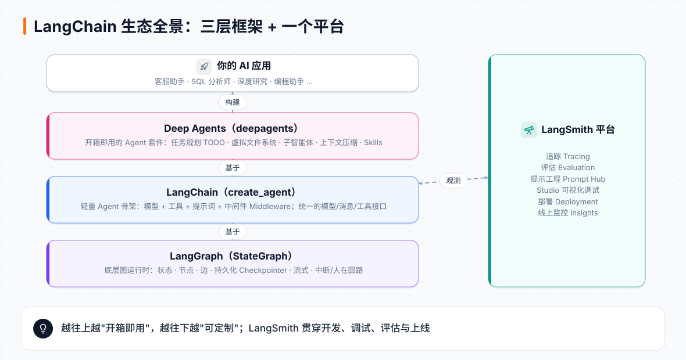

<div align="center">


# LangChain 中文学堂

**一套从零开始、讲人话、配满图的 LangChain / LangGraph / Deep Agents / LangSmith 中文教程**

教程正文 · 互动学习网站 · 离线练手题，一个仓库全部打包

### 🌐 在线学习站：[ethanbai-dev.github.io/langchain-zh](https://ethanbai-dev.github.io/langchain-zh/)

[📖 直接读教程](content/README.md) ·
[🧪 动手做练习](exercises/README.md)

</div>

---

## 这是什么？

[LangChain Academy](https://academy.langchain.com/) 是 LangChain 官方的免费课程平台，内容很好，但全是英文视频和 Notebook。
这个仓库把这些课程**重新用中文讲了一遍**：不是逐字翻译，而是按照中文读者的习惯重新组织，每个概念都配了原创示意图或动图，代码按 LangChain / LangGraph **1.x** 新版写好并在本地实际跑过。

学完以后你能做到：

- 用十来行代码造一个会调用工具的 Agent；
- 看懂并自己画出 LangGraph 的"状态 + 节点 + 边"；
- 给 Agent 加上记忆、人工审批、并行、子图、长期记忆，并部署成服务；
- 用 Deep Agents 搭出 Claude Code 那样能跑几十步的"长任务 Agent"；
- 用 LangSmith 追踪、评估、监控你的 Agent。

## 适合谁？

| 你的情况 | 推荐用法 |
|---|---|
| 会一点 Python，从没写过 AI Agent | 打开学习站，从第 0 章按顺序学，每章做完小测验和练习 |
| 用过老版 LangChain（LCEL、`create_react_agent`） | 先看第 1、3 章的 `create_agent` 和中间件，再看第 4–5 章 |
| 想把 Agent 做成产品 | 重点看第 8、10、11 章（人在回路、长期记忆、部署）和第 17–18 章（LangSmith） |
| 想做长任务 Agent | 第 6 章打底，再看第 12 章原理和第 14–16 章实战 |
| 只想先有个大概印象 | 打开学习站首页看两张全景图，再读第 0 章的总导读 |

**前置知识**：会写 Python 函数和类、知道什么是 API Key 就够了，不需要机器学习背景。

---

## 仓库里有什么？

| 文件夹 | 是什么 | 怎么用 |
|---|---|---|
| [`content/`](content/README.md) | 📖 **教程正文**：19 章 + 附录，Markdown 格式，配 50 多张原创示意图和动图 | 在 GitHub 上直接点开读，或者去学习站读 |
| [`site/`](site/README.md) | 🌐 **互动学习站**（VitePress）：把教程渲染成网站，加上测验、进度、实验室、中文搜索 | 打开 [在线地址](https://ethanbai-dev.github.io/langchain-zh/)，或在本地 `npm run dev` |
| [`exercises/`](exercises/README.md) | 🧪 **LangChain 练手题**：12 章、42 道题，填 `TODO`，一条命令自动检查 | 配合教程第 0–3、6–13 章做 |
| [`exercises-langgraph/`](exercises-langgraph/README.md) | 🧪 **LangGraph 练手题**：16 章、56 道题，最后一章是邮件助理综合项目 | 想把 LangGraph 练扎实时做 |

<p align="center"></p>

---

## 章节目录

整套教程预计学习时长约 **13 小时**，可以分成五段：

### 🚀 开始之前 & LangChain 入门

| 章 | 标题 | 你将学会 |
|---|---|---|
| 0 | [环境准备](content/00-环境准备.md) | 理解开发环境，手动或用 AI 配好 VS Code 并跑通离线练习 |
| 1 | [十分钟造一个 Agent](content/01-十分钟造一个Agent.md) | 用 `create_agent` 做一个会查数据库的 SQL 智能体 |
| 2 | [Agent 的积木](content/02-Agent的积木.md) | 消息、流式输出、工具描述、MCP |
| 3 | [记忆、结构化输出与中间件](content/03-记忆结构化输出与中间件.md) | 记住对话、输出 JSON、动态提示词、人工审批 |
| 4 | [模型、多模态与多智能体](content/04-模型多模态与多智能体.md) | 换模型、多模态消息、MCP 资源、子智能体当工具 |
| 5 | [管理消息与动态 Agent](content/05-管理消息与动态Agent.md) | 摘要与删除消息、动态模型/提示词/工具、邮件助手 |

### 🧩 LangGraph 进阶

| 章 | 标题 | 你将学会 |
|---|---|---|
| 6 | [LangGraph 图的基本功](content/06-LangGraph图的基本功.md) | 从零搭出一个 ReAct Agent |
| 7 | [状态与短期记忆](content/07-状态与短期记忆.md) | Reducer、裁剪消息、滚动摘要、SQLite 持久化 |
| 8 | [人在回路](content/08-人在回路.md) | 断点、修改状态、动态中断、时间旅行 |
| 9 | [并行、子图与多智能体](content/09-并行子图与多智能体.md) | 扇出扇入、子图、Map-Reduce、研究助手项目 |
| 10 | [长期记忆](content/10-长期记忆.md) | 跨会话记住用户：Profile 与 Collection |
| 11 | [部署上线](content/11-部署上线.md) | 把图变成服务：Assistants、Threads、Runs |

### 🧠 高级专题

| 章 | 标题 | 你将学会 |
|---|---|---|
| 12 | [Deep Agents](content/12-DeepAgents.md) | 规划、文件系统、子智能体的原理，从零实现一遍 |
| 13 | [LangSmith](content/13-LangSmith.md) | 追踪、评估、提示工程、上线监控概览 |

### 🤖 Deep Agents 实战

| 章 | 标题 | 你将学会 |
|---|---|---|
| 14 | [Deep Agents 上手](content/14-DeepAgents上手.md) | 用官方 `deepagents` 库：模型、工具、MCP、人工审批 |
| 15 | [运行环境与上下文](content/15-DeepAgents运行环境与上下文.md) | 后端与权限、沙箱、解释器、摘要、技能、长期记忆 |
| 16 | [委派、综合项目与部署](content/16-DeepAgents委派与综合项目.md) | 子智能体团队、动态子智能体、销售助理项目 |

### 📊 LangSmith 实战

| 章 | 标题 | 你将学会 |
|---|---|---|
| 17 | [追踪与评估](content/17-LangSmith追踪与评估.md) | 四种追踪接法、数据集、评估器、实验对比 |
| 18 | [提示工程与生产监控](content/18-LangSmith提示工程与生产监控.md) | Prompt Hub、在线评估、标注队列、仪表盘 |
| 附录 | [速查表与术语表](content/附录-速查表与术语表.md) | 一页纸复习所有 API 和术语 |

---

## 怎么用？

### 🌐 用学习网站学（最推荐）

打开 **<https://ethanbai-dev.github.io/langchain-zh/>**，网站里除了教程正文，还有：

- **章末小测验**：提交后逐题解析，成绩自动记录；
- **学习进度**：标记已完成的章节，首页显示还剩多少时长；
- **互动实验室**：ReAct 循环模拟器、Reducer 实验台、术语记忆卡片；
- **中文全文搜索**：搜任何关键词都能找到对应章节。

进度只保存在你自己的浏览器里，不需要注册账号。

想在本地跑网站：

```bash
cd site
npm ci
npm run dev      # 浏览器打开终端里显示的地址
```

### 🧪 做练手题

每道题都是"起始代码 + 自动检查 + 参考答案"。检查**完全离线**，用的是假模型，不需要 API Key，也不花钱。

```bash
cd exercises                 # 或 exercises-langgraph
python -m venv .venv && source .venv/bin/activate
pip install -r requirements.txt
pytest --solution            # 先确认参考答案全部通过
pytest ch01_sql_agent        # 写完某一章后检查自己的答案
```

跑完会打印一张中文成绩单，告诉你哪一题没过、为什么。详细说明见 [exercises/README.md](exercises/README.md)。

---

## 内容来源与说明

- 课程内容依据 LangChain Academy 的公开课程，以及 GitHub 上的官方课程仓库：`langchain-ai/lca-langchainV1-essentials`、`langchain-academy`、`deep-agents-from-scratch`、`deepagents`、`lca-lc-foundations`。
- `content/assets/course/` 里的配图来自官方课程仓库（MIT 许可）；其余示意图和动图为原创，源码在 `content/assets/_figure-src/`，可以重新渲染。
- 代码按 LangChain / LangGraph 1.x 编写，关键输出已在本地运行验证。官方库更新很快，如果遇到 API 变化，欢迎提 Issue。
- 本项目是个人学习整理，与 LangChain 官方无关。
