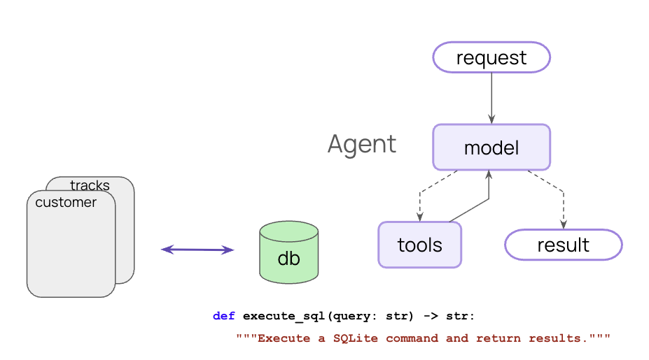
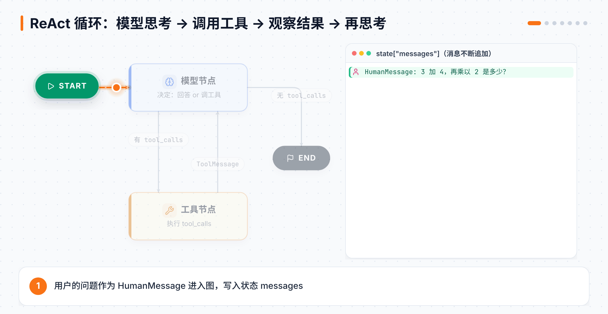
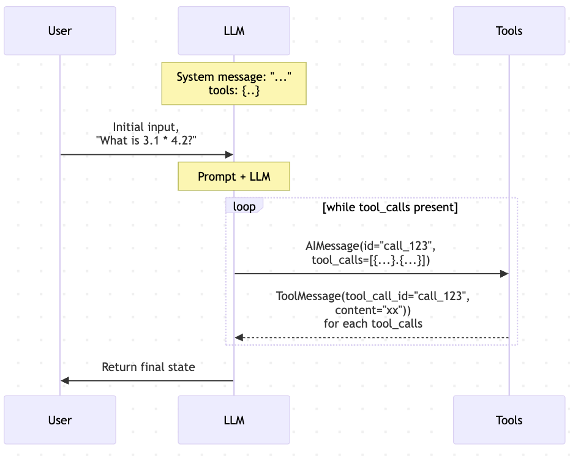
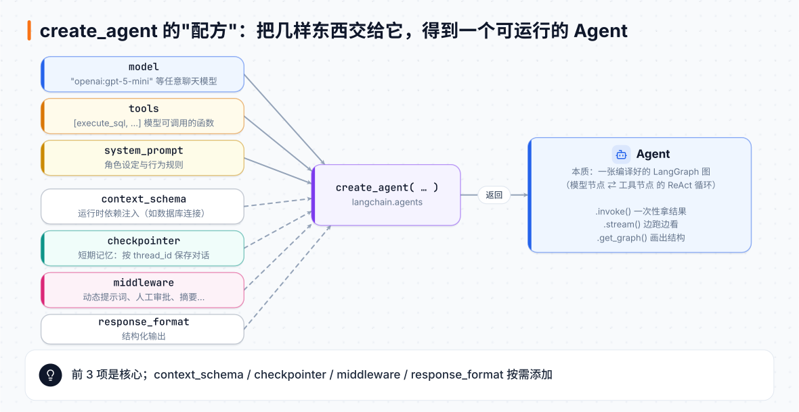

# 第 1 章 十分钟造一个 Agent：SQL 智能体

> **本章目标**：用不到 30 行代码，做出一个能自己探索数据库、写 SQL、出错自我修正的 Agent，并理解它背后的 ReAct 循环。
> **对应课程**：LangChain Essentials · L1 Fast Agent（`L1_fast_agent.ipynb`）

[← 上一章](00-环境准备.md) ｜ [返回导读](README.md) ｜ [下一章 →](02-Agent的积木.md)

---

## 1.1 先看效果



我们要做的东西：用户用自然语言提问（"哪种音乐流派的曲目平均最长？"），Agent **自己**去查有哪些表、表里有哪些字段、写 SQL、执行、看结果，出错了再改，最后用人话回答。

数据库用的是经典示例库 **Chinook**（一家音乐商店：艺术家、专辑、曲目、客户、发票……），课程仓库里自带 `Chinook.db`。

## 1.2 什么是 Agent？什么是 ReAct？

一个 Agent 只有三样东西：

1. **一个大模型**（大脑）
2. **一组工具**（手脚：查数据库、搜网页、算数……）
3. **一段提示词**（规则：你是谁、要怎么做）

它的工作方式叫 **ReAct**（Reason + Act，推理 + 行动），是一个循环：



用文字描述就是：

1. **Reason（思考）**：模型看对话和工具说明，决定"直接回答"还是"调用某个工具"。
2. **Act（行动）**：如果要调用工具，模型输出一个 `tool_call`（工具名 + 参数），由工具节点真正执行。
3. **Observe（观察）**：工具结果作为 `ToolMessage` 回到模型。
4. 回到第 1 步，直到模型觉得不需要再调用工具，输出最终答案。

> 💡 **关键认识**：模型本身从不执行代码。它只会"说"我想调用哪个工具、传什么参数；执行是框架做的。

换成时序图来看（课程配图）：只要模型的回复里还有 `tool_calls`，就继续"模型 → 工具 → 模型"的循环；`AIMessage` 里每个工具调用的 `id`，会和工具返回的 `ToolMessage.tool_call_id` 一一对应。



## 1.3 动手：一步步搭出 SQL Agent

### 第 1 步：连上数据库

```python
from dotenv import load_dotenv
load_dotenv()

from sql_db import SQLDatabase          # 课程仓库自带的小封装
db = SQLDatabase.from_uri("sqlite:///Chinook.db")
```

### 第 2 步：定义"运行时上下文"

```python
from dataclasses import dataclass

@dataclass
class RuntimeContext:
    db: SQLDatabase
```

为什么不直接在工具里用全局变量 `db`？因为真实系统里，**每次调用可能要连不同的数据库**（比如不同租户）。`context_schema` 是一种**依赖注入**：调用 Agent 时把依赖传进来，工具在运行时取用。

### 第 3 步：写一个工具

```python
from langchain_core.tools import tool
from langgraph.runtime import get_runtime

@tool
def execute_sql(query: str) -> str:
    """Execute a SQLite command and return results."""
    runtime = get_runtime(RuntimeContext)   # 拿到本次调用传入的上下文
    db = runtime.context.db
    try:
        return db.run(query)
    except Exception as e:
        return f"Error: {e}"                 # 把错误当结果返回，模型才能自我修正
```

三个要点：

- `@tool` 装饰器把普通函数变成工具；**函数名、参数类型、docstring 会被发给模型**，所以要写清楚。
- 出错时**不要抛异常**，而是返回 `"Error: ..."` 字符串。这样模型能看到错误信息，自己改 SQL 重试。
- ⚠️ 课程特别提醒：这个演示**没有过滤模型生成的 SQL**，生产环境一定要限制权限（只读账号、白名单等）。

### 第 4 步：写系统提示词

```python
SYSTEM_PROMPT = """You are a careful SQLite analyst.

Rules:
- Think step-by-step.
- When you need data, call the tool `execute_sql` with ONE SELECT query.
- Read-only only; no INSERT/UPDATE/DELETE/ALTER/DROP/CREATE/REPLACE/TRUNCATE.
- Limit to 5 rows of output unless the user explicitly asks otherwise.
- If the tool returns 'Error:', revise the SQL and try again.
- Prefer explicit column lists; avoid SELECT *.
"""
```

提示词里的每一条都在解决一个实际问题：一次只跑一条查询（便于纠错）、只读（安全）、限制行数（省 token）、出错重试（鲁棒）。

### 第 5 步：创建 Agent

```python
from langchain.agents import create_agent

agent = create_agent(
    model="openai:gpt-5-mini",
    tools=[execute_sql],
    system_prompt=SYSTEM_PROMPT,
    context_schema=RuntimeContext,
)
```



`create_agent` 返回的是一张**编译好的 LangGraph 图**。你可以把它画出来：

```python
from IPython.display import Image, display
display(Image(agent.get_graph(xray=True).draw_mermaid_png()))
```

会看到 `__start__ → model ⇄ tools → __end__` 的结构，正是上面动图里的循环。

### 第 6 步：运行

```python
question = "Which table has the largest number of entries?"

for step in agent.stream(
    {"messages": question},
    context=RuntimeContext(db=db),   # 注入依赖
    stream_mode="values",
):
    step["messages"][-1].pretty_print()
```

你会看到类似这样的过程（模型不同，步骤会略有差异）：

```
================================ Human Message =================================
Which table has the largest number of entries?
================================== Ai Message ==================================
Tool Calls:
  execute_sql  Args: query: SELECT name FROM sqlite_master WHERE type='table';
================================= Tool Message =================================
[('Album',), ('Artist',), ('Customer',), ('Employee',), ('Genre',), ('Invoice',), ...]
================================== Ai Message ==================================
Tool Calls:
  execute_sql  Args: query: SELECT 'Album', COUNT(*) FROM Album UNION ALL ...
================================= Tool Message =================================
...
================================== Ai Message ==================================
The table with the most rows is PlaylistTrack (8,715 rows).
```

**请注意观察三件事**（课程原文强调）：

1. Agent 一开始**并不知道表结构**，它自己去 `sqlite_master` 里查。
2. Agent **可能犯错**，但因为错误信息会返回给它，它能自我修正。
3. 连续问两个问题，它**不记得**上次查到的表结构——因为还没有记忆。这个问题第 3 章解决。

> `context` 也可以直接传字典：`context={"db": db}`。

## 1.4 在 Studio 里看它运行

课程仓库的 `studio/` 目录里有 `sql_agent1.py`，运行 `langgraph dev` 后可以在浏览器里：

- 看到图的结构
- 输入问题，逐步看每个节点的输入输出
- 随时暂停、回放

> Studio 目前不支持传入运行时 context，所以 `studio/sql_agent1.py` 里的工具直接使用了模块级的 `db`。

## 📌 本章小结

| 概念 | 一句话 |
|---|---|
| Agent | 模型 + 工具 + 提示词，在循环中自主决策 |
| ReAct | 思考 → 行动 → 观察，直到不再需要工具 |
| `create_agent` | LangChain 1.0 的标准 Agent 工厂，返回一张 LangGraph 图 |
| `@tool` | 函数 → 工具；名字、类型、docstring 就是给模型看的说明书 |
| `context_schema` + `get_runtime` | 运行时依赖注入 |

## 🧪 动手练习

1. 问它 `"Which genre on average has the longest tracks?"`，数一数它调用了几次工具。
2. 故意把提示词里 "Read-only" 那条删掉，问"删除所有发票"，观察会发生什么（**请在副本数据库上做！**），然后理解为什么生产中要在工具层面做权限控制。
3. 把模型换成另一家的，比较回答质量和工具调用次数。

[下一章：Agent 的积木 →](02-Agent的积木.md)
