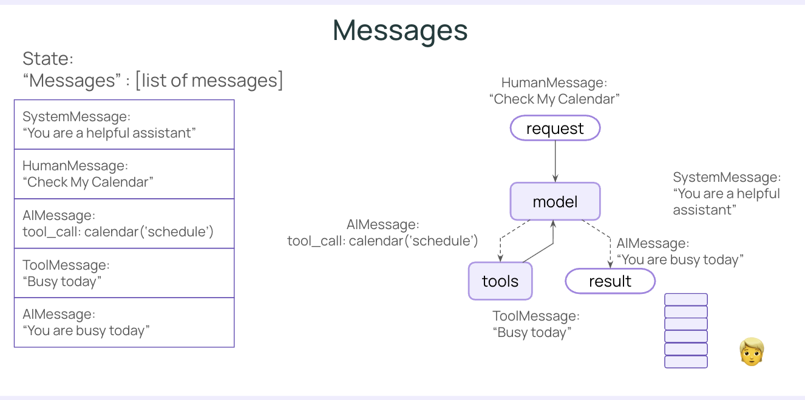
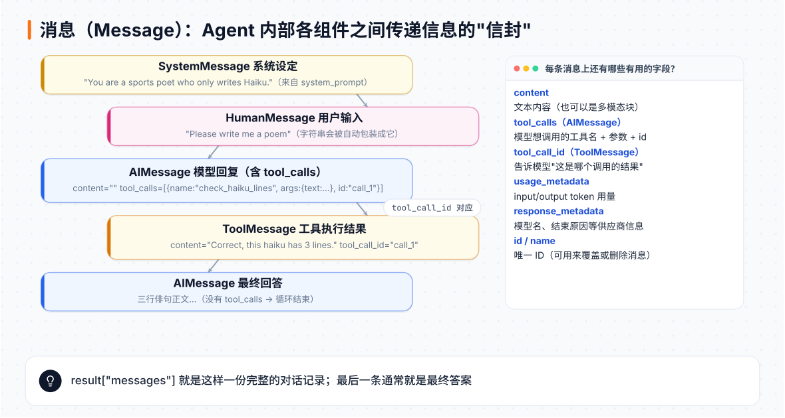
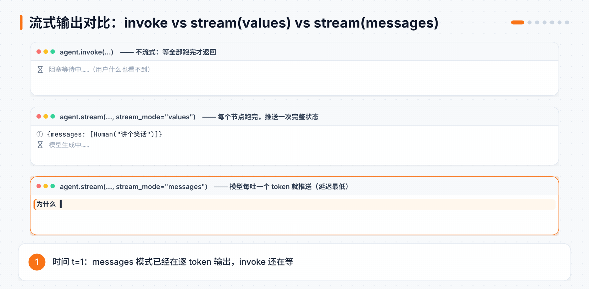
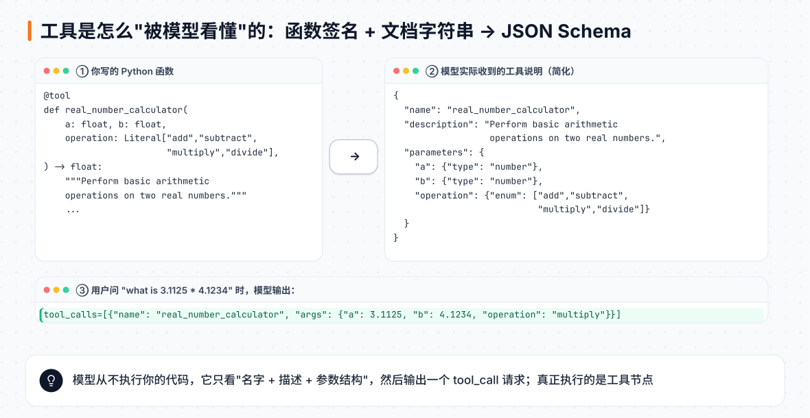
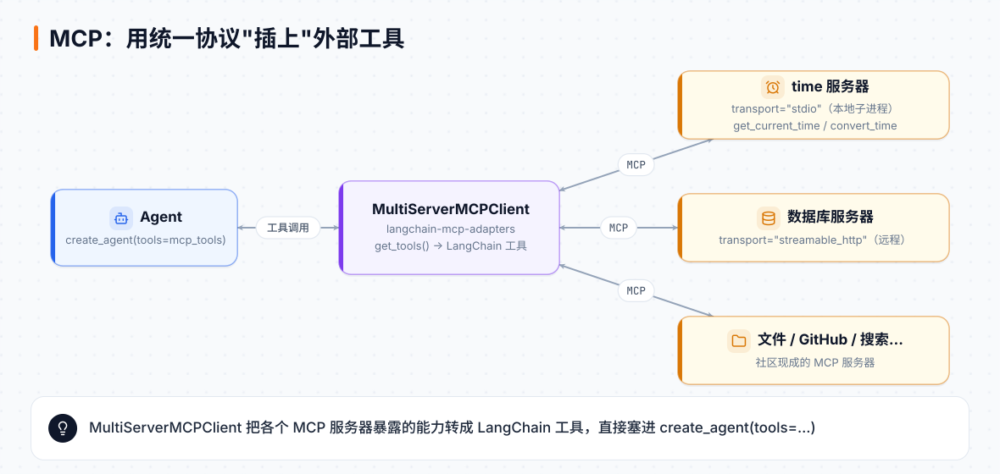

# 第 2 章 Agent 的积木：消息、流式、工具、MCP

> **本章目标**：拆开 `create_agent`，看懂它内部流动的"消息"，学会边跑边看（流式），写出模型容易用对的工具，并接入 MCP 生态。
> **对应课程**：LangChain Essentials · L2 Messages、L3 Streaming、L4 Tools、L5 Tools with MCP

[← 上一章](01-十分钟造一个Agent.md) ｜ [返回导读](README.md) ｜ [下一章 →](03-记忆结构化输出与中间件.md)

---

## 2.1 消息（Messages）：一切信息的载体



在 LangChain 里，模型的输入和输出都是**消息**。Agent 的状态核心就是一个消息列表 `messages`。



| 类型 | 谁产生的 | 典型内容 |
|---|---|---|
| `SystemMessage` | 你（通过 `system_prompt`） | 角色设定、规则 |
| `HumanMessage` | 用户 | 问题 |
| `AIMessage` | 模型 | 回答文本，或 `tool_calls` |
| `ToolMessage` | 工具节点 | 工具执行结果，带 `tool_call_id` |

### 三种等价的输入写法

```python
from langchain.agents import create_agent
from langchain_core.messages import HumanMessage

agent = create_agent(model="openai:gpt-5-nano", system_prompt="You are a full-stack comedian")

# ① 消息对象
agent.invoke({"messages": [HumanMessage("Hello, how are you?")]})
# ② 纯字符串：LangChain 自动当成 HumanMessage
agent.invoke({"messages": "Tell me about baseball"})
# ③ 字典（OpenAI 风格）
agent.invoke({"messages": {"role": "user", "content": "Write a haiku about sprinters"}})
```

字典写法还能一次传多轮，`role` 可以是 `system` / `user` / `assistant`：

```python
messages = [
    {"role": "system", "content": "You are a sports poetry expert who completes haikus"},
    {"role": "user", "content": "Write a haiku about sprinters"},
    {"role": "assistant", "content": "Feet don't fail me..."},   # 让模型接着写
]
```

### 看一次带工具的完整对话

```python
from langchain_core.tools import tool

@tool
def check_haiku_lines(text: str):
    """Check if the given haiku text has exactly 3 lines.

    Returns None if it's correct, otherwise an error message.
    """
    lines = [l.strip() for l in text.strip().splitlines() if l.strip()]
    if len(lines) != 3:
        return f"Incorrect! This haiku has {len(lines)} lines. A haiku must have exactly 3 lines."
    return "Correct, this haiku has 3 lines."

agent = create_agent(
    model="openai:gpt-5",
    tools=[check_haiku_lines],
    system_prompt="You are a sports poet who only writes Haiku. You always check your work.",
)
result = agent.invoke({"messages": "Please write me a poem"})

for msg in result["messages"]:
    msg.pretty_print()
```

`result["messages"]` 里是完整的历史：Human → AI(tool_calls) → Tool → AI(最终俳句)。几个有用的字段：

```python
result["messages"][-1].content            # 最终答案
result["messages"][-1].usage_metadata     # token 用量
result["messages"][-1].response_metadata  # 模型名、结束原因等
```

## 2.2 流式输出（Streaming）：别让用户干等

Agent 一次运行可能要十几秒。**流式**就是在结果完全出来之前，先把已经有的东西推给用户。



| 方式 | 写法 | 每次拿到什么 | 适合 |
|---|---|---|---|
| 不流式 | `agent.invoke(...)` | 全部跑完后的最终状态 | 后台任务 |
| `values` | `agent.stream(..., stream_mode="values")` | 每个节点跑完后的**完整状态** | 调试、展示每一步 |
| `updates` | `stream_mode="updates"` | 每个节点产生的**增量** | 只关心变化 |
| `messages` | `stream_mode="messages"` | 模型**逐 token** 输出 | 聊天界面 |
| `custom` | `stream_mode="custom"` | 你在工具里主动推送的任意数据 | 进度提示 |

逐 token 输出：

```python
for token, metadata in agent.stream(
    {"messages": [{"role": "user", "content": "Write me a family friendly poem."}]},
    stream_mode="messages",
):
    print(token.content, end="")
```

### 工具也能"流式"：推送自定义进度

```python
from langgraph.config import get_stream_writer

def get_weather(city: str) -> str:
    """Get weather for a given city."""
    writer = get_stream_writer()
    writer(f"Looking up data for city: {city}")    # 推送进度
    writer(f"Acquired data for city: {city}")
    return f"It's always sunny in {city}!"

agent = create_agent(model="openai:gpt-5-mini", tools=[get_weather])

for chunk in agent.stream(
    {"messages": [{"role": "user", "content": "What is the weather in SF?"}]},
    stream_mode=["values", "custom"],      # 可以同时订阅多种模式
):
    print(chunk)    # 同时订阅多种模式时，chunk 是 (模式名, 数据) 元组
```

只想看自定义进度：`if chunk[0] == "custom": print(chunk[1])`。

## 2.3 工具（Tools）：写给模型看的说明书

工具让 Agent 能"行动"。关键在于：**模型只能看到工具的名字、描述和参数结构**，看不到你的代码。



### 基础写法

```python
from typing import Literal
from langchain.tools import tool

@tool
def real_number_calculator(
    a: float, b: float, operation: Literal["add", "subtract", "multiply", "divide"]
) -> float:
    """Perform basic arithmetic operations on two real numbers."""
    if operation == "add":
        return a + b
    elif operation == "subtract":
        return a - b
    elif operation == "multiply":
        return a * b
    elif operation == "divide":
        if b == 0:
            raise ValueError("Division by zero is not allowed.")
        return a / b
```

- 类型注解 → 参数类型（`Literal` 变成枚举，模型只会选这几个值）
- docstring → 工具描述

### 描述写得好不好，差别很大

课程做了一个有趣的实验：

| 问题 | 结果（多次运行不稳定） | 原因 |
|---|---|---|
| `what is 3.1125 * 4.1234` | 调用了计算器 | 小数，模型觉得需要工具 |
| `what is 3 * 4` | 常常**不调用** | 描述写的是"real numbers"，模型以为整数不归它管 |
| `what is 3.0 * 4.0` | 常常**不调用** | 太简单了，模型选择心算 |

改进办法：写更明确的描述，并给每个参数写说明。

```python
@tool(
    "calculator",                    # 改个更通用的名字
    parse_docstring=True,            # 解析 Google 风格的 Args 说明
    description=(
        "Perform basic arithmetic operations on two real numbers."
        "Use this whenever you have operations on any numbers, even if they are integers."
    ),
)
def real_number_calculator(
    a: float, b: float, operation: Literal["add", "subtract", "multiply", "divide"]
) -> float:
    """Perform basic arithmetic operations on two real numbers.

    Args:
        a (float): The first number.
        b (float): The second number.
        operation (Literal["add", "subtract", "multiply", "divide"]):
            The arithmetic operation to perform.
    """
    ...
```

改完后 `3 * 4` 也会稳定调用工具了。

> 💡 **写工具的三条经验**
> 1. 描述里写清楚**什么时候该用**它，而不只是它**能做什么**。
> 2. 参数尽量用 `Literal`、明确类型，减少模型乱填。
> 3. 出错返回可读的错误信息，让模型能自我修正。

## 2.4 MCP：一键接入现成工具生态

**MCP（Model Context Protocol）** 是一个开放协议，让"工具提供方"和"AI 应用"用统一的方式对接。社区已经有大量现成的 MCP 服务器（时间、文件系统、GitHub、数据库、搜索……）。



用 `langchain-mcp-adapters` 连接：

```python
import shutil
from langchain_mcp_adapters.client import MultiServerMCPClient

uvx = shutil.which("uvx")      # 需要先装好 uv

mcp_client = MultiServerMCPClient({
    "time": {
        "transport": "stdio",              # 本地启动一个子进程
        "command": uvx,
        "args": ["--with", "mcp<2", "mcp-server-time"],
    }
    # 也可以连远程服务器：{"transport": "streamable_http", "url": "https://..."}
})

mcp_tools = await mcp_client.get_tools()   # 异步：在 notebook 里可以直接 await
print([t.name for t in mcp_tools])         # 例如 ['get_current_time', 'convert_time']

agent = create_agent(model="openai:gpt-5", tools=mcp_tools,
                     system_prompt="You are a helpful assistant")

result = await agent.ainvoke(
    {"messages": [{"role": "user", "content": "What's the time in SF right now?"}]}
)
```

注意 MCP 工具通常是**异步**的，所以用 `ainvoke` / `astream`。

> 课程仓库注释提到：`mcp-server-time` 和 `mcp>=2.0` 有兼容问题，所以加了 `--with "mcp<2"`；Windows 上还要把 `sys.stderr` 恢复成真实文件句柄。

## 📌 本章小结

- **消息**是 Agent 内部的通用语言：System / Human / AI / Tool 四种。
- **流式**有 `values` / `updates` / `messages` / `custom` 几种模式，可以组合订阅。
- **工具**的名字、描述、参数类型就是给模型的说明书，写得越清楚，模型用得越准。
- **MCP** 让你几行代码接入社区工具生态。

## 🧪 动手练习

1. 用 `stream_mode="updates"` 跑一次带工具的 Agent，对比它和 `values` 的输出差别。
2. 给计算器加一个 `power`（幂运算）操作，并修改描述，测试 `2 的 10 次方是多少`。
3. 找一个你感兴趣的 MCP 服务器（比如文件系统），接到 Agent 上。

[下一章：记忆、结构化输出与中间件 →](03-记忆结构化输出与中间件.md)
