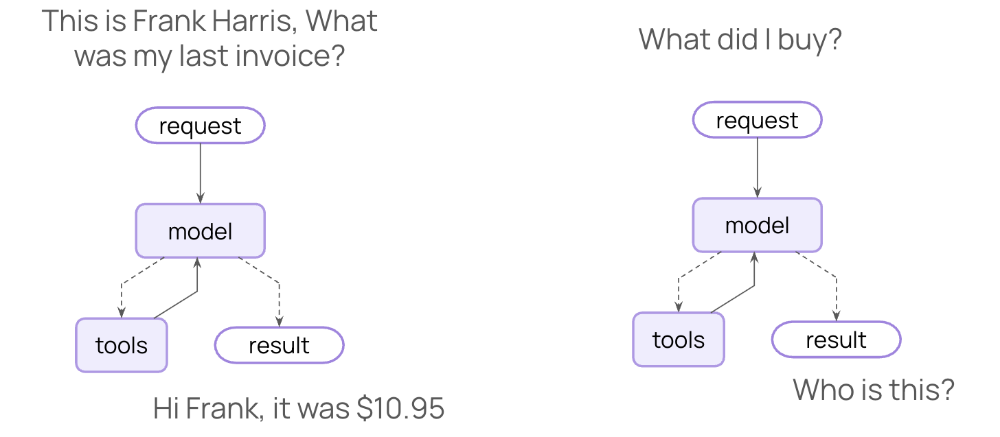
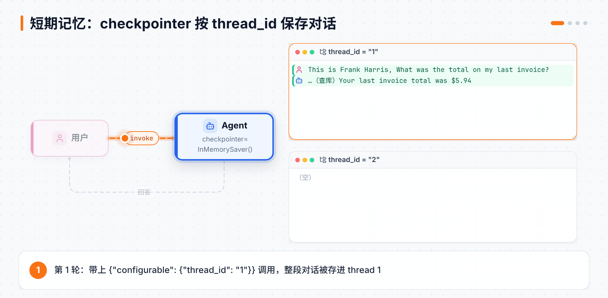
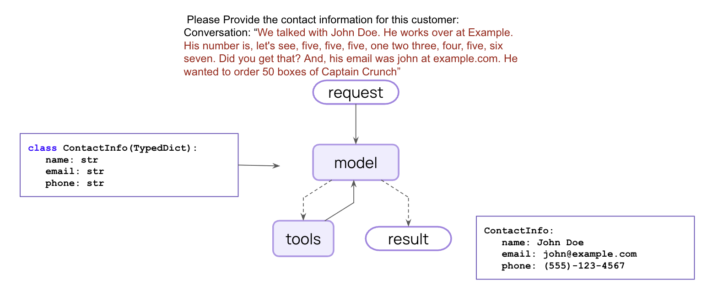
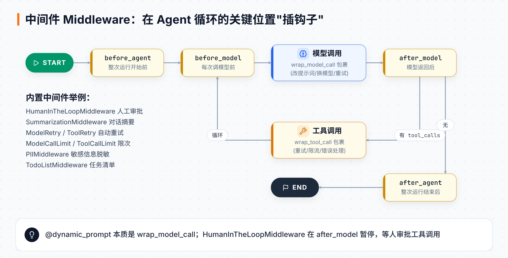
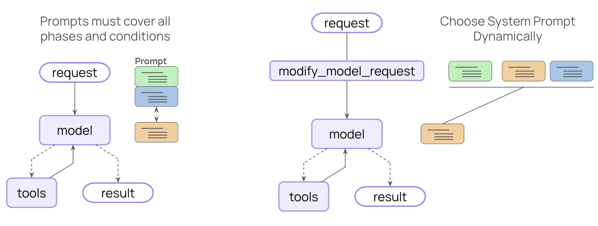
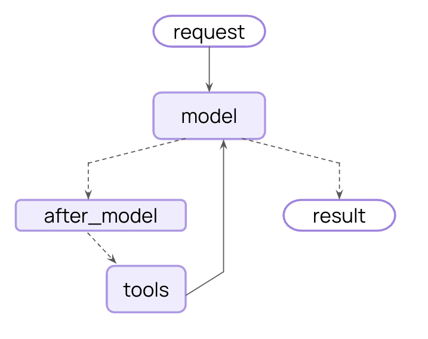
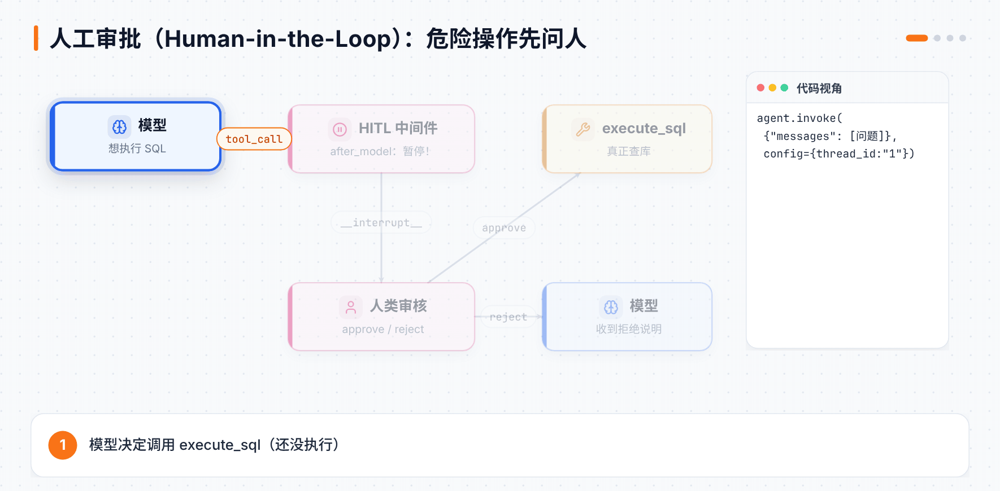

# 第 3 章 记忆、结构化输出与中间件

> **本章目标**：让 Agent 记住对话；让它输出程序能直接用的结构化数据；学会用中间件在不改主流程的情况下定制 Agent（动态提示词、人工审批）。
> **对应课程**：LangChain Essentials · L6 Memory、L7 Structured Output、L8 Dynamic Prompt、L9 Human-in-the-Loop

[← 上一章](02-Agent的积木.md) ｜ [返回导读](README.md) ｜ [下一章 →](04-模型多模态与多智能体.md)

---

## 3.1 短期记忆：让 Agent 记住上一句

### 问题重现

还是第 1 章的 SQL Agent，连续问两句：

```python
q1 = "This is Frank Harris, What was the total on my last invoice?"
q2 = "What were the titles?"
```

第一句它能查出 Frank Harris 最近一张发票是 **$5.94**（2013-07-04，本地查库验证）。但第二句它会一脸茫然——"什么 titles？"——因为**每次 `invoke` 都是全新的开始**。



### 解决：加一个 checkpointer

```python
from langgraph.checkpoint.memory import InMemorySaver

agent = create_agent(
    model="openai:gpt-5",
    tools=[execute_sql],
    system_prompt=SYSTEM_PROMPT,
    context_schema=RuntimeContext,
    checkpointer=InMemorySaver(),        # ← 只加这一行
)

config = {"configurable": {"thread_id": "1"}}     # ← 调用时指定"对话编号"

agent.invoke({"messages": [{"role": "user", "content": q1}]}, config, context=RuntimeContext(db=db))
agent.invoke({"messages": [{"role": "user", "content": q2}]}, config, context=RuntimeContext(db=db))
```

这次第二句就能答出那张发票里的曲目（Holier Than Thou、Through The Never、My Friend Of Misery……）。



| 概念 | 类比 |
|---|---|
| `checkpointer` | 聊天软件的服务器，负责保存聊天记录 |
| `thread_id` | 一个聊天窗口的编号 |

- 同一个 `thread_id` → 接着聊；换一个 → 新对话。
- `InMemorySaver` 存在内存里，程序重启就没了。生产环境用 `SqliteSaver` / `PostgresSaver`（见第 7 章）。

## 3.2 结构化输出：让 Agent 返回 JSON 而不是作文

很多场景下，你要的不是一段话，而是能直接存进数据库的**结构化数据**。



```python
from typing_extensions import TypedDict
from langchain.agents import create_agent

class ContactInfo(TypedDict):
    name: str
    email: str
    phone: str

agent = create_agent(model="openai:gpt-5-mini", response_format=ContactInfo)

recorded_conversation = """We talked with John Doe. He works over at Example. His number is, let's see,
five, five, five, one two three, four, five, six seven. Did you get that?
And, his email was john at example.com. He wanted to order 50 boxes of Captain Crunch."""

result = agent.invoke({"messages": [{"role": "user", "content": recorded_conversation}]})
result["structured_response"]
# {'name': 'John Doe', 'email': 'john@example.com', 'phone': '555-123-4567'}
```

注意结果在 `result["structured_response"]` 里，而不是最后一条消息。模型把"five, five, five..."这种口语化表达自动整理成了标准格式。

`response_format` 支持四种写法：

| 写法 | 特点 |
|---|---|
| `TypedDict` | 轻量，返回 dict |
| Pydantic `BaseModel` | 有运行时校验，返回对象 |
| `dataclass` | 返回 dataclass 实例 |
| JSON Schema（dict） | 跨语言 |

## 3.3 中间件（Middleware）：在关键位置"插钩子"

Lesson 2–7 用的都是 `create_agent` 的开箱功能。如果你想**定制**它的行为——比如每次调用模型前改提示词、调用工具前要人审批——就用**中间件**。



LangChain 1.0 的中间件可以挂在这些位置（`langchain.agents.middleware` 中实际提供的钩子）：

| 钩子 | 时机 | 典型用途 |
|---|---|---|
| `before_agent` / `after_agent` | 整次运行开始前 / 结束后 | 加载/保存数据、清理 |
| `before_model` / `after_model` | 每次调用模型前 / 后 | 裁剪消息、审核输出、人工审批 |
| `wrap_model_call` | 包裹模型调用 | 动态改提示词、换模型、重试 |
| `wrap_tool_call` | 包裹工具调用 | 重试、限流、错误处理 |

还有一批**内置中间件**直接可用：`HumanInTheLoopMiddleware`、`SummarizationMiddleware`、`ModelRetryMiddleware`、`ToolCallLimitMiddleware`、`PIIMiddleware`、`TodoListMiddleware` 等。

### 例 1：动态提示词——员工和顾客看到不同权限



需求：顾客只能查专辑、艺术家等公开表；员工可以查所有表。

```python
from dataclasses import dataclass
from langchain.agents.middleware.types import ModelRequest, dynamic_prompt

@dataclass
class RuntimeContext:
    is_employee: bool
    db: SQLDatabase

SYSTEM_PROMPT_TEMPLATE = """You are a careful SQLite analyst.
Rules:
- Think step-by-step.
- When you need data, call the tool `execute_sql` with ONE SELECT query.
- Read-only only; no INSERT/UPDATE/DELETE/ALTER/DROP/CREATE/REPLACE/TRUNCATE.
- Limit to 5 rows unless the user explicitly asks otherwise.
{table_limits}
- If the tool returns 'Error:', revise the SQL and try again.
- Prefer explicit column lists; avoid SELECT *.
"""

@dynamic_prompt
def dynamic_system_prompt(request: ModelRequest) -> str:
    if not request.runtime.context.is_employee:
        table_limits = "- Limit access to these tables: Album, Artist, Genre, Playlist, PlaylistTrack, Track."
    else:
        table_limits = ""
    return SYSTEM_PROMPT_TEMPLATE.format(table_limits=table_limits)

agent = create_agent(
    model="openai:gpt-5",
    tools=[execute_sql],
    middleware=[dynamic_system_prompt],   # 注意：不再传 system_prompt
    context_schema=RuntimeContext,
)
```

同一个问题 `"What is the most costly purchase by Frank Harris?"`：

- `context=RuntimeContext(is_employee=False, db=db)` → 拒绝访问发票表
- `context=RuntimeContext(is_employee=True, db=db)` → 查出结果（本地查库：最贵一单是 **$13.86**，2010-09-23）

> ⚠️ 用提示词限制权限只是"软约束"，模型可能被绕过。真正的权限控制应放在工具/数据库层面，提示词限制作为第一道防线。

### 例 2：人工审批（Human-in-the-Loop）



需求：执行 SQL 之前必须经过人批准。

```python
from langchain.agents.middleware import HumanInTheLoopMiddleware
from langgraph.checkpoint.memory import InMemorySaver

agent = create_agent(
    model="openai:gpt-5",
    tools=[execute_sql],
    system_prompt=SYSTEM_PROMPT,
    checkpointer=InMemorySaver(),          # 必须有：暂停时要保存状态
    context_schema=RuntimeContext,
    middleware=[
        HumanInTheLoopMiddleware(
            interrupt_on={"execute_sql": {"allowed_decisions": ["approve", "reject"]}},
        ),
    ],
)
```



运行与恢复：

```python
from langgraph.types import Command

config = {"configurable": {"thread_id": "1"}}
result = agent.invoke(
    {"messages": [{"role": "user", "content": "What are the names of all the employees?"}]},
    config=config, context=RuntimeContext(db=db),
)

if "__interrupt__" in result:
    req = result["__interrupt__"][-1].value["action_requests"][-1]
    print(req["description"])          # 给审核人看：要执行什么工具、什么参数

    # 拒绝，并告诉模型原因
    result = agent.invoke(
        Command(resume={"decisions": [{"type": "reject", "message": "the database is offline."}]}),
        config=config,                 # 同一个 thread_id 才能接着跑
        context=RuntimeContext(db=db),
    )
print(result["messages"][-1].content)
```

`__interrupt__` 里的数据长这样（本地用假模型实测）：

```python
{'action_requests': [{'name': 'execute_sql',
                      'args': {'query': "SELECT FirstName||' '||LastName FROM Employee;"},
                      'description': 'Tool execution requires approval\n\nTool: execute_sql\nArgs: ...'}],
 'review_configs': [{'action_name': 'execute_sql', 'allowed_decisions': ['approve', 'reject']}]}
```

批准就传 `{"type": "approve"}`。一个问题可能触发多次工具调用，所以通常写成 `while "__interrupt__" in result:` 循环处理。

> 中间件挂上去后，Agent 的图里会多出一个节点 `HumanInTheLoopMiddleware.after_model`——它正是在模型输出之后、工具执行之前把流程拦下来的。

## 📌 本章小结

| 需求 | 做法 |
|---|---|
| 记住对话 | `checkpointer=InMemorySaver()` + `thread_id` |
| 输出结构化数据 | `response_format=Schema`，取 `result["structured_response"]` |
| 根据身份改提示词 | `@dynamic_prompt` 中间件 + `context_schema` |
| 危险操作先审批 | `HumanInTheLoopMiddleware` + `Command(resume=...)` |

到这里，你已经能用 LangChain 写出相当实用的 Agent 了。接下来两章不换工具，还是 `create_agent` 加中间件，但换一种学法：跟着三个完整的小项目（私人厨师、婚礼策划、邮件助手），把前三章的积木拼成真正能用的 Agent，顺便补上多模态、多智能体、管理长对话和动态 Agent。学完第 5 章，我们再打开引擎盖，看看 `create_agent` 底下的 **LangGraph** 是怎么工作的。

## 🧪 动手练习

1. 给 SQL Agent 加记忆，连续问 3 个相关问题；再换个 `thread_id` 问第 3 个问题，比较结果。
2. 用 Pydantic 定义一个 `Order(product: str, quantity: int)`，从上面那段通话记录里提取订单（50 盒 Captain Crunch）。
3. 把 HITL 的 `allowed_decisions` 加上 `"edit"`，尝试在审批时修改 SQL 参数。

[下一章：模型、多模态与多智能体 →](04-模型多模态与多智能体.md)
