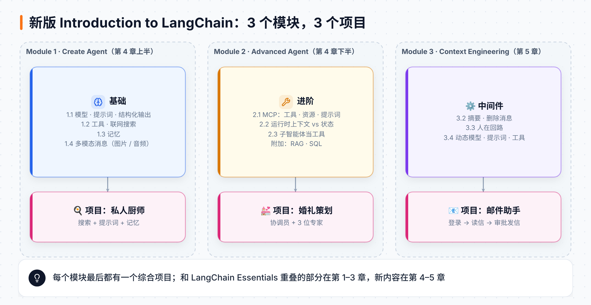
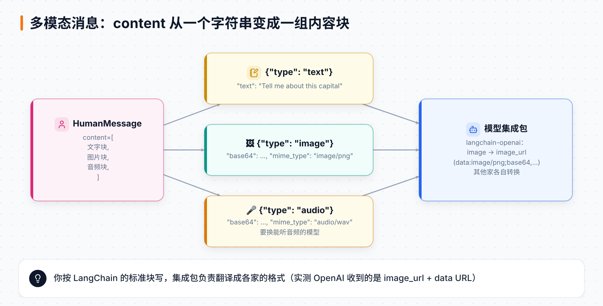
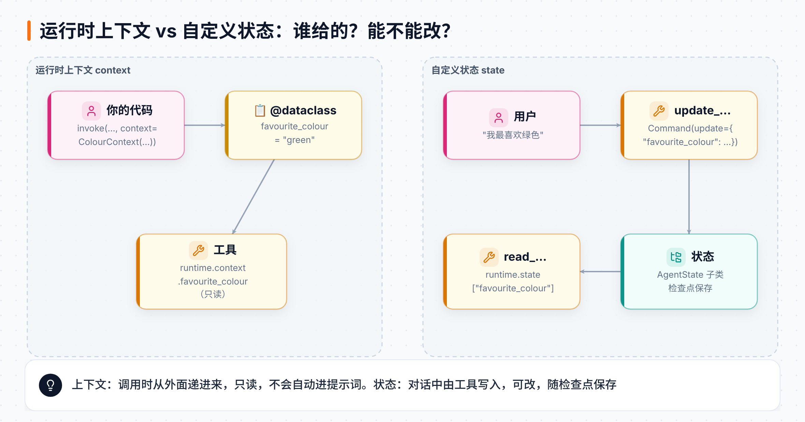
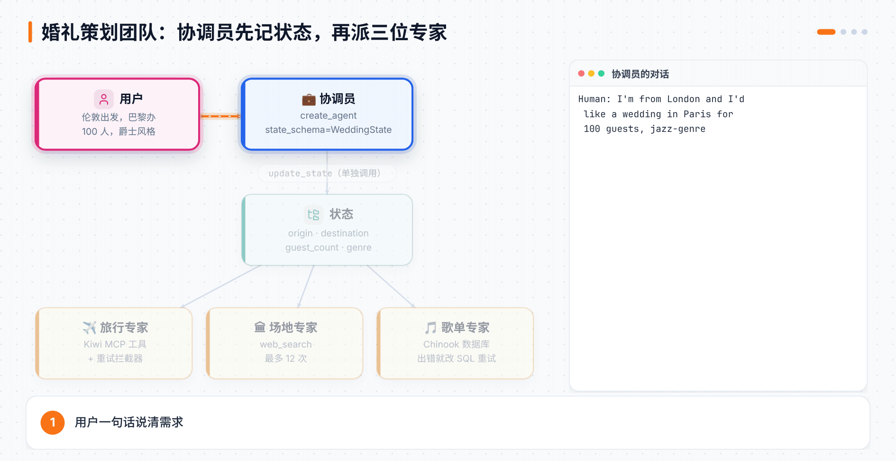

# 第 4 章 模型、多模态、MCP 与多智能体

> **本章目标**：跟着 Academy 新版 **Introduction to LangChain** 课程，补上前面章节没讲到的部分：换模型和调参数、四种提示词写法、**多模态消息**（图片和音频）、MCP 的资源与提示词、运行时上下文和自定义状态的区别，以及"子智能体当工具"的多智能体写法。顺手做两个课程项目：🍳 私人厨师和 💒 婚礼策划团队。
> **对应课程**：Introduction to LangChain (Python) · Module 1「Create Agent」（1.1 基础模型与提示词、1.2 工具与联网搜索、1.3 记忆、1.4 多模态消息、1.5 私人厨师项目）+ Module 2「Advanced Agent」（2.1 MCP 与旅行助手、2.2 运行时上下文与状态、2.3 多智能体、2.4 婚礼策划项目、附加：RAG 与 SQL）

[← 上一章](03-记忆结构化输出与中间件.md) ｜ [返回导读](README.md) ｜ [下一章 →](05-管理消息与动态Agent.md)

---

> 📎 **资料说明**：代码来自课程公开仓库 [langchain-ai/lca-lc-foundations](https://github.com/langchain-ai/lca-lc-foundations)。课程默认模型是 `gpt-5-nano`，要求 Python 3.12–3.13。标着"本地实测"的结果，是用 langchain 1.4.6、langchain-mcp-adapters 0.3.2 加一个按剧本说话的假模型跑出来的（不联网、不调真模型），用来验证框架行为；模型会说什么，以你自己运行为准。

## 4.1 这两章和前三章是什么关系

第 1–3 章带你把 LangChain 的积木一块块认了一遍：`create_agent`、消息、工具、MCP、记忆、结构化输出和中间件。这一章和下一章接着往下走，把这些积木拼成三个完整的小项目，并补上前面没讲到的东西。

这两章跟的是 Academy 的 **Introduction to LangChain**（3 个模块，3 个项目）。它和第 1–3 章跟的 **LangChain Essentials**（9 节，SQL Agent 主线）是两门独立的课，内容有一半重叠。官方没有规定先学哪门，本教程把它们排成一条线：先用 Essentials 认积木，再用 Introduction 做项目。重叠的部分这里只给个指路，不再重复：

| 课程里的课 | 讲什么 | 在本教程哪里 |
|---|---|---|
| 1.1 基础模型 | `init_chat_model`、换供应商、流式 | 第 1、2 章已讲 · **4.2 补换模型和参数** |
| 1.1 提示词 | 系统提示词、少样本、结构化提示、结构化输出 | **4.3**；结构化输出详见第 3 章 |
| 1.2 工具 / 联网搜索 | `@tool`、Tavily 搜索 | 第 2 章 · **4.5 项目里用到联网搜索** |
| 1.3 记忆 | `InMemorySaver` + `thread_id` | 第 3 章 |
| 1.4 多模态消息 | 文字、图片、音频输入 | **4.4（新）** |
| 1.5 私人厨师 | 第一个小项目 | **4.5（新）** |
| 2.1 MCP / 旅行助手 | 本地和远程 MCP 服务器、资源、提示词 | 第 2 章讲了工具 · **4.6 补资源和提示词** |
| 2.2 运行时上下文 / 状态 | `context_schema`、自定义状态、`Command` | 第 1 章打过底 · **4.7 把两者对比讲清**（第 7 章会从 LangGraph 角度再讲状态） |
| 2.3 多智能体 | 子智能体当工具 | **4.8 用 `create_agent` 的写法**（第 9 章再用 LangGraph 从底层搭一遍） |
| 2.4 婚礼策划 | 多智能体项目 | **4.9（新）** |
| 附加：RAG / SQL | 向量检索、SQL 查询 | **4.10** |
| Module 3 全部 | 管理消息、人在回路、动态模型/提示词/工具、邮件助手 | **第 5 章** |



## 4.2 模型：一行换供应商，调参数

```python
from langchain.chat_models import init_chat_model

model = init_chat_model(model="gpt-5-nano")
response = model.invoke("What's the capital of the Moon?")
print(response.content)
print(response.response_metadata)        # token 用量、模型名、结束原因……

model = init_chat_model(model="gpt-5-nano", temperature=1.0)   # 多余的参数原样传给模型
model = init_chat_model(model="claude-sonnet-4-6")             # 换 Anthropic，名字认得出来就行
```

也可以直接用某个供应商的类，比如 Google 的：

```python
from langchain_google_genai import ChatGoogleGenerativeAI
model = ChatGoogleGenerativeAI(model="gemini-3.1-flash-lite")
```

`create_agent` 收字符串也收模型对象：

```python
from langchain.agents import create_agent

agent = create_agent(model=model)           # 传模型对象
agent = create_agent("gpt-5-nano")          # 传名字
```

> 💡 "月球的首都是哪？"是这门课的固定开场。月球没有首都，模型怎么回答，正好用来观察提示词的作用（下一节）。

## 4.3 提示词的四种写法

同一个问题"What's the capital of the moon?"，课程用四种提示词各问一遍：

| 写法 | 做法 | 效果 |
|---|---|---|
| 基础 | 不给系统提示词 | 模型老实说"月球没有首都" |
| 系统提示词 | `system_prompt="You are a science fiction writer, create a capital city at the users request."` | 开始编一个科幻城市 |
| 少样本（few-shot） | 在系统提示词里放几组问答示范 | 学着示范的风格起名 |
| 结构化提示 | 在系统提示词里规定输出格式 | 按格式分行回答 |

少样本示范：

```python
system_prompt = """
You are a science fiction writer, create a space capital city at the users request.

User: What is the capital of mars?
Scifi Writer: Marsialis

User: What is the capital of Venus?
Scifi Writer: Venusovia
"""
```

结构化提示（只是"请求"模型按格式写，不保证）：

```python
system_prompt = """
You are a science fiction writer, create a space capital city at the users request.

Please keep to the below structure.

Name: The name of the capital city
Location: Where it is based
Vibe: 2-3 words to describe its vibe
Economy: Main industries
"""
```

要**保证**格式，就用第 3 章讲过的**结构化输出**，结果是一个 Pydantic 对象：

```python
from pydantic import BaseModel

class CapitalInfo(BaseModel):
    name: str
    location: str
    vibe: str
    economy: str

agent = create_agent(model="gpt-5-nano",
                     system_prompt="You are a science fiction writer, create a capital city at the users request.",
                     response_format=CapitalInfo)
response = agent.invoke({"messages": [HumanMessage(content="What is the capital of The Moon?")]})
info = response["structured_response"]
print(f"{info.name} is a city located at {info.location}")
```

## 4.4 多模态消息：让 Agent 看图、听声音

到目前为止，消息的 `content` 都是一个字符串。其实它也可以是一个**内容块列表**，每块有自己的 `type`：



```python
from langchain.messages import HumanMessage

# 纯文字也能写成内容块
question = HumanMessage(content=[
    {"type": "text", "text": "What is the capital of The Moon?"},
])
```

**图片**：把图片读成字节、转成 base64，放进 `image` 块：

```python
import base64

with open("resources/moon.png", "rb") as f:          # 课程用 Jupyter 的上传控件，效果一样
    img_b64 = base64.b64encode(f.read()).decode("utf-8")

multimodal_question = HumanMessage(content=[
    {"type": "text", "text": "Tell me about this capital"},
    {"type": "image", "base64": img_b64, "mime_type": "image/png"},
])
response = agent.invoke({"messages": [multimodal_question]})
```

**音频**：录 5 秒音、转成 WAV、再转 base64。注意要换一个**能听音频的模型**：

```python
import io, base64
import sounddevice as sd
from scipy.io.wavfile import write

duration, sample_rate = 5, 44100
audio = sd.rec(int(duration * sample_rate), samplerate=sample_rate, channels=1)
sd.wait()
buf = io.BytesIO()
write(buf, sample_rate, audio)
aud_b64 = base64.b64encode(buf.getvalue()).decode("utf-8")

agent = create_agent(model="gpt-audio")
response = agent.invoke({"messages": [HumanMessage(content=[
    {"type": "text", "text": "Tell me about this audio file"},
    {"type": "audio", "base64": aud_b64, "mime_type": "audio/wav"},
])]})
```

**本地实测**：上面那条图片消息的 `content_blocks` 是 `['text', 'image']`。交给 `langchain-openai` 转成 OpenAI 的请求格式后，`image` 块自动变成了 `image_url`，地址是 `data:image/png;base64,…`。也就是说，**你只管按 LangChain 的标准块写，各家的格式差异由集成包去转**。

> ⚠️ 不是每个模型都能看图或听音频。用之前查一下模型说明，比如 [OpenAI 模型列表](https://platform.openai.com/docs/models)。

## 4.5 项目一：🍳 私人厨师

Module 1 的小项目把前面几课串起来：**联网搜索工具 + 系统提示词 + 记忆**。你告诉它冰箱里剩什么，它上网找菜谱，还记得你们聊过什么。

```python
from typing import Any, Dict
from tavily import TavilyClient
from langchain.tools import tool
from langchain.agents import create_agent
from langgraph.checkpoint.memory import InMemorySaver

tavily_client = TavilyClient()            # 需要 TAVILY_API_KEY

@tool
def web_search(query: str) -> Dict[str, Any]:
    """Search the web for information"""
    return tavily_client.search(query)

system_prompt = """
You are a personal chef. The user will give you a list of ingredients they have left over in their house.

Using the web search tool, search the web for recipes that can be made with the ingredients they have.

Return recipe suggestions and eventually the recipe instructions to the user, if requested.
"""

agent = create_agent(model="gpt-5-nano", tools=[web_search],
                     system_prompt=system_prompt, checkpointer=InMemorySaver())

config = {"configurable": {"thread_id": "1"}}
response = agent.invoke(
    {"messages": [HumanMessage(content="I have some leftover chicken and rice. What can I make?")]},
    config,
)
print(response["messages"][-1].content)
```

接着用同一个 `thread_id` 说"第二个怎么做？"，它记得刚才推荐过什么。

课程还把它做成了一个 `.py` 文件，配上 `langgraph.json`，可以在 Studio 里聊：

```json
{
  "dependencies": ["."],
  "graphs": { "agent": "./1.5_personal_chef.py:agent" },
  "env": "../../.env"
}
```

```bash
cd notebooks/module-1
uv run langgraph dev
```

> 💡 **为什么要联网搜索？** 课程先问了不带工具的 Agent 一句"How up to date is your training knowledge?"，它会说出自己的知识截止日期。凡是"最新的""现在的"信息，都得靠工具。

## 4.6 MCP：工具之外，还有资源和提示词

第 2 章讲过用 MCP 接现成的工具。其实一个 MCP 服务器能提供**三样东西**：

| 能力 | 是什么 | 客户端怎么拿 |
|---|---|---|
| 工具（tools） | 可以调用的函数 | `await client.get_tools()` |
| 资源（resources） | 可以读的内容，比如一个文件 | `await client.get_resources("服务器名")` |
| 提示词（prompts） | 服务器自带的提示词模板 | `await client.get_prompt("服务器名", "提示词名")` |

课程自己写了一个本地 MCP 服务器，三样都有：

```python
# resources/2.1_mcp_server.py
from mcp.server.fastmcp import FastMCP

mcp = FastMCP("mcp_server")

@mcp.tool()
def search_web(query: str) -> Dict[str, Any]:
    """Search the web for information"""
    return tavily_client.search(query)

@mcp.resource("github://langchain-ai/langchain-mcp-adapters/main/README.md")
def github_file():
    """Resource for accessing langchain-ai/langchain-mcp-adapters/README.md file"""
    return get("https://raw.githubusercontent.com/langchain-ai/langchain-mcp-adapters/main/README.md").text

@mcp.prompt()
def prompt():
    """Analyze data from a langchain-ai repo file with comprehensive insights"""
    return """You are a helpful assistant that answers user questions about LangChain, LangGraph and LangSmith. ..."""

if __name__ == "__main__":
    mcp.run(transport="stdio")
```

客户端把三样都拿过来，**服务器给的提示词直接当系统提示词用**：

```python
from langchain_mcp_adapters.client import MultiServerMCPClient

client = MultiServerMCPClient({
    "local_server": {
        "transport": "stdio",
        "command": "python",
        "args": ["resources/2.1_mcp_server.py"],
    }
})

tools = await client.get_tools()
resources = await client.get_resources("local_server")
prompt = (await client.get_prompt("local_server", "prompt"))[0].content

agent = create_agent(model="gpt-5-nano", tools=tools, system_prompt=prompt)
response = await agent.ainvoke(
    {"messages": [HumanMessage(content="Tell me about the langchain-mcp-adapters library")]},
    config={"configurable": {"thread_id": "1"}},
)
```

> ⚠️ MCP 的工具是**异步**的，所以这里用 `await agent.ainvoke(...)`。在 Jupyter 里可以直接 `await`；在普通 `.py` 脚本里要包进 `asyncio.run(...)`。Windows 上的 Jupyter 还要先切换事件循环策略，课程 notebook 开头有现成代码。

**本地实测**：照着课程写了一个同样结构的假服务器（搜索不联网），用 `stdio` 连上：

| 调用 | 拿到的东西 |
|---|---|
| `get_tools()` | `search_web` 等工具，已经是 LangChain 工具 |
| `get_resources("local_server")` | 一个 `Blob` 对象，元数据里的 `uri` 就是 `github://…/README.md` |
| `get_prompt("local_server", "prompt")` | 一个**消息列表**，第一条是 `HumanMessage`，所以要取 `[0].content` 才是文字 |

### 现成的 MCP 服务器

不用自己写，社区有很多。课程接了两个：

```python
# 时间服务器：本地用 uv 启动
client = MultiServerMCPClient({
    "time": {
        "transport": "stdio",
        "command": "uv",
        "args": ["run", "python", "-m", "mcp_server_time", "--local-timezone=America/New_York"],
    }
})

# Kiwi 机票服务器：远程，用 HTTP 连接
client = MultiServerMCPClient({
    "travel_server": {"transport": "streamable_http", "url": "https://mcp.kiwi.com"}
})
tools = await client.get_tools()

agent = create_agent("gpt-5-nano", tools=tools, checkpointer=InMemorySaver(),
                     system_prompt="You are a travel agent. No follow up questions.")
response = await agent.ainvoke(
    {"messages": [HumanMessage(content="Get me a direct flight from San Francisco to Tokyo on March 31st")]},
    {"configurable": {"thread_id": "1"}},
)
```

| `transport` | 服务器在哪 | 需要 |
|---|---|---|
| `stdio` | 本机，作为子进程启动 | `command` + `args` |
| `streamable_http` | 远程 | `url` |

## 4.7 运行时上下文 vs 自定义状态

这两样东西都能让工具"知道一些额外信息"，初学者很容易混。一句话区分：**上下文是调用时从外面递进来的、只读的；状态是 Agent 自己在对话中记下来的、可以改的。**



| | 运行时上下文（context） | 自定义状态（state） |
|---|---|---|
| 怎么定义 | `@dataclass` → `context_schema=` | 继承 `AgentState` → `state_schema=` |
| 谁来设置 | 你在 `invoke(..., context=...)` 时传 | 工具返回 `Command(update=...)` 写入，或在输入里给初值 |
| 能不能改 | 一次调用里只读 | 可以改，会被检查点存下来 |
| 工具里怎么读 | `runtime.context.字段` | `runtime.state["字段"]` |
| 适合放 | 用户 ID、权限、数据库连接、语言偏好 | 对话中才知道的事实，比如"用户喜欢绿色" |

### 上下文

```python
from dataclasses import dataclass
from langchain.tools import tool, ToolRuntime

@dataclass
class ColourContext:
    favourite_colour: str = "blue"
    least_favourite_colour: str = "yellow"

@tool
def get_favourite_colour(runtime: ToolRuntime[ColourContext]) -> str:
    """Get the favourite colour of the user"""
    return runtime.context.favourite_colour

agent = create_agent(model="gpt-5-nano", tools=[get_favourite_colour], context_schema=ColourContext)
agent.invoke({"messages": [HumanMessage(content="What is my favourite colour?")]},
             context=ColourContext(favourite_colour="green"))      # 每次调用可以换
```

`runtime` 参数模型看不见，是框架自动注入的。课程先演示了**没有工具**时的情况：光有 `context_schema` 模型也不知道你喜欢什么颜色，因为上下文**不会自动进入提示词**，要靠工具（或下一章的动态提示词）去读。

### 状态

```python
from langchain.agents import AgentState
from langchain.messages import ToolMessage
from langgraph.types import Command

class CustomState(AgentState):
    favourite_colour: str

@tool
def update_favourite_colour(favourite_colour: str, runtime: ToolRuntime) -> Command:
    """Update the favourite colour of the user in the state once they've revealed it."""
    return Command(update={
        "favourite_colour": favourite_colour,
        "messages": [ToolMessage("Successfully updated favourite colour", tool_call_id=runtime.tool_call_id)],
    })

@tool
def read_favourite_colour(runtime: ToolRuntime) -> str:
    """Read the favourite colour of the user from the state."""
    try:
        return runtime.state["favourite_colour"]
    except KeyError:
        return "No favourite colour found in state"

agent = create_agent("gpt-5-nano", tools=[update_favourite_colour, read_favourite_colour],
                     checkpointer=InMemorySaver(), state_schema=CustomState)
```

> ⚠️ 工具返回 `Command` 时，**必须**在 `messages` 里带一条 `ToolMessage`，而且 `tool_call_id` 要对上。否则模型发出的工具调用没有回音，下一轮会出错。

## 4.8 多智能体：把子智能体包成工具

最简单的多智能体写法：**每个子智能体也是一个 `create_agent`，主 Agent 通过工具去调用它。**

```python
@tool
def square_root(x: float) -> float:
    """Calculate the square root of a number"""
    return x ** 0.5

@tool
def square(x: float) -> float:
    """Calculate the square of a number"""
    return x ** 2

subagent_1 = create_agent(model="gpt-5-nano", tools=[square_root])
subagent_2 = create_agent(model="gpt-5-nano", tools=[square])

@tool
def call_subagent_1(x: float) -> float:
    """Call subagent 1 in order to calculate the square root of a number"""
    response = subagent_1.invoke({"messages": [HumanMessage(content=f"Calculate the square root of {x}")]})
    return response["messages"][-1].content

@tool
def call_subagent_2(x: float) -> float:
    """Call subagent 2 in order to calculate the square of a number"""
    response = subagent_2.invoke({"messages": [HumanMessage(content=f"Calculate the square of {x}")]})
    return response["messages"][-1].content

main_agent = create_agent(
    model="gpt-5-nano",
    tools=[call_subagent_1, call_subagent_2],
    system_prompt="You are a helpful assistant who can call subagents to calculate the square root or square of a number.",
)
```

关键在**包装工具**里那两行：只把一句任务交给子智能体，只把它的**最后一条消息**拿回来。子智能体中间调了几次工具、想了什么，主 Agent 都看不到，主 Agent 的上下文就保持干净。这就是**上下文隔离**。第 12 章的 Deep Agents 会大量用到它，它的 `task` 工具也是这个思路。

## 4.9 项目二：💒 婚礼策划团队

Module 2 的综合项目：用户说一句"我在伦敦，想在巴黎办一场 100 人的婚礼，爵士风格"，一个**协调员**带三个**专家**分头干活。



| 角色 | 工具 | 任务 |
|---|---|---|
| 🧑‍💼 协调员 | `update_state` + 三个调用专家的工具 | 先把信息记进状态，再派活，最后汇总 |
| ✈️ 旅行专家 | Kiwi 机票 MCP 工具 | 找机票：最便宜、最快、最合适的日期 |
| 🏛 场地专家 | `web_search`（最多 12 次） | 找容量刚好、评价最高、最便宜的场地 |
| 🎵 歌单专家 | `query_playlist_db`（Chinook 数据库） | 按风格选歌，算总时长和总价 |

### 第一步：把关键信息存进状态

```python
class WeddingState(AgentState):
    origin: str
    destination: str
    guest_count: str
    genre: str

@tool
def update_state(origin: str, destination: str, guest_count: str, genre: str, runtime: ToolRuntime) -> str:
    """Update the state when you know all of the values: origin, destination, guest_count, genre.
    This tool must be called alone, without any other tool calls. It must complete and return to make,
    the information available to other tools."""
    return Command(update={
        "origin": origin, "destination": destination, "guest_count": guest_count, "genre": genre,
        "messages": [ToolMessage("Successfully updated state", tool_call_id=runtime.tool_call_id)],
    })
```

注意工具说明里那句"**必须单独调用**"。模型常常一次并行调用好几个工具；如果 `update_state` 和 `search_flights` 同一轮执行，后者读状态时信息还没写进去。

### 第二步：专家从状态里读参数

调用专家的工具**没有参数**，全靠 `runtime.state` 拿信息，模型就没机会传错：

```python
@tool
async def search_flights(runtime: ToolRuntime) -> str:
    """Travel agent searches for flights to the desired destination wedding location."""
    origin, destination = runtime.state["origin"], runtime.state["destination"]
    response = await travel_agent.ainvoke(
        {"messages": [HumanMessage(content=f"Find flights from {origin} to {destination}")]})
    return response["messages"][-1].content

@tool
def search_venues(runtime: ToolRuntime) -> str:
    """Venue agent chooses the best venue for the given location and capacity."""
    query = f"Find wedding venues in {runtime.state['destination']} for {runtime.state['guest_count']} guests"
    return venue_agent.invoke({"messages": [HumanMessage(content=query)]})["messages"][-1].content

@tool
def suggest_playlist(runtime: ToolRuntime) -> str:
    """Playlist agent curates the perfect playlist for the given genre."""
    query = f"Find {runtime.state['genre']} tracks for wedding playlist"
    return playlist_agent.invoke({"messages": [HumanMessage(content=query)]})["messages"][-1].content

coordinator = create_agent(
    model="gpt-5-nano",
    tools=[search_flights, search_venues, suggest_playlist, update_state],
    state_schema=WeddingState,
    system_prompt="""
    You are a wedding coordinator.
    First find all the information you need to update the state. When you have the information, update the state.
    Once that has completed and returned, you can delegate the tasks
    to your specialists for flights, venues, and playlists.
    Once you have received their answers, coordinate the perfect wedding for me.
    """,
)

response = await coordinator.ainvoke(
    {"messages": [HumanMessage(content="I'm from London and I'd like a wedding in Paris for 100 guests, jazz-genre")]},
    config={"tags": ["WP"], "recursion_limit": 40},     # 打标签好在 LangSmith 里找；步数上限放宽到 40
)
```

课程的输出里，最终状态是 `destination: 'Paris'`、`genre: 'jazz'`、`guest_count: '100'`，协调员把三位专家的结果整理成一份婚礼方案。

### 第三步：让 Agent 扛得住出错

课程录完视频后又加固了一版，有三个值得学的技巧：

**1. 工具出错时把错误还给模型，而不是让程序崩掉。**

```python
@tool
def query_playlist_db(query: str) -> str:
    """Query the database for playlist information"""
    try:
        return db.run(query)
    except Exception as e:
        return f"Error querying database: {e}"     # 模型看到错误会改 SQL 再试
```

**2. 用参数让模型自己数搜索次数**，到上限就收手：

```python
@tool
def web_search(query: str, search_number: int, max_search_number: int) -> Dict[str, Any]:
    """Search the web for information. You must track your search count by providing
    search_number (starting at 1) and max_search_number on every call. ..."""
    if search_number > max_search_number:
        return {"message": "Search limit reached. Please summarize your findings and provide your final answer."}
    try:
        return tavily_client.search(query)
    except Exception as e:
        return {"error": str(e)}
```

**3. 给 MCP 客户端加一个重试拦截器**：可重试的错误（比如服务器内部错误 `-32603`）按 1、2、4 秒退避重试；不可重试的直接把错误文字交给模型；重试用完也只返回一段说明，不抛异常。

```python
RETRYABLE_MCP_CODES = {-32603}

class RetryMCPInterceptor:
    def __init__(self, max_retries: int = 3):
        self.max_retries = max_retries

    async def __call__(self, request, handler):
        last_error = None
        for attempt in range(self.max_retries):
            try:
                return await handler(request)
            except McpError as exc:
                last_error = exc
                if exc.error.code not in RETRYABLE_MCP_CODES:
                    return CallToolResult(content=[TextContent(type="text", text=f"Tool call failed (non-retryable): {exc}")], isError=False)
            except Exception as exc:
                last_error = exc
            if attempt < self.max_retries - 1:
                await asyncio.sleep(2 ** attempt)
        return CallToolResult(content=[TextContent(type="text", text=f"Tool call failed after {self.max_retries} attempts: {last_error}")], isError=False)

client = MultiServerMCPClient({"travel_server": {"transport": "streamable_http", "url": "https://mcp.kiwi.com"}},
                              tool_interceptors=[RetryMCPInterceptor()])
```

**本地实测**：给一个本地 MCP 服务器的工具故意抛 `RuntimeError("upstream timeout")`，挂上计数版的拦截器后，拦截器**只执行了 1 次**，工具直接返回了 `Error executing tool flaky: upstream timeout` 这段文字。原因是：**工具函数自己报错时，服务器会把错误包成一个正常的结果返回**，客户端看不到异常，也就不会重试。拦截器的重试只对**连接断了、协议出错**这类问题起作用，比如远程服务器偶发的 `-32603`。

## 4.10 附加课：RAG 和 SQL

Module 2 还有两节附加课，各用几十行搭一个常见类型的 Agent。

**RAG（检索增强生成）**：把员工手册 PDF 切块、向量化，包成一个搜索工具：

```python
from langchain_community.document_loaders import PyPDFLoader
from langchain_text_splitters import RecursiveCharacterTextSplitter
from langchain_openai import OpenAIEmbeddings
from langchain_core.vectorstores import InMemoryVectorStore

data = PyPDFLoader("resources/acmecorp-employee-handbook.pdf").load()
splits = RecursiveCharacterTextSplitter(chunk_size=1000, chunk_overlap=200, add_start_index=True).split_documents(data)

vector_store = InMemoryVectorStore(OpenAIEmbeddings(model="text-embedding-3-large"))
vector_store.add_documents(documents=splits)

@tool
def search_handbook(query: str) -> str:
    """Search the employee handbook for information"""
    return vector_store.similarity_search(query)[0].page_content

agent = create_agent(model="gpt-5-nano", tools=[search_handbook],
                     system_prompt="You are a helpful agent that can search the employee handbook for information.")
agent.invoke({"messages": [HumanMessage(content="How many days of vacation does an employee get in their first year?")]})
```

**SQL**：和第 1 章的 SQL Agent 一样，只是更精简：

```python
from langchain_community.utilities import SQLDatabase

db = SQLDatabase.from_uri("sqlite:///resources/Chinook.db")

@tool
def sql_query(query: str) -> str:
    """Obtain information from the database using SQL queries"""
    try:
        return db.run(query)
    except Exception as e:
        return f"Error: {e}"

agent = create_agent(model="gpt-5-nano", tools=[sql_query])
response = agent.invoke({"messages": [HumanMessage(content="Who is the most popular artist beginning with 'S' in this database?")]})
print(response["messages"][-3].tool_calls[0]["args"]["query"])     # 看看它写了什么 SQL
```

## 📌 本章小结

| 你想做的事 | 用什么 | 关键写法 |
|---|---|---|
| 换模型、调参数 | `init_chat_model` | `init_chat_model("claude-sonnet-4-6", temperature=1.0)` |
| 保证输出格式 | 结构化输出 | `response_format=CapitalInfo` → `response["structured_response"]` |
| 发图片 / 音频 | 内容块 | `{"type": "image", "base64": ..., "mime_type": "image/png"}` |
| 用 MCP 的资源和提示词 | MCP 客户端 | `get_resources(...)`、`get_prompt(...)[0].content` |
| 连远程 MCP | HTTP 传输 | `{"transport": "streamable_http", "url": ...}` |
| 调用时递进只读信息 | 运行时上下文 | `context_schema=` + `runtime.context.x` |
| 对话中记下可改的信息 | 自定义状态 | `state_schema=` + `Command(update=...)` + `runtime.state["x"]` |
| 多智能体 | 子智能体包成工具 | 工具里 `subagent.invoke(...)["messages"][-1].content` |
| 工具出错不崩 | 把错误当结果返回 | `except Exception as e: return f"Error: {e}"` |
| MCP 偶发故障 | 拦截器 | `tool_interceptors=[RetryMCPInterceptor()]` |

## 🧪 动手练习

1. **四种提示词**：用 4.3 的四种写法问"火星的首都是哪"，对比输出；再把结构化提示换成结构化输出，故意让模型"忘记"一个字段，看看会发生什么。
2. **看图说话**：拍一张自己冰箱的照片，用多模态消息发给 4.5 的私人厨师，让它根据照片里的食材推荐菜谱。
3. **自己的 MCP 服务器**：仿照 4.6 写一个服务器，提供一个"查天气"工具、一个"城市介绍"资源和一个"导游人设"提示词，用 `get_prompt` 拿到的提示词做系统提示词。
4. **上下文还是状态**：给第 1 章的 SQL Agent 加上"用户只能查自己负责的客户"这个限制。负责人 ID 应该放在上下文还是状态里？为什么？
5. **加一个专家**：给婚礼策划团队加一个"菜单专家"（用 `web_search` 找当地特色菜），协调员的状态里要新增什么字段？

[下一章：管理消息与动态 Agent →](05-管理消息与动态Agent.md)
