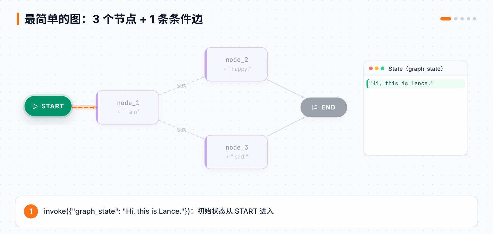
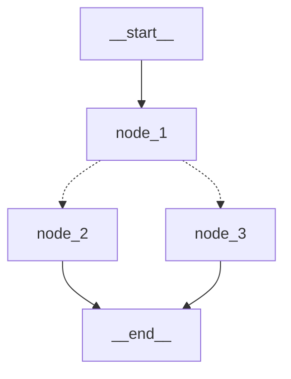
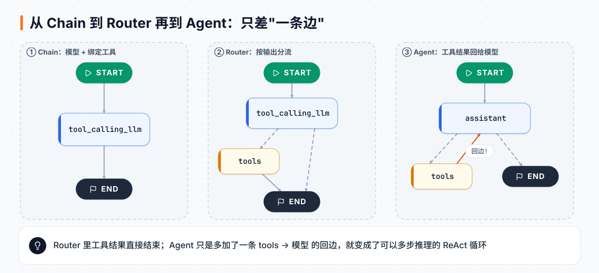

# 第 6 章 LangGraph 图的基本功：从零搭出一个 Agent

> **本章目标**：理解 LangGraph 的三个核心概念——**状态、节点、边**，并亲手从"最简单的图"一步步演进到第 1 章用过的 ReAct Agent。
> **对应课程**：Introduction to LangGraph · Module 1（Simple Graph、Chain、Router、Agent、Agent with Memory、Deployment）

[← 上一章](05-管理消息与动态Agent.md) ｜ [返回导读](README.md) ｜ [下一章 →](07-状态与短期记忆.md)

---

## 6.1 为什么要学"图"？

`create_agent` 封装了一个固定形状的循环。但真实业务常常不是这个形状：

- 先检索、再生成、再检查，不合格就重来
- 两个数据源并行查询再汇总
- 某一步必须等人确认

**LangGraph** 让你把任何流程画成一张图：**节点**做事，**边**决定下一步去哪，**状态**在节点之间传递。`create_agent` 只不过是 LangGraph 里预先画好的一张图。

| 概念 | 是什么 | 在代码里 |
|---|---|---|
| **State 状态** | 整张图共享的数据结构 | 一个 `TypedDict`（或 dataclass / Pydantic） |
| **Node 节点** | 一个 Python 函数：读状态、返回要更新的字段 | `def node(state): return {...}` |
| **Edge 边** | 固定从 A 走到 B | `builder.add_edge("a", "b")` |
| **Conditional Edge 条件边** | 用函数决定下一步去哪 | `builder.add_conditional_edges("a", router_fn)` |
| `START` / `END` | 特殊的起点和终点 | `from langgraph.graph import START, END` |

## 6.2 第一张图：3 个节点 + 1 条条件边



```python
import random
from typing import Literal
from typing_extensions import TypedDict
from langgraph.graph import StateGraph, START, END

# ① 状态
class State(TypedDict):
    graph_state: str

# ② 节点：读状态，返回新值（默认会"覆盖"旧值）
def node_1(state):
    print("---Node 1---")
    return {"graph_state": state["graph_state"] + " I am"}

def node_2(state):
    print("---Node 2---")
    return {"graph_state": state["graph_state"] + " happy!"}

def node_3(state):
    print("---Node 3---")
    return {"graph_state": state["graph_state"] + " sad!"}

# ③ 条件边：返回下一个节点的名字
def decide_mood(state) -> Literal["node_2", "node_3"]:
    return "node_2" if random.random() < 0.5 else "node_3"

# ④ 组装
builder = StateGraph(State)
builder.add_node("node_1", node_1)
builder.add_node("node_2", node_2)
builder.add_node("node_3", node_3)
builder.add_edge(START, "node_1")
builder.add_conditional_edges("node_1", decide_mood)
builder.add_edge("node_2", END)
builder.add_edge("node_3", END)

# ⑤ 编译（会做结构检查）
graph = builder.compile()

graph.invoke({"graph_state": "Hi, this is Lance."})
```

本地实测输出：

```
---Node 1---
---Node 2---
{'graph_state': 'Hi, this is Lance. I am happy!'}
```

用 `graph.get_graph().draw_mermaid()` 可以拿到图的 Mermaid 文本（实线是普通边，虚线是条件边）：



> 💡 编译后的图实现了 LangChain 的 **Runnable** 接口，所以有统一的 `invoke` / `stream` / `batch` / `ainvoke` 等方法。

## 6.3 从 Chain 到 Router 再到 Agent

下面三步，每一步只比上一步多一点点，最后就得到 ReAct Agent。



### 第 1 步 Chain：消息作为状态 + 绑定工具的模型

**① 把聊天消息放进状态。** 关键问题：节点每次返回新消息，如果"覆盖"旧值，历史就丢了。所以要给 `messages` 指定一个 **reducer**（合并规则）——`add_messages`，表示"追加"：

```python
from typing import Annotated
from langchain_core.messages import AnyMessage
from langgraph.graph.message import add_messages

class MessagesState(TypedDict):
    messages: Annotated[list[AnyMessage], add_messages]
```

这太常用了，LangGraph 直接内置了：`from langgraph.graph import MessagesState`。需要更多字段就继承它：

```python
from langgraph.graph import MessagesState
class State(MessagesState):
    summary: str        # 额外字段
```

**② 把工具绑定到模型上。** `bind_tools` 让模型知道有哪些工具可以用：

```python
from langchain_openai import ChatOpenAI

def multiply(a: int, b: int) -> int:
    """Multiply a and b.

    Args:
        a: first int
        b: second int
    """
    return a * b

llm = ChatOpenAI(model="gpt-4o")
llm_with_tools = llm.bind_tools([multiply])

llm_with_tools.invoke("What is 2 multiplied by 3").tool_calls
# [{'name': 'multiply', 'args': {'a': 2, 'b': 3}, 'id': '...', 'type': 'tool_call'}]
```

**③ 组成一张图：**

```python
def tool_calling_llm(state: MessagesState):
    return {"messages": [llm_with_tools.invoke(state["messages"])]}

builder = StateGraph(MessagesState)
builder.add_node("tool_calling_llm", tool_calling_llm)
builder.add_edge(START, "tool_calling_llm")
builder.add_edge("tool_calling_llm", END)
graph = builder.compile()
```

输入 `"Hello!"` → 模型直接回复；输入 `"Multiply 2 and 3"` → 模型返回一个 tool_call，但**没人执行它**。

### 第 2 步 Router：让图去执行工具

加两样预制件：

- `ToolNode(tools)`：执行最后一条 AIMessage 里的所有 tool_calls，返回 ToolMessage。
- `tools_condition`：条件边函数，有 tool_calls 就去 `"tools"`，否则去 `END`。

```python
from langgraph.prebuilt import ToolNode, tools_condition

builder = StateGraph(MessagesState)
builder.add_node("tool_calling_llm", tool_calling_llm)
builder.add_node("tools", ToolNode([multiply]))
builder.add_edge(START, "tool_calling_llm")
builder.add_conditional_edges("tool_calling_llm", tools_condition)
builder.add_edge("tools", END)          # ← 工具执行完就结束
graph = builder.compile()
```

这时模型就像一个**路由器**：根据输入决定"直接回答"还是"走工具"。但工具结果直接返回给了用户，模型没机会再加工。

### 第 3 步 Agent：加一条回边

只改一行：把 `tools → END` 改成 `tools → assistant`。

```python
from langchain_core.messages import SystemMessage

def add(a: int, b: int) -> int:
    """Adds a and b."""
    return a + b

def divide(a: int, b: int) -> float:
    """Divide a and b."""
    return a / b

tools = [add, multiply, divide]
llm_with_tools = llm.bind_tools(tools, parallel_tool_calls=False)  # 算术要按顺序来

sys_msg = SystemMessage(content="You are a helpful assistant tasked with performing arithmetic on a set of inputs.")

def assistant(state: MessagesState):
    return {"messages": [llm_with_tools.invoke([sys_msg] + state["messages"])]}

builder = StateGraph(MessagesState)
builder.add_node("assistant", assistant)
builder.add_node("tools", ToolNode(tools))
builder.add_edge(START, "assistant")
builder.add_conditional_edges("assistant", tools_condition)
builder.add_edge("tools", "assistant")      # ← 回边！形成循环
react_graph = builder.compile()

react_graph.invoke({"messages": [HumanMessage("Add 3 and 4. Multiply the output by 2. Divide the output by 5")]})
```

模型会依次调用 `add(3,4)=7` → `multiply(7,2)=14` → `divide(14,5)=2.8`，最后回答 2.8。这就是 ReAct：

| 步骤 | 英文 | 在图里 |
|---|---|---|
| 行动 | act | assistant 输出 tool_call |
| 观察 | observe | tools 节点把结果写回 messages |
| 推理 | reason | assistant 读结果，决定下一步 |

> 🎯 现在回头看第 1 章的 `create_agent`：它就是帮你画好了这张 `assistant ⇄ tools` 的图，外加中间件、结构化输出等增强。

## 6.4 给 Agent 加记忆

和第 3 章一样的道理，只是这次在 `compile` 时加：

```python
from langgraph.checkpoint.memory import MemorySaver   # InMemorySaver 的别名

react_graph_memory = builder.compile(checkpointer=MemorySaver())
config = {"configurable": {"thread_id": "1"}}

react_graph_memory.invoke({"messages": [HumanMessage("Add 3 and 4.")]}, config)
react_graph_memory.invoke({"messages": [HumanMessage("Multiply that by 2.")]}, config)  # 知道 that = 7
```

checkpointer 会在**每一步**之后保存一次状态快照（checkpoint），同一个 thread 的快照串起来就是这段对话的完整历史。这个机制后面还会用来做人在回路和时间旅行。

## 6.5 部署初体验

Module 1 最后一课演示了把图交给 **LangGraph Server** 运行（本地 `langgraph dev` 或云端部署），然后用 SDK 调用：

```python
from langgraph_sdk import get_client

client = get_client(url="http://127.0.0.1:2024")       # langgraph dev 的地址
thread = await client.threads.create()
async for chunk in client.runs.stream(
    thread["thread_id"],
    "agent",                                              # langgraph.json 里图的名字
    input={"messages": [{"role": "user", "content": "Multiply 3 by 2."}]},
    stream_mode="values",
):
    print(chunk)
```

服务器会自动帮你处理持久化（不需要自己传 checkpointer）。详细内容见第 11 章。

## 📌 本章小结

```
State   ── 共享数据（TypedDict）
Node    ── 函数：读 state，返回要更新的字段
Edge    ── add_edge 固定走向；add_conditional_edges 动态走向
compile ── 检查结构，得到可运行的图（可传 checkpointer）
Agent   ── assistant ⇄ tools 的循环 = ReAct
```

## 🧪 动手练习

1. 把 6.2 的 `decide_mood` 改成：字符串里包含 "Lance" 就去 node_2，否则 node_3。
2. 在 Agent 里加一个 `subtract` 工具，问 "10 减 3 再乘 4"。
3. 把 `parallel_tool_calls=False` 去掉，问一个可以并行计算的问题（"分别算 2×3 和 4×5"），观察一条 AIMessage 里出现多个 tool_calls。

[下一章：状态与短期记忆 →](07-状态与短期记忆.md)
