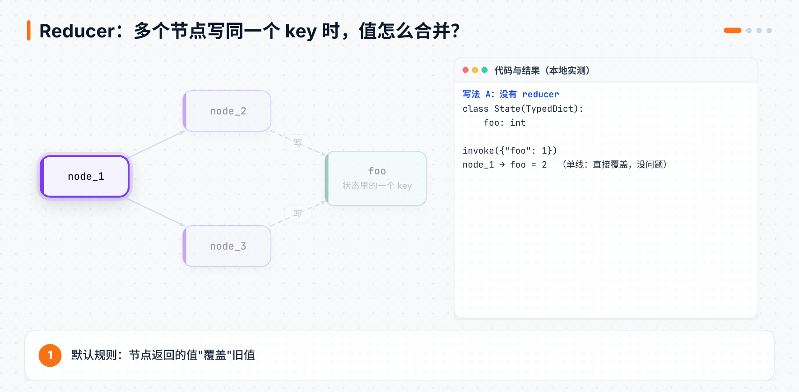
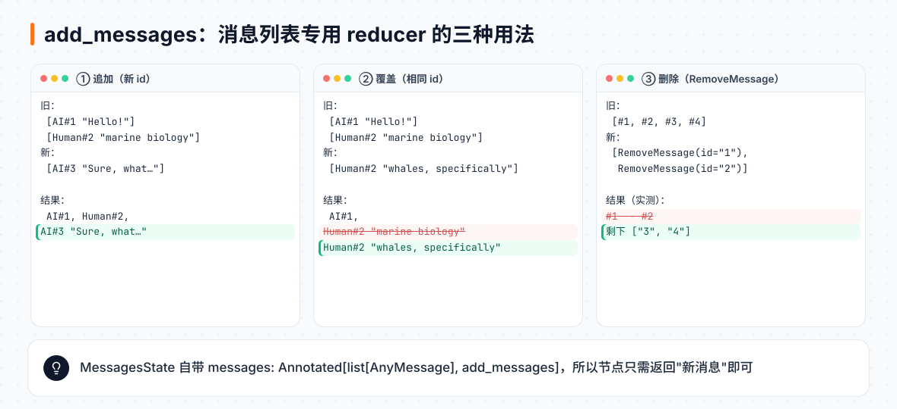
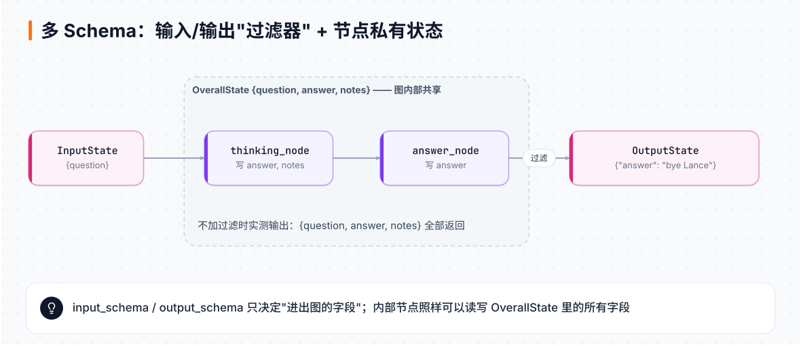
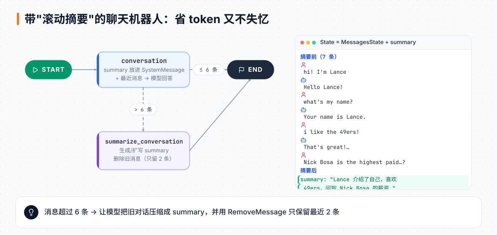

# 第 7 章 状态与短期记忆

> **本章目标**：掌握状态的三种定义方式、Reducer（合并规则）、多 Schema，学会处理"对话越来越长"的问题（过滤、裁剪、摘要），并把记忆持久化到数据库。
> **对应课程**：Introduction to LangGraph · Module 2（State Schema、State Reducers、Multiple Schemas、Trim and Filter Messages、Chatbot w/ Summarization、Chatbot w/ External Memory）

[← 上一章](06-LangGraph图的基本功.md) ｜ [返回导读](README.md) ｜ [下一章 →](08-人在回路.md)

---

## 7.1 定义状态的三种方式

| 方式 | 访问字段 | 运行时校验 | 适用 |
|---|---|---|---|
| `TypedDict` | `state["name"]` | ❌ 只是类型提示 | 默认首选，最轻量 |
| `dataclass` | `state.name` | ❌ | 喜欢属性访问、需要默认值 |
| Pydantic `BaseModel` | `state.name` | ✅ 不合法直接报错 | 需要严格校验输入 |

```python
from typing import Literal
from typing_extensions import TypedDict
from dataclasses import dataclass
from pydantic import BaseModel, field_validator

class TypedDictState(TypedDict):
    name: str
    mood: Literal["happy", "sad"]

@dataclass
class DataclassState:
    name: str
    mood: Literal["happy", "sad"]

class PydanticState(BaseModel):
    name: str
    mood: str

    @field_validator("mood")
    @classmethod
    def validate_mood(cls, value):
        if value not in ["happy", "sad"]:
            raise ValueError("Each mood must be either 'happy' or 'sad'")
        return value
```

`DataclassState(name="Lance", mood="mad")` 不会报错（类型提示不强制），而 `PydanticState(name="John Doe", mood="mad")` 会抛 `ValidationError`。

> 一个容易困惑的点：即使状态是 dataclass，**节点仍然返回字典** `{"name": ...}`。因为 LangGraph 把状态的每个字段当作独立的"通道"（channel）分别存储，返回字典只是告诉它"更新哪些通道"。

## 7.2 Reducer：同一个字段被多次写入时怎么办



**默认规则：覆盖。** 单线流程没问题。但如果 `node_1` 之后分叉到 `node_2` 和 `node_3`，它们在**同一步**并行执行，都去写 `foo`，就会报错（本地实测）：

```
InvalidUpdateError: At key 'foo': Can receive only one value per step.
Use an Annotated key to handle multiple values.
```

**解决：用 `Annotated` 指定 reducer。**

```python
from operator import add
from typing import Annotated

class State(TypedDict):
    foo: Annotated[list[int], add]     # 列表拼接

def node(state):
    return {"foo": [state["foo"][-1] + 1]}
```

`invoke({"foo": [1]})` 在分叉图上的实测结果是 `{'foo': [1, 2, 3, 3]}`：node_1 追加 2，node_2、node_3 各追加 3。

**自定义 reducer**：reducer 就是一个 `(旧值, 新值) -> 合并后的值` 函数。比如处理 `None`：

```python
def reduce_list(left: list | None, right: list | None) -> list:
    return (left or []) + (right or [])

class CustomReducerState(TypedDict):
    foo: Annotated[list[int], reduce_list]
```

用 `operator.add` 时传 `{"foo": None}` 会报 `TypeError: can only concatenate list (not "NoneType") to list`，换成 `reduce_list` 就没问题。

## 7.3 消息专用 reducer：add_messages

`MessagesState` 的 `messages` 字段用的是 `add_messages`，它比单纯的拼接聪明：



```python
from langgraph.graph.message import add_messages
from langchain_core.messages import AIMessage, HumanMessage, RemoveMessage

# ① 追加：新消息 id 不同 → 加到末尾
# ② 覆盖：id 相同 → 替换
initial = [AIMessage("Hello! How can I assist you?", id="1"),
           HumanMessage("I'm looking for information on marine biology.", id="2")]
add_messages(initial, HumanMessage("I'm looking for information on whales, specifically", id="2"))
# 实测：id=2 的消息内容被替换成了 "whales, specifically"

# ③ 删除：RemoveMessage
msgs = [AIMessage("Hi.", id="1"), HumanMessage("Hi.", id="2"),
        AIMessage("So you said you were researching ocean mammals?", id="3"),
        HumanMessage("Yes, I know about whales. But what others should I learn about?", id="4")]
add_messages(msgs, [RemoveMessage(id=m.id) for m in msgs[:-2]])
# 实测：只剩 id 为 "3"、"4" 的两条
```

这三个技巧在第 8 章"修改状态"和"时间旅行"中都会用到。

## 7.4 多 Schema：控制输入输出、传递私有数据



**场景 1：输入/输出过滤。** 内部用了很多中间字段（比如思考笔记 `notes`），但只想对外暴露 `answer`：

```python
class InputState(TypedDict):
    question: str

class OutputState(TypedDict):
    answer: str

class OverallState(TypedDict):
    question: str
    answer: str
    notes: str

def thinking_node(state: InputState):
    return {"answer": "bye", "notes": "... his name is Lance"}

def answer_node(state: OverallState) -> OutputState:
    return {"answer": "bye Lance"}

graph = StateGraph(OverallState, input_schema=InputState, output_schema=OutputState)
graph.add_node("answer_node", answer_node)
graph.add_node("thinking_node", thinking_node)
graph.add_edge(START, "thinking_node")
graph.add_edge("thinking_node", "answer_node")
graph.add_edge("answer_node", END)
graph = graph.compile()

graph.invoke({"question": "hi"})
```

本地实测：不加 input/output schema 时返回 `{'question': 'hi', 'answer': 'bye Lance', 'notes': '... his name is Lance'}`；加了之后只返回 `{'answer': 'bye Lance'}`。

**场景 2：私有状态。** 节点之间传递一些"不该出现在最终结果里"的中间数据：

```python
class OverallState(TypedDict):
    foo: int

class PrivateState(TypedDict):
    baz: int

def node_1(state: OverallState) -> PrivateState:
    return {"baz": state["foo"] + 1}

def node_2(state: PrivateState) -> OverallState:
    return {"foo": state["baz"] + 1}
```

`invoke({"foo": 1})` 返回 `{"foo": 3}`，`baz` 不会出现在输出里。

## 7.5 对话太长怎么办？过滤、裁剪、摘要

对话越长，token 越多、越慢、越贵，还可能超出上下文窗口。三种对策：

| 方法 | 做法 | 状态里的历史 | 优缺点 |
|---|---|---|---|
| **删除** | 节点返回 `RemoveMessage` | 真的删了 | 简单粗暴，信息永久丢失 |
| **过滤** | 调模型时只传 `state["messages"][-1:]` | 保留 | 不改状态，但模型看不到早期内容 |
| **裁剪** | `trim_messages(..., max_tokens=100, strategy="last")` | 保留 | 按 token 精确控制 |
| **摘要** | 让模型把旧对话写成 summary | 旧消息删掉，留 summary | 信息压缩保留，最实用 |

裁剪示例：

```python
from langchain_core.messages import trim_messages

def chat_model_node(state: MessagesState):
    messages = trim_messages(
        state["messages"],
        max_tokens=100,
        strategy="last",                          # 保留最新的
        token_counter=ChatOpenAI(model="gpt-4o"), # 用模型的分词器计数
        allow_partial=False,
    )
    return {"messages": [llm.invoke(messages)]}
```

## 7.6 实战：带滚动摘要的聊天机器人



```python
from langgraph.graph import MessagesState, StateGraph, START, END
from langchain_core.messages import SystemMessage, HumanMessage, RemoveMessage
from langgraph.checkpoint.memory import MemorySaver

model = ChatOpenAI(model="gpt-4o", temperature=0)

class State(MessagesState):
    summary: str

def call_model(state: State):
    summary = state.get("summary", "")
    if summary:
        messages = [SystemMessage(content=f"Summary of conversation earlier: {summary}")] + state["messages"]
    else:
        messages = state["messages"]
    return {"messages": model.invoke(messages)}

def summarize_conversation(state: State):
    summary = state.get("summary", "")
    if summary:
        prompt = (f"This is summary of the conversation to date: {summary}\n\n"
                  "Extend the summary by taking into account the new messages above:")
    else:
        prompt = "Create a summary of the conversation above:"
    response = model.invoke(state["messages"] + [HumanMessage(content=prompt)])
    delete_messages = [RemoveMessage(id=m.id) for m in state["messages"][:-2]]   # 只留最近 2 条
    return {"summary": response.content, "messages": delete_messages}

def should_continue(state: State):
    return "summarize_conversation" if len(state["messages"]) > 6 else END

workflow = StateGraph(State)
workflow.add_node("conversation", call_model)
workflow.add_node(summarize_conversation)        # 不写名字时用函数名
workflow.add_edge(START, "conversation")
workflow.add_conditional_edges("conversation", should_continue)
workflow.add_edge("summarize_conversation", END)
graph = workflow.compile(checkpointer=MemorySaver())
```

使用：

```python
config = {"configurable": {"thread_id": "1"}}
for text in ["hi! I'm Lance", "what's my name?", "i like the 49ers!",
             "i like Nick Bosa, isn't he the highest paid defensive player?"]:
    graph.invoke({"messages": [HumanMessage(content=text)]}, config)

graph.get_state(config).values.get("summary", "")   # 第 4 轮后出现摘要
```

前 3 轮共 6 条消息，不触发摘要；第 4 轮后有 8 条，触发摘要，旧消息被删除、summary 被写入。下一轮模型看到的是"摘要 + 最近消息"，依然记得用户叫 Lance、喜欢 49ers。

> 💡 `create_agent` 里有现成的 `SummarizationMiddleware` 实现同样的效果。理解了这里的原理，用中间件时就心里有数了。

## 7.7 持久化：把记忆存进数据库

`MemorySaver` 在内存里，进程一停就没了。换成 SQLite 只要改 checkpointer：

```python
import sqlite3
from langgraph.checkpoint.sqlite import SqliteSaver   # pip install langgraph-checkpoint-sqlite

conn = sqlite3.connect("state_db/example.db", check_same_thread=False)
memory = SqliteSaver(conn)
graph = workflow.compile(checkpointer=memory)
```

重启 notebook 内核后，`graph.get_state({"configurable": {"thread_id": "1"}})` 依然能读到之前的对话。生产环境常用 `PostgresSaver`。

## 📌 本章小结

- 状态 = 若干独立通道；节点返回字典更新指定通道。
- 并行写同一通道 → 必须用 `Annotated[类型, reducer]`。
- `add_messages`：追加 / 同 id 覆盖 / `RemoveMessage` 删除。
- `input_schema` / `output_schema` 过滤进出；私有 Schema 传中间数据。
- 长对话：过滤、裁剪、摘要；持久化换 `SqliteSaver` / `PostgresSaver`。

## 🧪 动手练习

1. 写一个 reducer：合并两个列表并去重、排序。
2. 把摘要阈值从 6 改成 4，观察 summary 的变化。
3. 用 SqliteSaver 跑一段对话，退出 Python 再进来，用同一个 thread_id 继续聊。

[下一章：人在回路 →](08-人在回路.md)
