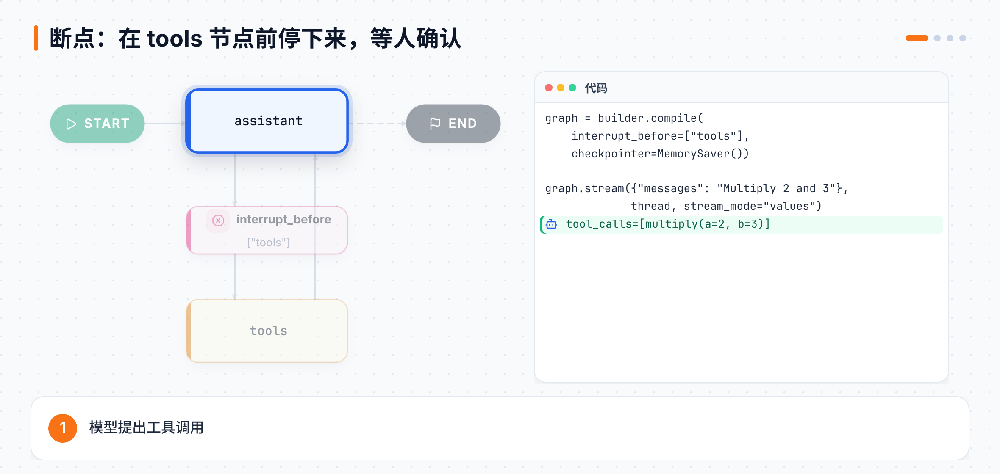
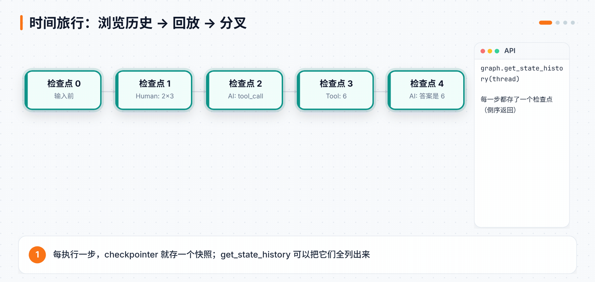

# 第 8 章 人在回路（Human-in-the-Loop）

> **本章目标**：学会在 Agent 运行过程中"看"（流式）、"停"（断点 / interrupt）、"改"（编辑状态）、"回"（时间旅行）。
> **对应课程**：Introduction to LangGraph · Module 3（Streaming、Breakpoints、Editing State & Human Feedback、Dynamic Breakpoints、Time Travel）

[← 上一章](07-状态与短期记忆.md) ｜ [返回导读](README.md) ｜ [下一章 →](09-并行子图与多智能体.md)

---

## 8.0 为什么需要人在回路？

课程总结了三个动机：

| 动机 | 例子 | 用到的能力 |
|---|---|---|
| **审批 Approval** | 转账、发邮件、删数据前先让人确认 | 断点 / interrupt |
| **调试 Debugging** | 回到出错前的那一步，复现或绕开问题 | 时间旅行 |
| **编辑 Editing** | 发现模型理解错了，直接改它的状态 | update_state |

这些能力全部建立在第 6、7 章的 **checkpointer** 之上：因为每一步都存了快照，才能暂停、恢复、回退。

## 8.1 流式：先学会"看"

第 2 章讲过 `create_agent` 的流式，LangGraph 图同样支持，并且多一个 `updates` 模式：

| 模式 | 每次推送 |
|---|---|
| `stream_mode="values"` | 每个节点之后的**完整状态** |
| `stream_mode="updates"` | 每个节点之后的**增量**，形如 `{节点名: {更新的字段}}` |

```python
config = {"configurable": {"thread_id": "1"}}
for chunk in graph.stream({"messages": [HumanMessage("hi! I'm Lance")]}, config, stream_mode="updates"):
    print(chunk)          # {'conversation': {'messages': AIMessage(...)}}
```

**逐 token 流式**：可以用 `stream_mode="messages"`，或者更底层的 `astream_events`，并通过 `metadata["langgraph_node"]` 只取某个节点的 token：

```python
async for event in graph.astream_events({"messages": [HumanMessage("Tell me about the 49ers NFL team")]},
                                        config, version="v2"):
    if event["event"] == "on_chat_model_stream" and event["metadata"].get("langgraph_node") == "conversation":
        print(event["data"]["chunk"].content, end="|")
```

## 8.2 断点：在某个节点前停下来

最简单的暂停方式：编译时告诉图"在哪个节点之前停"。



```python
graph = builder.compile(interrupt_before=["tools"], checkpointer=MemorySaver())

thread = {"configurable": {"thread_id": "1"}}
for event in graph.stream({"messages": HumanMessage("Multiply 2 and 3")}, thread, stream_mode="values"):
    event["messages"][-1].pretty_print()
# 模型输出 tool_call 后停住

graph.get_state(thread).next      # ('tools',)  ← 下一个要跑的节点
```

**恢复的诀窍：传 `None`**。`graph.stream(None, thread)` 表示"不加新输入，从最后一个检查点继续"。

```python
user_approval = input("Do you want to call the tool? (yes/no): ")
if user_approval.lower() == "yes":
    for event in graph.stream(None, thread, stream_mode="values"):
        event["messages"][-1].pretty_print()
else:
    print("Operation cancelled by user.")
```

> `interrupt_before` / `interrupt_after` 是**静态断点**，由开发者在编译时设好，适合调试和固定的审批点。

## 8.3 编辑状态：停下来之后改一改

停下来不只能"批准/拒绝"，还能**直接改状态**。比如在 `assistant` 之前停下，偷偷把用户的问题改掉：

```python
graph = builder.compile(interrupt_before=["assistant"], checkpointer=MemorySaver())
thread = {"configurable": {"thread_id": "1"}}

for event in graph.stream({"messages": "Multiply 2 and 3"}, thread, stream_mode="values"):
    pass

graph.update_state(thread, {"messages": [HumanMessage(content="No, actually multiply 3 and 3!")]})
```

`update_state` 同样遵循 reducer：`messages` 用的是 `add_messages`，所以**不带 id 是追加，带上原消息的 id 就是覆盖**。然后 `graph.stream(None, thread)` 继续，模型会算 3×3=9。

### 把"人类反馈"做成图里的一个节点

更规范的做法：专门放一个空节点 `human_feedback` 作为占位，在它之前设断点，然后**以这个节点的身份**写入状态：

```python
def human_feedback(state: MessagesState):
    pass                                    # 什么也不做，只是个占位

builder.add_node("human_feedback", human_feedback)
builder.add_edge(START, "human_feedback")
builder.add_edge("human_feedback", "assistant")
builder.add_conditional_edges("assistant", tools_condition)
builder.add_edge("tools", "human_feedback")
graph = builder.compile(interrupt_before=["human_feedback"], checkpointer=MemorySaver())

# ……运行到断点后：
user_input = input("Tell me how you want to update the state: ")
graph.update_state(thread, {"messages": user_input}, as_node="human_feedback")   # ← 关键
for event in graph.stream(None, thread, stream_mode="values"):
    event["messages"][-1].pretty_print()
```

`as_node="human_feedback"` 让图认为"这个更新是 human_feedback 节点产生的"，于是会按图的边继续走到 `assistant`。

## 8.4 动态中断：让节点自己决定要不要停

静态断点是"每次都停"。如果只想在**某些条件**下停（比如金额超过 1 万、输入太长），就在节点内部中断。

课程视频里用的是 `raise NodeInterrupt(...)`；在当前版本的 LangGraph 中，**推荐写法是 `interrupt()` + `Command(resume=...)`**，它还能把人的回答直接作为返回值拿回来。下面是本地实测的例子：

```python
from typing_extensions import TypedDict
from langgraph.types import interrupt, Command
from langgraph.checkpoint.memory import InMemorySaver

class State(TypedDict):
    input: str

def step_2(state: State):
    if len(state["input"]) > 5:
        # 暂停，并把问题抛给人；恢复时 resume 的值会成为 interrupt() 的返回值
        answer = interrupt({"question": f"输入 '{state['input']}' 超过 5 个字符，要改成什么？"})
        return {"input": answer}
    return state

builder = StateGraph(State)
builder.add_node("step_1", lambda s: s)
builder.add_node("step_2", step_2)
builder.add_node("step_3", lambda s: s)
builder.add_edge(START, "step_1"); builder.add_edge("step_1", "step_2")
builder.add_edge("step_2", "step_3"); builder.add_edge("step_3", END)
graph = builder.compile(checkpointer=InMemorySaver())

cfg = {"configurable": {"thread_id": "x"}}
for ev in graph.stream({"input": "hello world"}, cfg, stream_mode="updates"):
    print(ev)
```

实测输出：

```
{'step_1': {'input': 'hello world'}}
{'__interrupt__': (Interrupt(value={'question': "输入 'hello world' 超过 5 个字符，要改成什么？"}, id='...'),)}
```

```python
graph.get_state(cfg).next                    # ('step_2',)
for ev in graph.stream(Command(resume="hi"), cfg, stream_mode="updates"):
    print(ev)
# {'step_2': {'input': 'hi'}}
# {'step_3': {'input': 'hi'}}
```

| 对比 | 静态断点 `interrupt_before` | 动态中断 `interrupt()` |
|---|---|---|
| 在哪设置 | `compile()` 时 | 节点代码内部 |
| 是否有条件 | 每次都停 | 可以写 if |
| 能否告诉人原因 | 不能 | 能（传任意数据） |
| 如何恢复 | `stream(None, ...)` | `stream(Command(resume=值), ...)` |

> 第 3 章的 `HumanInTheLoopMiddleware` 内部就是用 `interrupt()` 实现的。

## 8.5 时间旅行：浏览、回放、分叉



**浏览历史**：

```python
graph.get_state(thread)                              # 当前状态
all_states = [s for s in graph.get_state_history(thread)]   # 所有检查点（最新的在前）
```

本地对上面那个 3 步小图实测，`get_state_history` 返回 5 个检查点：

```
next=()           values={'input': 'hi'}            ← 最终
next=('step_3',)  values={'input': 'hi'}
next=('step_2',)  values={'input': 'hello world'}
next=('step_1',)  values={'input': 'hello world'}
next=('__start__',) values={}                        ← 最初
```

每个检查点都有 `config`（含 `checkpoint_id`）、`values`（当时的状态）、`next`（下一步）。

**回放（Replay）**：把某个历史检查点的 config 传回去即可。图知道这些步骤执行过，会从那里重新跑：

```python
to_replay = all_states[-2]                 # 收到用户输入的那一步
for event in graph.stream(None, to_replay.config, stream_mode="values"):
    event["messages"][-1].pretty_print()
```

**分叉（Fork）**：在历史检查点上**改状态**，生成一条新分支：

```python
to_fork = all_states[-2]
fork_config = graph.update_state(
    to_fork.config,
    {"messages": [HumanMessage(content="Multiply 5 and 3",
                               id=to_fork.values["messages"][0].id)]},   # 同 id → 覆盖原问题
)
for event in graph.stream(None, fork_config, stream_mode="values"):
    event["messages"][-1].pretty_print()        # 这次算的是 5×3=15
```

原来的历史不会丢，新分支和旧分支并存。这在调试 Agent 时极其好用：**不用从头再跑，直接回到出问题的那一步，改一下再试**。

## 📌 本章小结

```
看   stream(values / updates / messages)、astream_events
停   compile(interrupt_before=[...])        静态
     interrupt(payload)                      动态，节点内部
继续 stream(None, config)                    从检查点继续
     stream(Command(resume=值), config)      回应 interrupt
改   update_state(config, 更新, as_node=...)
回   get_state_history → stream(None, 旧config) 回放
                        → update_state(旧config, ...) 分叉
```

## 🧪 动手练习

1. 给第 6 章的数学 Agent 加 `interrupt_before=["tools"]`，实现一个命令行审批。
2. 用 `interrupt()` 改写：只有当工具是 `divide` 时才请求审批。
3. 让 Agent 算错一道题，然后用时间旅行回到出错前，修改输入后分叉重跑。

[下一章：并行、子图与多智能体 →](09-并行子图与多智能体.md)
