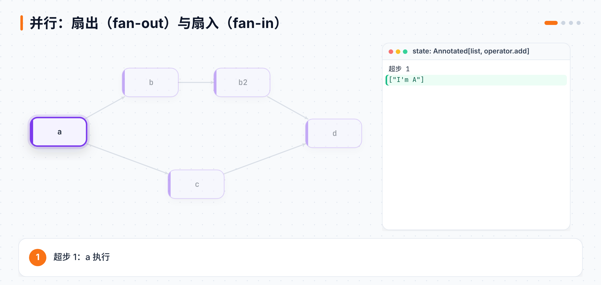
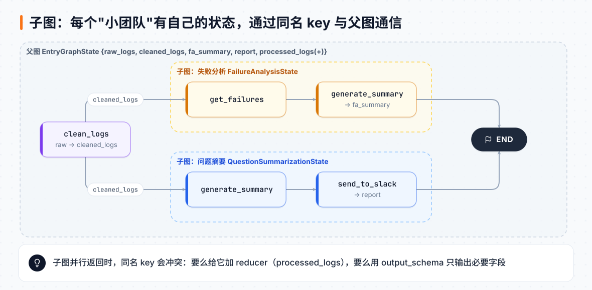
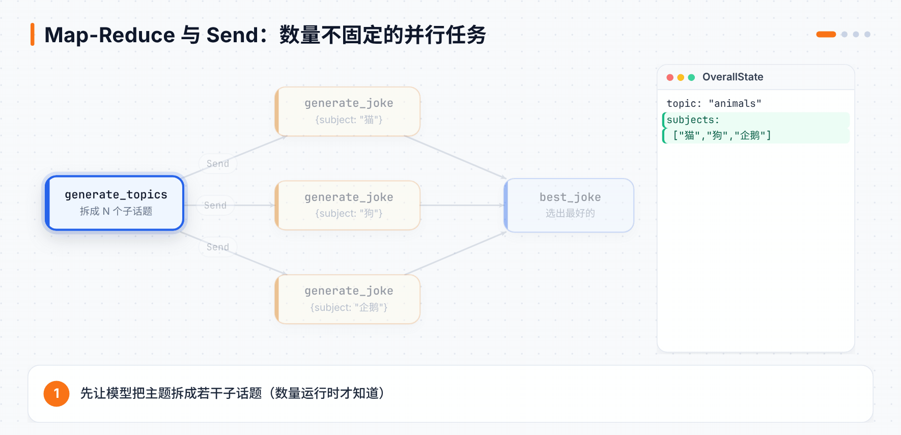
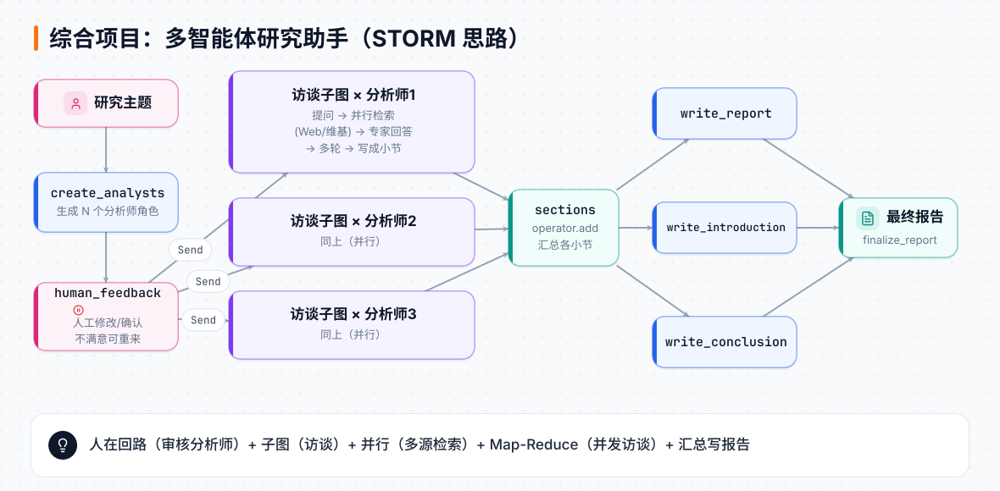

# 第 9 章 并行、子图与多智能体

> **本章目标**：学会让多个节点同时跑（并行）、把大图拆成小图（子图）、处理数量不固定的并行任务（Map-Reduce），最后把前面所有知识组合成一个**多智能体研究助手**。
> **对应课程**：Introduction to LangGraph · Module 4（Parallelization、Sub-graphs、Map-reduce、Research Assistant）

[← 上一章](08-人在回路.md) ｜ [返回导读](README.md) ｜ [下一章 →](10-长期记忆.md)

---

## 9.1 并行：扇出与扇入

只要一个节点连出多条边，下游节点就会**在同一个"超步"（super-step）里并行执行**。



```python
import operator
from typing import Any, Annotated
from typing_extensions import TypedDict
from langgraph.graph import StateGraph, START, END

class State(TypedDict):
    state: Annotated[list, operator.add]     # 并行写同一字段 → 必须有 reducer（见第 7 章）

class ReturnNodeValue:
    def __init__(self, node_secret: str):
        self._value = node_secret
    def __call__(self, state: State) -> Any:
        print(f"Adding {self._value} to {state['state']}")
        return {"state": [self._value]}

builder = StateGraph(State)
for name, val in [("a", "I'm A"), ("b", "I'm B"), ("b2", "I'm B2"), ("c", "I'm C"), ("d", "I'm D")]:
    builder.add_node(name, ReturnNodeValue(val))

builder.add_edge(START, "a")
builder.add_edge("a", "b")          # 扇出
builder.add_edge("a", "c")
builder.add_edge("b", "b2")
builder.add_edge(["b2", "c"], "d")  # 扇入：d 要等 b2 和 c 都完成
builder.add_edge("d", END)
graph = builder.compile()
graph.invoke({"state": []})
```

本地实测输出：

```
Adding I'm A to []
Adding I'm B to ["I'm A"]
Adding I'm C to ["I'm A"]               ← b、c 在同一超步，看到的是同一份旧状态
Adding I'm B2 to ["I'm A", "I'm B", "I'm C"]
Adding I'm D to ["I'm A", "I'm B", "I'm C", "I'm B2"]
{'state': ["I'm A", "I'm B", "I'm C", "I'm B2", "I'm D"]}
```

三个要点：

1. **同一超步内的节点看到的是同一份状态**，它们的更新在超步结束时统一合并。
2. 两条支路长短不一时，用 `add_edge(["b2", "c"], "d")` 明确"d 要等两边都完成"。
3. 同一超步内多个更新的**合并顺序由框架决定**，你无法控制。需要固定顺序时，可以写一个排序的 reducer：

```python
def sorting_reducer(left, right):
    if not isinstance(left, list): left = [left]
    if not isinstance(right, list): right = [right]
    return sorted(left + right, reverse=False)
```

### 真实例子：同时查维基百科和网页

```python
class State(TypedDict):
    question: str
    answer: str
    context: Annotated[list, operator.add]

def search_web(state):
    from langchain_tavily import TavilySearch
    data = TavilySearch(max_results=3).invoke({"query": state["question"]})
    docs = data.get("results", data)
    return {"context": ["\n\n---\n\n".join(f'<Document href="{d["url"]}">\n{d["content"]}\n</Document>' for d in docs)]}

def search_wikipedia(state):
    from langchain_community.document_loaders import WikipediaLoader
    docs = WikipediaLoader(query=state["question"], load_max_docs=2).load()
    return {"context": ["\n\n---\n\n".join(f'<Document source="{d.metadata["source"]}">\n{d.page_content}\n</Document>' for d in docs)]}

def generate_answer(state):
    prompt = f"Answer the question {state['question']} using this context: {state['context']}"
    return {"answer": llm.invoke([SystemMessage(content=prompt), HumanMessage(content="Answer the question.")])}

builder = StateGraph(State)
builder.add_node("search_web", search_web)
builder.add_node("search_wikipedia", search_wikipedia)
builder.add_node("generate_answer", generate_answer)
builder.add_edge(START, "search_wikipedia")      # START 也可以扇出
builder.add_edge(START, "search_web")
builder.add_edge("search_wikipedia", "generate_answer")
builder.add_edge("search_web", "generate_answer")
builder.add_edge("generate_answer", END)
graph = builder.compile()

graph.invoke({"question": "How were Nvidia's Q2 2025 earnings"})
```

两次检索并行进行，总耗时约等于较慢的那一个，而不是两者相加。

## 9.2 子图：大系统拆成小团队

当系统变复杂（尤其是多智能体），每个"团队"最好有**自己的状态**，互不干扰。子图就是**把一张编译好的图当作另一张图的节点**。



课程例子：一个日志分析系统，收到日志后由两个子图并行处理：失败分析、问题摘要。

```python
from typing import List, Optional

class Log(TypedDict):
    id: str
    question: str
    docs: Optional[List]
    answer: str
    grade: Optional[int]
    grader: Optional[str]
    feedback: Optional[str]

# —— 子图 1：失败分析 ——
class FailureAnalysisState(TypedDict):
    cleaned_logs: List[Log]
    failures: List[Log]
    fa_summary: str
    processed_logs: List[str]

class FailureAnalysisOutputState(TypedDict):     # 只输出这两个字段
    fa_summary: str
    processed_logs: List[str]

def get_failures(state):
    return {"failures": [log for log in state["cleaned_logs"] if "grade" in log]}

def generate_summary(state):
    return {"fa_summary": "Poor quality retrieval of Chroma documentation.",
            "processed_logs": [f"failure-analysis-on-log-{f['id']}" for f in state["failures"]]}

fa_builder = StateGraph(FailureAnalysisState, output_schema=FailureAnalysisOutputState)
fa_builder.add_node("get_failures", get_failures)
fa_builder.add_node("generate_summary", generate_summary)
fa_builder.add_edge(START, "get_failures")
fa_builder.add_edge("get_failures", "generate_summary")
fa_builder.add_edge("generate_summary", END)

# —— 子图 2：问题摘要（结构类似，输出 report、processed_logs）——
# qs_builder = StateGraph(QuestionSummarizationState, output_schema=QuestionSummarizationOutputState) ...

# —— 父图 ——
class EntryGraphState(TypedDict):
    raw_logs: List[Log]
    cleaned_logs: List[Log]
    fa_summary: str                                   # 只由子图 1 产生
    report: str                                       # 只由子图 2 产生
    processed_logs: Annotated[List[int], operator.add]  # 两个子图都会产生 → 需要 reducer

def clean_logs(state):
    return {"cleaned_logs": state["raw_logs"]}

entry_builder = StateGraph(EntryGraphState)
entry_builder.add_node("clean_logs", clean_logs)
entry_builder.add_node("question_summarization", qs_builder.compile())   # ← 子图当节点
entry_builder.add_node("failure_analysis", fa_builder.compile())
entry_builder.add_edge(START, "clean_logs")
entry_builder.add_edge("clean_logs", "failure_analysis")
entry_builder.add_edge("clean_logs", "question_summarization")
entry_builder.add_edge("failure_analysis", END)
entry_builder.add_edge("question_summarization", END)
graph = entry_builder.compile()
```

**最关键的一点：父图和子图通过"同名的 key"通信。**

- 子图从父图读 `cleaned_logs`（两边都有这个字段）。
- 父图从子图拿 `fa_summary`、`report`、`processed_logs`。

**常见坑**：子图默认会把它的**所有字段**都返回给父图。两个子图并行时，都返回 `cleaned_logs` → 同一超步写同一字段 → 报错。两种解决办法：

1. 给 `cleaned_logs` 也加 reducer（不推荐，会重复）；
2. **给子图设 `output_schema`**，只输出真正需要交回的字段（推荐，上面就是这么做的）。

查看嵌套结构：`graph.get_graph(xray=1).draw_mermaid_png()`。

## 9.3 Map-Reduce：数量不固定的并行任务

9.1 的并行是**在建图时就写死的**（固定 2 条支路）。但如果任务数量要到运行时才知道呢？比如"先让模型列出 N 个子话题，再对每个子话题并行处理"。这就要用 **`Send`**。



```python
import operator
from typing import Annotated
from pydantic import BaseModel
from langgraph.types import Send

subjects_prompt = "Generate a list of 3 sub-topics that are all related to this overall topic: {topic}."
joke_prompt = "Generate a joke about {subject}"
best_joke_prompt = """Below are a bunch of jokes about {topic}. Select the best one! Return the ID of the best one, starting 0 as the ID for the first joke. Jokes: \n\n  {jokes}"""

class Subjects(BaseModel):
    subjects: list[str]
class Joke(BaseModel):
    joke: str
class BestJoke(BaseModel):
    id: int

class OverallState(TypedDict):
    topic: str
    subjects: list
    jokes: Annotated[list, operator.add]     # 各分支结果在这里汇合
    best_selected_joke: str

class JokeState(TypedDict):                  # 每个 map 分支自己的小状态
    subject: str

def generate_topics(state: OverallState):
    resp = model.with_structured_output(Subjects).invoke(subjects_prompt.format(topic=state["topic"]))
    return {"subjects": resp.subjects}

def continue_to_jokes(state: OverallState):
    # 返回一组 Send：每个都会启动一次 generate_joke，并带上自己的输入
    return [Send("generate_joke", {"subject": s}) for s in state["subjects"]]

def generate_joke(state: JokeState):
    resp = model.with_structured_output(Joke).invoke(joke_prompt.format(subject=state["subject"]))
    return {"jokes": [resp.joke]}

def best_joke(state: OverallState):
    jokes = "\n\n".join(state["jokes"])
    resp = model.with_structured_output(BestJoke).invoke(best_joke_prompt.format(topic=state["topic"], jokes=jokes))
    return {"best_selected_joke": state["jokes"][resp.id]}

graph = StateGraph(OverallState)
graph.add_node("generate_topics", generate_topics)
graph.add_node("generate_joke", generate_joke)
graph.add_node("best_joke", best_joke)
graph.add_edge(START, "generate_topics")
graph.add_conditional_edges("generate_topics", continue_to_jokes, ["generate_joke"])
graph.add_edge("generate_joke", "best_joke")
graph.add_edge("best_joke", END)
app = graph.compile()

for s in app.stream({"topic": "animals"}):
    print(s)
```

本地用假数据替换模型后实测的流式输出（结构与课程一致）：

```
{'gen_topics': {'subjects': ['猫', '狗', '企鹅']}}
{'gen_joke': {'jokes': ['关于猫的笑话']}}
{'gen_joke': {'jokes': ['关于狗的笑话']}}
{'gen_joke': {'jokes': ['关于企鹅的笑话']}}
{'best': {'best': '关于猫的笑话'}}
```

`Send` 的两个特点：

- 发送的状态**不必和 OverallState 一样**，`generate_joke` 用的是自己的 `JokeState`。
- 发多少个由运行时数据决定，图结构不用改。

## 9.4 综合项目：多智能体研究助手

把前面学的**全部**组合起来：记忆、人在回路、并行、子图、Map-Reduce。思路来自斯坦福的 [STORM](https://arxiv.org/abs/2402.14207) 论文——通过"多视角访谈"写出深度报告。



| 环节 | 做什么 | 用到的技术 |
|---|---|---|
| 生成分析师 | 根据主题，让模型生成 N 个不同视角的"分析师"（姓名、所属机构、关注点） | 结构化输出 |
| 人工审核 | 人可以给反馈（"加一个创业公司 CEO 视角"），不满意就重新生成 | `interrupt_before=["human_feedback"]` + `update_state` |
| 访谈 | 每个分析师与"专家"进行多轮问答；专家每次都从 Web 和维基并行检索再回答 | **子图**（访谈图有自己的状态）+ **并行** |
| 并发访谈 | 所有分析师同时进行访谈 | **Map-Reduce**（`Send`） |
| 写报告 | 每个访谈写成一个小节；汇总后并行写正文、引言、结论，最后拼成完整报告 | reducer 汇总 + 并行 |

关键代码骨架：

```python
def initiate_all_interviews(state: ResearchGraphState):
    human_analyst_feedback = state.get("human_analyst_feedback")
    if human_analyst_feedback:
        return "create_analysts"            # 有反馈 → 回去重新生成分析师
    topic = state["topic"]
    return [Send("conduct_interview", {
                "analyst": analyst,
                "messages": [HumanMessage(content=f"So you said you were writing an article on {topic}?")],
            }) for analyst in state["analysts"]]

builder = StateGraph(ResearchGraphState)
builder.add_node("create_analysts", create_analysts)
builder.add_node("human_feedback", human_feedback)
builder.add_node("conduct_interview", interview_builder.compile())   # 子图
builder.add_node("write_report", write_report)
builder.add_node("write_introduction", write_introduction)
builder.add_node("write_conclusion", write_conclusion)
builder.add_node("finalize_report", finalize_report)

builder.add_edge(START, "create_analysts")
builder.add_edge("create_analysts", "human_feedback")
builder.add_conditional_edges("human_feedback", initiate_all_interviews,
                              ["create_analysts", "conduct_interview"])
builder.add_edge("conduct_interview", "write_report")
builder.add_edge("conduct_interview", "write_introduction")
builder.add_edge("conduct_interview", "write_conclusion")
builder.add_edge(["write_conclusion", "write_report", "write_introduction"], "finalize_report")
builder.add_edge("finalize_report", END)

graph = builder.compile(interrupt_before=["human_feedback"], checkpointer=MemorySaver())
```

使用流程：

```python
thread = {"configurable": {"thread_id": "1"}}
graph.stream({"topic": "The benefits of adopting LangGraph as an agent framework", "max_analysts": 3}, thread)
# → 停在 human_feedback 前，打印出 3 个分析师

graph.update_state(thread, {"human_analyst_feedback": "Add in the CEO of gen ai native startup"},
                   as_node="human_feedback")
graph.stream(None, thread)                     # → 重新生成分析师，再次停下

graph.update_state(thread, {"human_analyst_feedback": None}, as_node="human_feedback")
graph.stream(None, thread, stream_mode="updates")   # → 满意了，开始并发访谈并写报告

print(graph.get_state(thread).values["final_report"])
```

> 这个项目是课程的"毕业设计"。如果想深入，Academy 还有一门专门的 **Deep Research with LangGraph** 项目课。

## 📌 本章小结

| 需求 | 做法 |
|---|---|
| 固定的几条支路同时跑 | 一个节点连多条边（扇出），`add_edge([...], 下游)`（扇入） |
| 并行写同一字段 | reducer |
| 系统拆分、各团队独立状态 | 子图：`add_node("名字", 子图.compile())`，用同名 key 通信 |
| 子图并行返回冲突 | 子图设 `output_schema` |
| 任务数运行时才确定 | 条件边返回 `[Send("节点", 状态), ...]` |

## 🧪 动手练习

1. 在"维基 + 网页"并行检索中再加一个数据源（比如 arXiv），观察总耗时。
2. 把 Map-Reduce 例子改成：给定一篇长文章，切成段落，并行总结每段，最后合并成全文摘要。
3. 跑一遍研究助手，用两次不同的人工反馈，对比生成的报告。

[下一章：长期记忆 →](10-长期记忆.md)
