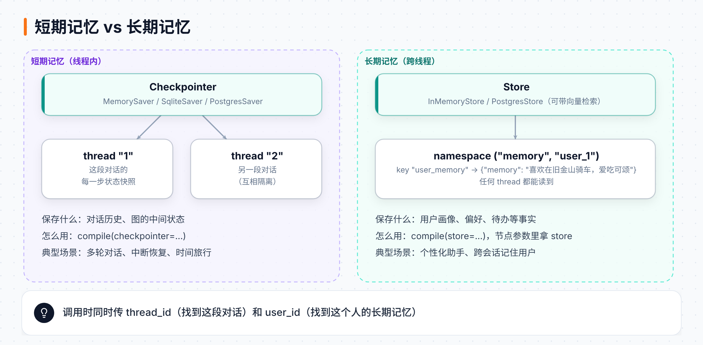
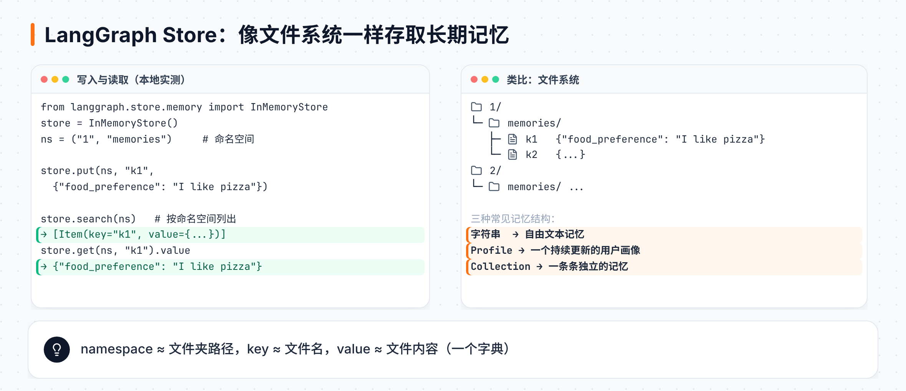

# 第 10 章 长期记忆：跨会话记住用户

> **本章目标**：区分短期记忆和长期记忆；用 LangGraph Store 存取跨线程的记忆；把记忆从"一段文字"升级为结构化的 Profile 和 Collection；最后做一个能自己决定"记什么"的待办助手。
> **对应课程**：Introduction to LangGraph · Module 5（Memory Store、Memory Schema: Profile、Memory Schema: Collection、Memory Agent）

[← 上一章](09-并行子图与多智能体.md) ｜ [返回导读](README.md) ｜ [下一章 →](11-部署上线.md)

---

## 10.1 短期 vs 长期



到目前为止，记忆都绑在 `thread_id` 上：换一个对话窗口，Agent 就不认识你了。**长期记忆**要解决的是：**无论在哪个对话里，都记得这个用户是谁、喜欢什么。**

| | 短期记忆（线程内） | 长期记忆（跨线程） |
|---|---|---|
| 存储 | Checkpointer | **Store** |
| 键 | `thread_id` | `namespace` + `key`（通常含 `user_id`） |
| 内容 | 对话历史、图的状态 | 关于用户的事实、偏好、待办…… |
| 挂载方式 | `compile(checkpointer=...)` | `compile(store=...)` |

> 课程借用了认知科学的分类：**语义记忆**（事实，如"用户住在旧金山"）、**情景记忆**（经历）、**程序记忆**（做事的方法/规则）。本章主要讲语义记忆，10.5 会涉及程序记忆。

## 10.2 Store 的基本用法



```python
import uuid
from langgraph.store.memory import InMemoryStore

in_memory_store = InMemoryStore()

user_id = "1"
namespace_for_memory = (user_id, "memories")       # 命名空间：元组，像文件夹路径
key = str(uuid.uuid4())                            # 键：像文件名
value = {"food_preference": "I like pizza"}        # 值：字典，像文件内容

in_memory_store.put(namespace_for_memory, key, value)

memories = in_memory_store.search(namespace_for_memory)   # 列出命名空间下的所有条目
memories[0].key, memories[0].value
in_memory_store.get(namespace_for_memory, key).value      # 按 key 精确读取
```

本地实测：`search` 返回 `Item`，有 `namespace`、`key`、`value`、创建/更新时间等字段；`get(...).value` 就是 `{'food_preference': 'I like pizza'}`。

## 10.3 第一个有长期记忆的聊天机器人

设计：两个节点。

1. `call_model`：从 Store 读出该用户的记忆，放进系统提示词，再回答。
2. `write_memory`：回顾本轮对话，把新信息合并进记忆，写回 Store。

```python
from langchain_core.messages import SystemMessage
from langchain_core.runnables.config import RunnableConfig
from langgraph.graph import StateGraph, MessagesState, START, END
from langgraph.store.base import BaseStore
from langgraph.checkpoint.memory import MemorySaver

MODEL_SYSTEM_MESSAGE = """You are a helpful assistant with memory that provides information about the user.
If you have memory for this user, use it to personalize your responses.
Here is the memory (it may be empty): {memory}"""

CREATE_MEMORY_INSTRUCTION = """You are collecting information about the user to personalize your responses.
CURRENT USER INFORMATION:
{memory}
INSTRUCTIONS:
1. Review the chat history below carefully
2. Identify new information about the user ...
3. Merge any new information with existing memory
4. Format the memory as a clear, bulleted list
5. If new information conflicts with existing memory, keep the most recent version
Based on the chat history below, please update the user information:"""

def call_model(state: MessagesState, config: RunnableConfig, store: BaseStore):   # ← store 自动注入
    user_id = config["configurable"]["user_id"]
    existing = store.get(("memory", user_id), "user_memory")
    memory = existing.value.get("memory") if existing else "No existing memory found."
    response = model.invoke([SystemMessage(content=MODEL_SYSTEM_MESSAGE.format(memory=memory))] + state["messages"])
    return {"messages": response}

def write_memory(state: MessagesState, config: RunnableConfig, store: BaseStore):
    user_id = config["configurable"]["user_id"]
    existing = store.get(("memory", user_id), "user_memory")
    memory = existing.value.get("memory") if existing else "No existing memory found."
    new_memory = model.invoke([SystemMessage(content=CREATE_MEMORY_INSTRUCTION.format(memory=memory))] + state["messages"])
    store.put(("memory", user_id), "user_memory", {"memory": new_memory.content})

builder = StateGraph(MessagesState)
builder.add_node("call_model", call_model)
builder.add_node("write_memory", write_memory)
builder.add_edge(START, "call_model")
builder.add_edge("call_model", "write_memory")
builder.add_edge("write_memory", END)

graph = builder.compile(checkpointer=MemorySaver(), store=InMemoryStore())   # 短期 + 长期
```

使用时**两个 ID 一起传**：

```python
config = {"configurable": {"thread_id": "1", "user_id": "1"}}
graph.invoke({"messages": [HumanMessage("Hi, my name is Lance")]}, config)
graph.invoke({"messages": [HumanMessage("I like to bike around San Francisco")]}, config)

# 新对话（thread 2），同一个用户
config = {"configurable": {"thread_id": "2", "user_id": "1"}}
graph.invoke({"messages": [HumanMessage("Hi! Where would you recommend that I go biking?")]}, config)
# → 模型知道你叫 Lance、在旧金山骑车，会推荐金门大桥等路线
```

> 💡 节点函数签名里写上 `store: BaseStore`，LangGraph 就会把编译时传入的 store 自动注入进来；`config` 同理。

这种在用户对话过程中同步写记忆的方式，课程称为 **"in the hot path"（热路径）**。优点是实时；缺点是增加每轮的延迟。另一种做法是在后台异步整理记忆。

## 10.4 让记忆有结构：Profile 与 Collection

用一段自由文本当记忆，读起来方便，但程序不好用、也容易在反复重写中丢信息。更好的做法是给记忆一个 **Schema**：

| 形式 | 结构 | 适合 | 更新难点 |
|---|---|---|---|
| **Profile（画像）** | 一个持续更新的对象：`{name, location, interests: [...]}` | 用户基本信息 | 每次整个重写，可能丢字段、浪费 token |
| **Collection（集合）** | 很多条独立记忆，每条一个对象 | 开放式、不断增长的信息 | 要判断是新增还是更新已有的某一条 |

### 用 `with_structured_output` 生成 Profile

```python
from typing import TypedDict, List

class UserProfile(TypedDict):
    """User profile schema with typed fields"""
    user_name: str
    interests: List[str]

model_with_structure = model.with_structured_output(UserProfile)
model_with_structure.invoke([HumanMessage("My name is Lance, I like to bike.")])
# {'user_name': 'Lance', 'interests': ['biking']}
```

问题：Schema 一复杂，模型容易抽取失败；而且每次都要**从头重新生成**整个 Profile。

### 用 Trustcall 增量更新

课程引入了 LangChain 团队开源的 [Trustcall](https://github.com/hinthornw/trustcall)。它的核心思想：**让模型生成 JSON Patch，只改需要改的部分**，而不是重写整个对象。

```python
from trustcall import create_extractor

trustcall_extractor = create_extractor(
    model,
    tools=[UserProfile],
    tool_choice="UserProfile",          # 强制输出这个 schema
)

# 首次抽取
result = trustcall_extractor.invoke({"messages": conversation})
result["responses"][0]                   # 解析后的 UserProfile

# 增量更新：把已有的画像传进去
result = trustcall_extractor.invoke({
    "messages": updated_conversation,
    "existing": {"UserProfile": existing_profile},
})
```

对 Collection，再加 `enable_inserts=True`，Trustcall 就能**同时**更新已有的条目、插入新的条目：

```python
from pydantic import BaseModel, Field

class Memory(BaseModel):
    content: str = Field(description="The main content of the memory. For example: User expressed interest in learning about French.")

trustcall_extractor = create_extractor(model, tools=[Memory], tool_choice="Memory", enable_inserts=True)

existing_memories = [(str(i), "Memory", m.model_dump()) for i, m in enumerate(old_memories)]
result = trustcall_extractor.invoke({"messages": updated_conversation, "existing": existing_memories})
result["response_metadata"]   # 每条结果对应哪个已有记忆（json_doc_id），没有则是新增
```

## 10.5 综合：会自己决定"记什么"的待办助手 task_mAIstro

前面的机器人**每轮都**写记忆。更聪明的 Agent 应该**自己判断**要不要记、记到哪里。课程的 `task_mAIstro` 管理三种长期记忆：

| 记忆类型 | 内容 | 存储形式 |
|---|---|---|
| `user` | 用户画像（姓名、所在地、家庭……） | Profile |
| `todo` | 待办事项（任务、截止时间、解决方案……） | Collection |
| `instructions` | 用户对"如何创建待办"的偏好 | 程序记忆（一段文本） |

做法：给模型一个工具 `UpdateMemory(update_type: Literal["user", "todo", "instructions"])`，模型像调用普通工具一样决定是否、以及更新哪种记忆；一个路由函数根据 `update_type` 把流程导向对应的写记忆节点（内部用 Trustcall）。

```
用户："我老婆让我给宝宝报游泳课"           → 模型调用 UpdateMemory(todo) → 新增一条待办
用户："创建待办时请附上本地商家的名字"      → UpdateMemory(instructions) → 更新偏好
用户："游泳课要在 11 月底前搞定"           → UpdateMemory(todo) → Trustcall 打补丁，更新截止时间
新对话："给我几个游泳课的选择"             → 读出 Profile + ToDo + Instructions，个性化回答
```

> 这个 Agent 就是第 11 章要部署上线的那个应用。

## 📌 本章小结

- 长期记忆用 **Store**：`namespace`（元组）+ `key` + `value`（字典）。
- 节点签名写 `store: BaseStore` 即可注入；调用时 config 里同时给 `thread_id` 和 `user_id`。
- 记忆形态：自由文本 → Profile → Collection，越往后越结构化。
- **Trustcall** 用 JSON Patch 做增量更新，避免重写丢信息。
- 让模型通过"工具调用"决定何时更新记忆，比每轮都写更高效。

## 🧪 动手练习

1. 在 10.3 的机器人里，用两个不同的 `user_id` 聊天，确认记忆互不串。
2. 把 `UserProfile` 扩展出 `location`、`favorite_foods` 字段，观察抽取效果。
3. 思考：哪些信息适合放 Profile，哪些适合放 Collection？各举三个例子。

[下一章：部署上线 →](11-部署上线.md)
