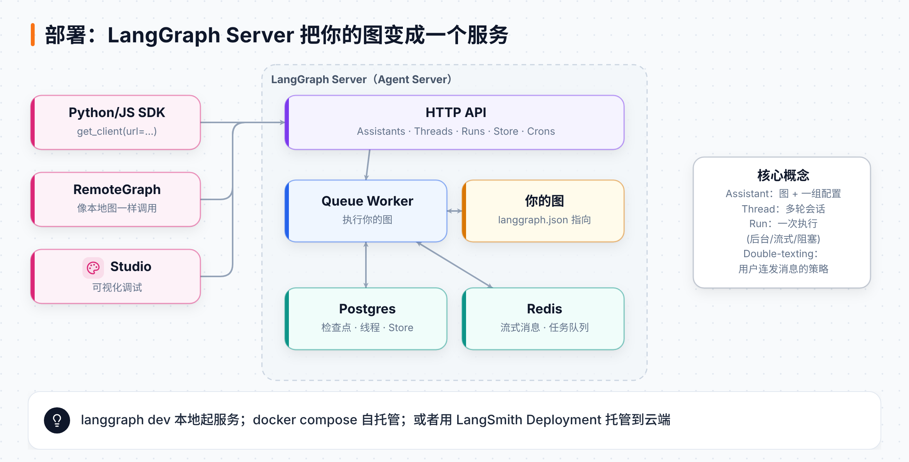

# 第 11 章 部署上线：把图变成服务

> **本章目标**：理解 LangGraph Server 的组成；学会用 SDK 管理 Threads、Runs、Store；用 Assistants 给同一张图做多套配置；了解用户"连发消息"（double-texting）的处理策略。
> **对应课程**：Introduction to LangGraph · Module 6（Creating、Connecting、Double Texting、Assistants），以及 Academy 的 LangSmith Deployment 课程

[← 上一章](10-长期记忆.md) ｜ [返回导读](README.md) ｜ [下一章 →](12-DeepAgents.md)

---

## 11.1 部署后的架构



本地开发时，图跑在你的 Python 进程里。上线后，需要一个**服务**来：接 HTTP 请求、并发执行、保存线程与检查点、支持流式与后台任务。这就是 **LangGraph Server**（文档中也称 Agent Server）。

| 组件 | 作用 |
|---|---|
| HTTP API | 暴露 Assistants / Threads / Runs / Store / Crons 等接口 |
| Queue Worker | 从队列取任务、执行你的图 |
| Postgres | 持久化：检查点、线程、长期记忆 Store、Assistant 配置 |
| Redis | 流式消息的发布订阅、任务队列 |

> 好消息：部署后**不用自己写 checkpointer 和 store**，服务器自动提供（基于 Postgres）。

## 11.2 三种运行方式

| 方式 | 命令 | 适合 |
|---|---|---|
| 本地开发服务器 | `langgraph dev` | 开发调试，配合 Studio |
| 自托管 Docker | `langgraph build -t my-image` + `docker compose up` | 自己的服务器 |
| 云端托管 | LangSmith Deployment（连接 GitHub 仓库一键部署） | 生产环境 |

项目只需要一个 `langgraph.json`：

```json
{
  "dockerfile_lines": [],
  "graphs": { "task_maistro": "./task_maistro.py:graph" },
  "python_version": "3.11",
  "dependencies": ["."]
}
```

课程的自托管示例（`module-6/deployment/`）：

```bash
cd module-6/deployment
langgraph build -t my-image          # 用 LangGraph CLI 构建镜像
docker compose up                    # 启动 redis、postgres、api 三个容器
```

启动后：API 在 `http://localhost:8123`，文档在 `/docs`，Studio 用 `https://smith.langchain.com/studio/?baseUrl=http://127.0.0.1:8123` 打开。

## 11.3 用 SDK 连接

```python
from langgraph_sdk import get_client
client = get_client(url="http://localhost:8123")
```

或者用 **RemoteGraph**，像操作本地图一样操作远程图：

```python
from langgraph.pregel.remote import RemoteGraph
remote_graph = RemoteGraph("task_maistro", url="http://localhost:8123")
remote_graph.invoke({"messages": [...]}, config={"configurable": {"user_id": "Test"}})
```

## 11.4 Runs：一次执行

| 类型 | 写法 | 场景 |
|---|---|---|
| 后台运行（fire and forget） | `client.runs.create(thread_id, graph, input=...)` | 长任务，不想阻塞 |
| 等待完成 | `client.runs.join(thread_id, run_id)` | 后台任务完成后再继续 |
| 流式运行 | `client.runs.stream(..., stream_mode="messages-tuple")` | 聊天界面逐字输出 |

```python
thread = await client.threads.create()
run = await client.runs.create(thread["thread_id"], "task_maistro",
                               input={"messages": [HumanMessage(content="Add a ToDo to finish booking travel to Hong Kong by end of next week.")]},
                               config={"configurable": {"user_id": "Test"}})
print(await client.runs.get(thread["thread_id"], run["run_id"]))   # status: 'pending'
await client.runs.join(thread["thread_id"], run["run_id"])         # 阻塞等待 → 'success'

async for chunk in client.runs.stream(thread["thread_id"], "task_maistro",
                                      input={"messages": [HumanMessage("What ToDo should I focus on first.")]},
                                      config={"configurable": {"user_id": "Test"}},
                                      stream_mode="messages-tuple"):
    if chunk.event == "messages":
        print("".join(d["content"] for d in chunk.data if "content" in d), end="", flush=True)
```

流式的内部机制：HTTP worker 生成 run ID → Queue worker 执行并把更新发布到 Redis → HTTP worker 订阅 Redis 再推给客户端。

## 11.5 Threads：多轮会话

```python
thread_state = await client.threads.get_state(thread["thread_id"])      # 当前状态
copied = await client.threads.copy(thread["thread_id"])                 # 复制（分叉）一个线程
states = await client.threads.get_history(thread["thread_id"])          # 历史检查点
```

第 8 章的所有人在回路能力（断点、编辑状态、时间旅行）在服务器上都可以用：从 `get_history` 找到检查点 → `threads.update_state(...)` 修改 → `runs.stream(..., checkpoint_id=...)` 从新检查点继续。

## 11.6 Store：服务器上的长期记忆

```python
items = await client.store.search_items(("todo", "general", "Test"), limit=5)   # 按命名空间搜
await client.store.put_item(("testing",), key="k1", value={"todo": "Test SDK put_item"})
await client.store.delete_item(("testing",), key="k1")
```

## 11.7 Assistants：一张图，多套配置

**Assistant = 图 + 一组配置**。同一个 `task_maistro` 图，可以创建"个人待办助手"和"工作待办助手"，各自有不同的角色设定和分类，并且支持版本管理。

```python
personal = await client.assistants.create(
    "task_maistro",                                     # 部署时的图名
    config={"configurable": {"todo_category": "personal"}},
)

task_maistro_role = """You are a focused and efficient work task assistant.
Your main focus is helping users manage their work commitments with realistic timeframes. ..."""

work = await client.assistants.create(
    "task_maistro",
    config={"configurable": {"todo_category": "work", "user_id": "lance",
                             "task_maistro_role": task_maistro_role}},
)

for a in await client.assistants.search():
    print(a["assistant_id"], a["config"])
```

图里通过一个 `Configuration` 数据类读取这些字段（`configuration.Configuration.from_runnable_config(config)`），所以不同 Assistant 行为不同、但共用一份代码。课程里"工作助手"在用户没给截止日期时会追问——这完全来自它的角色设定。

## 11.8 Double-texting：用户连发消息怎么办？

用户发了一句，Agent 还没回完，用户又发了一句。LangGraph Server 提供四种策略（`multitask_strategy`）：

| 策略 | 行为 |
|---|---|
| `reject` | 拒绝新请求，直到当前运行结束 |
| `enqueue` | 新请求排队，当前运行结束后再处理 |
| `interrupt` | 中断当前运行（保留已完成的进度），开始处理新请求 |
| `rollback` | 回滚当前运行（像没发生过），处理新请求 |

```python
await client.runs.create(thread["thread_id"], "task_maistro", input=..., multitask_strategy="interrupt")
```

## 📌 本章小结

- `langgraph.json` 声明图在哪里；`langgraph dev` / Docker / LangSmith Deployment 三种运行方式。
- 服务器自带 Postgres（持久化）+ Redis（流式/队列），不用自己配 checkpointer 和 store。
- SDK 核心对象：**Assistant**（配置）、**Thread**（会话）、**Run**（执行）、**Store**（长期记忆）。
- 连发消息用 `multitask_strategy` 控制。

## 🧪 动手练习

1. 把第 6 章的数学 Agent 写进一个 `agent.py`，配好 `langgraph.json`，用 `langgraph dev` 启动并在 Studio 中运行。
2. 用 SDK 创建一个后台 Run，轮询它的状态。
3. 创建两个 Assistant，系统提示词分别要求"用中文回答"和"用英文回答"，对比效果。

[下一章：Deep Agents →](12-DeepAgents.md)
