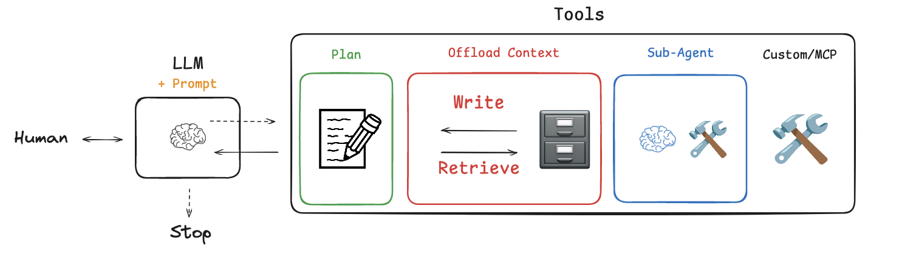
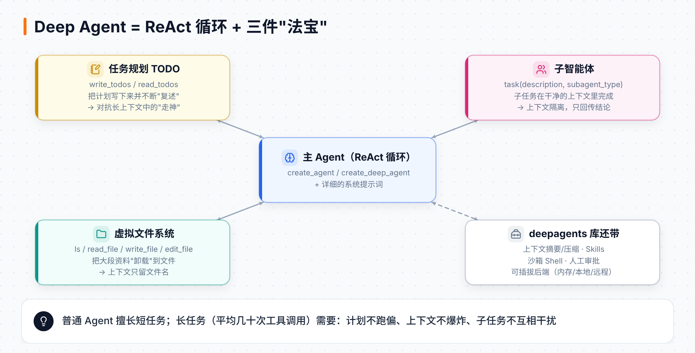
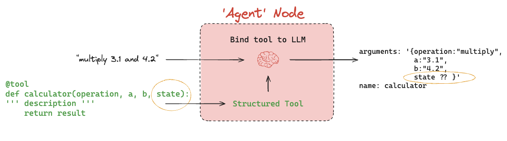
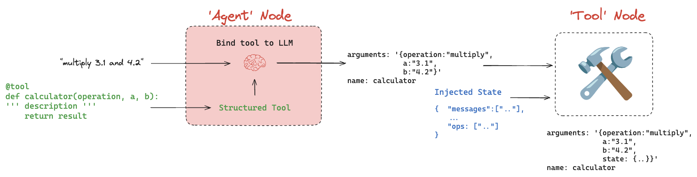
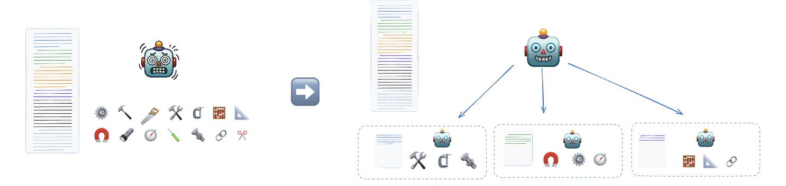
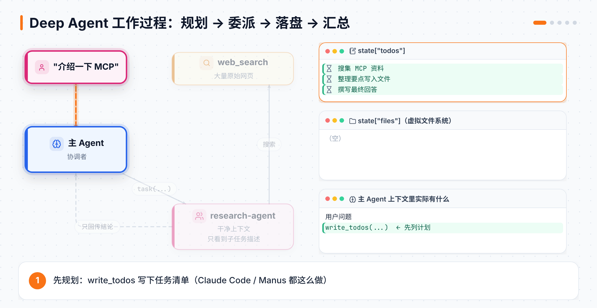

# 第 12 章 Deep Agents：能干"长活"的智能体

> **本章目标**：理解为什么普通 Agent 干不好长任务；从零实现 Deep Agent 的三件法宝——**任务规划、文件系统、子智能体**；最后用官方 `deepagents` 库几行代码得到同样的能力。
> **对应课程**：Deep Agents from Scratch（0_create_agent ~ 4_full_agent）。新版 Introduction to Deep Agents 见第 14–16 章

[← 上一章](11-部署上线.md) ｜ [返回导读](README.md) ｜ [下一章 →](13-LangSmith.md)

---

## 12.1 为什么需要 "Deep" Agent？



深度研究（Deep Research）和编程（Claude Code）是最早爆发的 Agent 场景，现在越来越多通用 Agent 在处理**长任务**：课程引用 Manus 的数据，**平均每个任务约 50 次工具调用**。

长任务会遇到三个问题：

| 问题 | 表现 | 对策 |
|---|---|---|
| **跑偏**（context rot） | 上下文越长，模型越容易忘了最初的目标 | **TODO 规划 + 反复复述** |
| **上下文爆炸** | 搜索结果、网页原文动辄几千 token，塞满窗口 | **文件系统卸载**：大内容写文件，上下文只留文件名 |
| **上下文冲突** | 多个子任务的信息混在一起，互相干扰 | **子智能体隔离**：子任务在干净上下文中完成，只回传结论 |

课程总结：这些正是 Claude Code、Manus、Deep Research 等"深度"Agent 共同的上下文工程（context engineering）模式。



## 12.2 预备知识：让工具读写图的状态

Deep Agent 的 TODO 和文件都存在**图的状态**里，所以工具需要能读写状态。这涉及两个技巧：

### 技巧 1：`InjectedState`——把状态"注入"给工具

如果工具参数里有 `state`，问题来了：模型生成工具调用时，根本不知道 state 是什么，没法填这个参数。



解决：用 `InjectedState` 标注。这个参数**不会出现在发给模型的工具说明里**，而是由工具节点在执行时自动填入。`InjectedToolCallId` 同理，注入当前工具调用的 id。



### 技巧 2：`Command`——工具返回"状态更新"

普通工具只能返回一个结果（变成 ToolMessage）。如果想同时改状态里的其他字段，就返回 `Command(update={...})`，注意 `messages` 里要手动放一条带 `tool_call_id` 的 ToolMessage：

```python
from typing import Annotated, Literal, Union
from langchain_core.messages import ToolMessage
from langchain_core.tools import InjectedToolCallId, tool
from langgraph.prebuilt import InjectedState
from langgraph.types import Command
from langchain.agents import AgentState

def reduce_list(left, right):
    return (left or []) + (right or [])

class CalcState(AgentState):
    ops: Annotated[list[str], reduce_list]       # 记录做过的所有运算

@tool
def calculator_wstate(
    operation: Literal["add", "subtract", "multiply", "divide"],
    a: Union[int, float],
    b: Union[int, float],
    state: Annotated[CalcState, InjectedState],            # ← 模型看不到
    tool_call_id: Annotated[str, InjectedToolCallId],      # ← 模型看不到
) -> Command:
    """Define a two-input calculator tool."""
    result = {"add": a + b, "subtract": a - b, "multiply": a * b, "divide": a / b}[operation]
    ops = [f"({operation}, {a}, {b}),"]
    return Command(update={
        "ops": ops,
        "messages": [ToolMessage(f"{result}", tool_call_id=tool_call_id)],
    })

agent = create_agent(model, tools=[calculator_wstate], system_prompt=SYSTEM_PROMPT, state_schema=CalcState)
```

运行后，结果里除了 `messages` 还多了一个 `ops` 字段，记录每次运算。

## 12.3 法宝一：TODO 任务规划

Claude Code 在执行复杂任务前，会用一个叫 `TodoWrite` 的工具列出任务清单；Manus 会在每完成一步后**重写整个清单**，相当于把目标"复述"到上下文末尾，让模型始终记得自己要干什么。

**状态定义**（课程 `state.py`）：

```python
from typing import Annotated, Literal, NotRequired
from typing_extensions import TypedDict
from langchain.agents import AgentState

class Todo(TypedDict):
    content: str                                          # 简短、具体的任务描述
    status: Literal["pending", "in_progress", "completed"]

def file_reducer(left, right):
    if left is None: return right
    if right is None: return left
    return {**left, **right}                             # 新文件覆盖同名旧文件

class DeepAgentState(AgentState):
    todos: NotRequired[list[Todo]]                       # 无 reducer：每次整体覆盖
    files: Annotated[NotRequired[dict[str, str]], file_reducer]
```

**工具**（课程 `todo_tools.py`）：

```python
@tool(description=WRITE_TODOS_DESCRIPTION, parse_docstring=True)
def write_todos(todos: list[Todo], tool_call_id: Annotated[str, InjectedToolCallId]) -> Command:
    """Create or update the agent's TODO list for task planning and tracking."""
    return Command(update={
        "todos": todos,
        "messages": [ToolMessage(f"Updated todo list to {todos}", tool_call_id=tool_call_id)],
    })

@tool(parse_docstring=True)
def read_todos(state: Annotated[DeepAgentState, InjectedState],
               tool_call_id: Annotated[str, InjectedToolCallId]) -> str:
    """Read the current TODO list from the agent state."""
    todos = state.get("todos", [])
    if not todos:
        return "No todos currently in the list."
    emoji = {"pending": "⏳", "in_progress": "🔄", "completed": "✅"}
    return "Current TODO List:\n" + "\n".join(
        f"{i}. {emoji.get(t['status'], '❓')} {t['content']} ({t['status']})" for i, t in enumerate(todos, 1))
```

设计要点：

- **整体重写**而不是逐条修改：每次重写都给模型一次重新审视计划的机会。
- 工具的长描述放在单独的 `prompts.py` 里（`@tool(description=...)` 时 docstring 不会发给模型），详细说明"什么时候该用、怎么用"。
- 系统提示词里要求：开始时先写 TODO，每完成一项就更新状态。

## 12.4 法宝二：虚拟文件系统（上下文卸载）

用一个字典模拟文件系统：key 是路径，value 是内容，存在状态的 `files` 里。

```python
@tool(description=LS_DESCRIPTION)
def ls(state: Annotated[DeepAgentState, InjectedState]) -> list[str]:
    """List all files in the virtual filesystem."""
    return list(state.get("files", {}).keys())

@tool(description=READ_FILE_DESCRIPTION, parse_docstring=True)
def read_file(file_path: str, state: Annotated[DeepAgentState, InjectedState],
              offset: int = 0, limit: int = 2000) -> str:
    """Read file content from virtual filesystem with optional offset and limit."""
    files = state.get("files", {})
    if file_path not in files:
        return f"Error: File '{file_path}' not found"      # 错误信息是写给模型看的
    lines = files[file_path].splitlines()
    return "\n".join(f"{i + 1:6d}\t{lines[i][:2000]}" for i in range(offset, min(offset + limit, len(lines))))

@tool(description=WRITE_FILE_DESCRIPTION, parse_docstring=True)
def write_file(file_path: str, content: str,
               state: Annotated[DeepAgentState, InjectedState],
               tool_call_id: Annotated[str, InjectedToolCallId]) -> Command:
    """Write content to a file in the virtual filesystem."""
    files = state.get("files", {})
    files[file_path] = content
    return Command(update={
        "files": files,
        "messages": [ToolMessage(f"Updated file {file_path}", tool_call_id=tool_call_id)],
    })
```

用法：搜索工具把几千 token 的网页原文**写进文件**，只把文件名和一段简短摘要返回给模型；模型需要细节时再 `read_file`。这和 Anthropic 多智能体研究系统的做法一致：子智能体把产出存到外部，只把"引用"传回协调者，避免"传话游戏"式的信息失真。

> 这里的虚拟文件系统存在 thread 状态里，属于**线程内**的短期存储，不跨会话。

## 12.5 法宝三：子智能体（上下文隔离）



主 Agent 通过一个 `task(description, subagent_type)` 工具把子任务委派出去。**子智能体只看到任务描述**，看不到主 Agent 的对话历史；完成后，只有最后一条结论作为 ToolMessage 回到主 Agent。

课程 `task_tool.py` 的核心：

```python
class SubAgent(TypedDict):
    name: str
    description: str
    prompt: str
    tools: NotRequired[list[str]]

def _create_task_tool(tools, subagents: list[SubAgent], model, state_schema):
    tools_by_name = {t.name: t for t in tools}
    agents = {
        sa["name"]: create_agent(model, system_prompt=sa["prompt"],
                                 tools=[tools_by_name[t] for t in sa["tools"]] if "tools" in sa else tools,
                                 state_schema=state_schema)
        for sa in subagents
    }
    other_agents = [f"- {sa['name']}: {sa['description']}" for sa in subagents]

    @tool(description=TASK_DESCRIPTION_PREFIX.format(other_agents=other_agents))
    def task(description: str, subagent_type: str,
             state: Annotated[DeepAgentState, InjectedState],
             tool_call_id: Annotated[str, InjectedToolCallId]):
        if subagent_type not in agents:
            return f"Error: invoked agent of type {subagent_type}, the only allowed types are {list(agents)}"
        state["messages"] = [{"role": "user", "content": description}]   # ← 关键：全新的上下文
        result = agents[subagent_type].invoke(state)
        return Command(update={
            "files": result.get("files", {}),                              # 子智能体写的文件合并回来
            "messages": [ToolMessage(result["messages"][-1].content, tool_call_id=tool_call_id)],
        })
    return task
```

注意两个细节：

- 子智能体**共享文件系统**（state 里的 `files` 会传进去、再合并回来），但**不共享对话**。所以子智能体可以把详细资料写进文件，主 Agent 需要时再读。
- 主 Agent 可以在一条消息里发起多个 `task` 调用，工具节点会**并行**执行它们，实现多个子研究同时进行。

## 12.6 合体：完整的深度研究 Agent



课程第 4 课把三件法宝合起来，再加两个研究工具：

| 工具 | 作用 |
|---|---|
| `tavily_search` | 搜索网页，把每个结果的原文**写进文件**，并用模型生成摘要，只把摘要返回 |
| `think_tool` | 让模型"停下来想一想"：反思已有信息、还缺什么、下一步做什么（工具本身只是把思考记录下来） |

组装方式：

```python
from langchain.agents import create_agent

sub_agent_tools = [tavily_search, think_tool]
built_in_tools = [ls, read_file, write_file, write_todos, read_todos, think_tool]

research_sub_agent = {
    "name": "research-agent",
    "description": "Delegate research to the sub-agent researcher. Only give this researcher one topic at a time.",
    "prompt": RESEARCHER_INSTRUCTIONS.format(date=get_today_str()),
    "tools": ["tavily_search", "think_tool"],      # 子智能体按名字挑选工具
}

task_tool = _create_task_tool(sub_agent_tools, [research_sub_agent], model, DeepAgentState)

# 搜索工具也给主 Agent 一份，简单问题可以自己查
all_tools = sub_agent_tools + built_in_tools + [task_tool]

INSTRUCTIONS = (
    "# TODO MANAGEMENT\n" + TODO_USAGE_INSTRUCTIONS + "\n\n" + "=" * 80 + "\n\n"
    + "# FILE SYSTEM USAGE\n" + FILE_USAGE_INSTRUCTIONS + "\n\n" + "=" * 80 + "\n\n"
    + "# SUB-AGENT DELEGATION\n" + SUBAGENT_INSTRUCTIONS
)

agent = create_agent(model, all_tools, system_prompt=INSTRUCTIONS, state_schema=DeepAgentState)
```

一次典型运行：写 TODO → 把原始问题存进文件 → 派子智能体调研 → 子智能体搜索、把原文写文件、反思、回传结论 → 主 Agent 更新 TODO → 读文件 → 写最终回答。

## 12.7 用官方库：`deepagents`

上面这一套，LangChain 已经打包成了开源库 [`deepagents`](https://github.com/langchain-ai/deepagents)（定位是"开箱即用的 Agent 套件 / harness"）：

```bash
uv add deepagents      # 或 pip install deepagents
```

```python
from deepagents import create_deep_agent

agent = create_deep_agent(
    model="openai:gpt-5",                     # 任何支持工具调用的模型
    system_prompt="You are a research assistant.",
)
result = agent.invoke({"messages": "Research LangGraph and write a summary"})
```

**我在本地实测（`deepagents 0.7.28`）**，不传任何工具时，模型收到的内置工具是：

```
['ls', 'read_file', 'write_file', 'edit_file', 'delete', 'glob', 'grep', 'task']
```

（另外文档说明还有 `execute`，在后端支持沙箱时可以执行 shell 命令。）运行后结果里除了 `messages`，还有 `files` 字段，存着 Agent 写的文件（带 `content`、创建/修改时间等元数据）。

> ⚠️ **版本差异提醒**：早期版本和"从零实现"课程里，`write_todos` 是 Deep Agent 的内置工具；在本地实测的 0.7.28 版本中，它已不在默认工具列表里。需要任务规划时，可以给 `middleware` 加上 LangChain 自带的 `TodoListMiddleware`（`from langchain.agents.middleware import TodoListMiddleware`），它会提供 `write_todos` 工具。

**加子智能体**（官方 quickstart 的写法）：

```python
research_sub_agent = {
    "name": "research-agent",
    "description": "Delegate research to the sub-agent researcher. Only give this researcher one topic at a time.",
    "system_prompt": RESEARCHER_INSTRUCTIONS,
    "tools": [tavily_search, think_tool],
}

agent = create_deep_agent(
    model=model,
    tools=[tavily_search, think_tool],
    system_prompt=INSTRUCTIONS,
    subagents=[research_sub_agent],
)
```

`create_deep_agent` 的其它常用参数（来自本地安装版本的函数签名）：

| 参数 | 作用 |
|---|---|
| `backend` | 文件系统后端：默认存在状态里，也可以换成本地磁盘、沙箱、远程存储 |
| `interrupt_on` | 对指定工具开启人工审批（同第 3 章 HITL） |
| `skills` | 按需加载的可复用技能 |
| `memory` | 持久记忆文件 |
| `checkpointer` / `store` | 短期 / 长期记忆（同第 7、10 章） |
| `response_format` | 结构化输出 |

> 三者关系（来自 deepagents 官方 FAQ）：**LangGraph 是图运行时；`create_agent` 是在它之上的最小 Agent 骨架；Deep Agents 是在 `create_agent` 之上更"有主见"的套件**。任何 LangGraph 编译好的图都可以作为子智能体传给 Deep Agent，所以三层可以自由组合。
>
> 安全提示：Deep Agents 遵循"信任模型"的原则——Agent 能做它的工具允许的一切事情。权限边界要在**工具和沙箱层面**强制，而不是指望模型自觉。

## 12.8 Academy 的 Deep Agents 课程地图

本章对应的是 **Deep Agents from Scratch**（从零手写）。Academy 新版的 **Introduction to Deep Agents** 直接用官方 `deepagents` 库，本书在第 14–16 章逐课讲解：

| 模块 | 内容 | 本书 |
|---|---|---|
| Module 0–1 搭建 | 环境准备、运行一个 Deep Agent、模型、系统提示词、工具、MCP、消息/线程/检查点、HITL | 第 14 章 |
| Module 2 环境 | 运行环境、文件系统后端与权限、沙箱与本地 Shell、解释器与 PTC | 第 15 章 |
| Module 3 上下文 | 摘要与卸载、技能、长期记忆 | 第 15 章 |
| Module 4 委派 | 任务清单、子智能体团队、动态子智能体 | 第 16 章 |
| Module 5 综合项目 | 本地部署、Chinook 销售助理、异步子智能体、沙箱进阶版 | 第 16 章 |
| Module 6 托管 | Managed Deep Agents | 第 16 章 |

## 📌 本章小结

| 法宝 | 解决的问题 | 实现要点 |
|---|---|---|
| TODO 规划 | 长任务跑偏 | `write_todos` 整体重写 + 提示词要求反复更新 |
| 文件系统 | 上下文爆炸 | 状态里的 `files` 字典 + `ls/read_file/write_file` |
| 子智能体 | 上下文冲突 | `task` 工具，子智能体用全新 messages，只回传结论 |
| 底层技巧 | 工具读写状态 | `InjectedState`、`InjectedToolCallId`、`Command(update=...)` |

## 🧪 动手练习

1. 用"从零实现"的代码，给研究 Agent 再加一个 `writer-agent` 子智能体，专门负责把研究结果写成报告。
2. 用 `create_deep_agent` 做一个"读书笔记助手"：给它一段长文本，让它分章节写入文件、最后汇总。
3. 打开 LangSmith 追踪，观察主 Agent 和子智能体各自的上下文长度。

[下一章：LangSmith →](13-LangSmith.md)
