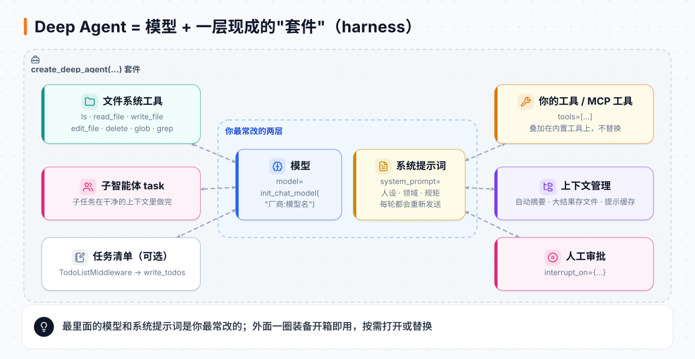
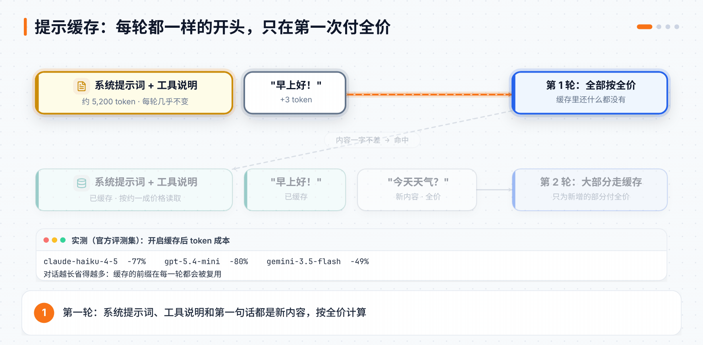
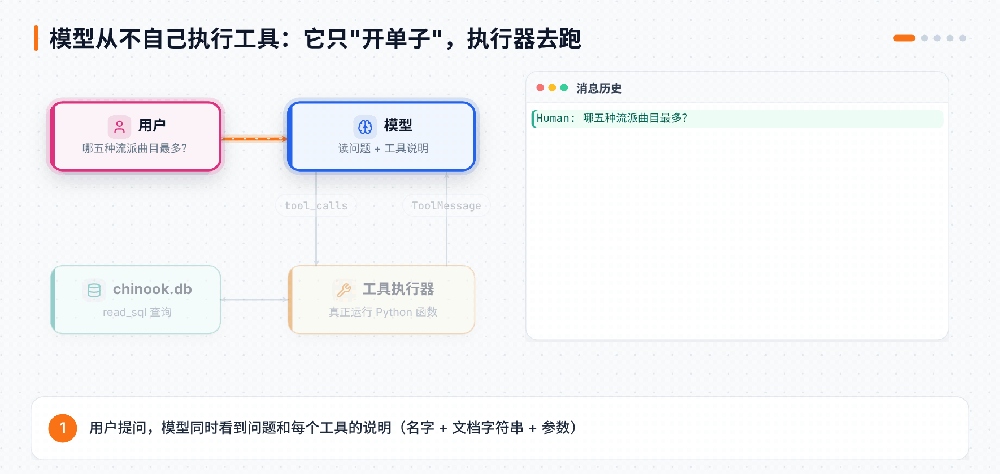
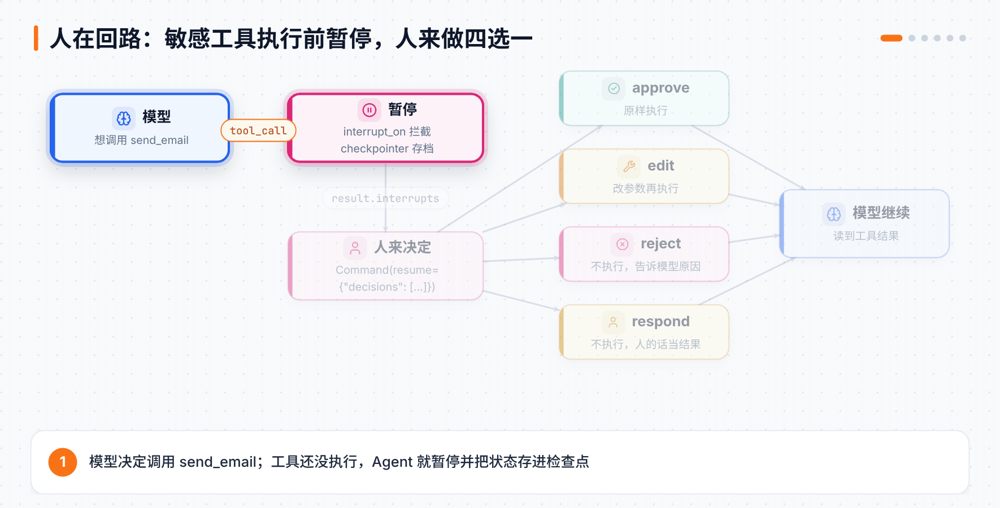

# 第 14 章 Deep Agents 上手：用官方套件搭一个 Agent

> **本章目标**：用官方 `deepagents` 库，从一行代码的最小 Agent 出发，一步步加上模型切换、系统提示词、自定义工具、MCP 工具、多轮记忆和人工审批。读完你能看懂一个 Deep Agent 的每一层，也知道每一层该改哪里。
> **对应课程**：Introduction to Deep Agents · 开课准备 + Module 1「Building a Deep Agent」（Overview、Running a Deep Agent、Models、The System Prompt、Tools、MCP、Messages/Threads/Checkpointers、HITL、Test Your Skills）

[← 上一章](13-LangSmith.md) ｜ [返回导读](README.md) ｜ [下一章 →](15-DeepAgents运行环境与上下文.md)

---

> 💡 **第 12 章和这三章是什么关系？** 第 12 章带你**从零手写**了 Deep Agent 的三件法宝，目的是看懂原理。第 14–16 章跟着 Academy 新版的 **Introduction to Deep Agents** 课程，直接用官方 `deepagents` 库干活：本章搭起一个 Agent，第 15 章讲它的运行环境和上下文管理，第 16 章讲子智能体、综合项目和部署。没读过第 12 章也能直接读本章。

## 14.1 Deep Agent 是什么？

一句话：**Deep Agent = 一个在循环里调用工具的大模型 + 一套现成的"装备"**。

普通 Agent（第 1 章的 `create_agent`）只有"模型 + 工具 + 循环"。Deep Agent 在外面又套了一层**套件（harness）**，开箱就带好这些东西：

| 装备 | 作用 | 本书哪里讲 |
|---|---|---|
| 系统提示词 | 每次调用模型都会带上的说明书 | 14.5 |
| 文件系统工具 | `ls`、`read_file`、`write_file` 等，给 Agent 一块草稿纸 | 14.6、第 15 章 |
| 子智能体 `task` | 把子任务交给一个上下文干净的"小助手" | 第 16 章 |
| 上下文压缩 | 对话太长时自动摘要、大结果自动存文件 | 第 15 章 |
| 任务清单（可选） | `write_todos`，长任务不跑偏 | 第 16 章 |



图里最里面两层（**模型**和**系统提示词**）是你最常改的地方，所以本章从它们开始。

> ⚠️ **版本提醒**：从 `deepagents 0.7` 开始，`write_todos` 不再默认开启，需要时手动加 `TodoListMiddleware`（第 16 章）。课程仓库固定在 `deepagents==0.7.0`，本章代码用 `deepagents 0.7.29` 本地实测过，两者行为一致的地方不再单独说明。

## 14.2 准备环境

课程的全部代码在官方仓库 [langchain-ai/lca-deepagents](https://github.com/langchain-ai/lca-deepagents) 里，Python 版在 `python/` 目录：

```bash
git clone --depth 1 https://github.com/langchain-ai/lca-deepagents.git
cd lca-deepagents/python
cp .env.example .env      # 填入 API Key
uv sync                   # 安装依赖
```

`.env` 里至少要填两个：

```bash
LANGSMITH_API_KEY=lsv2_...      # 追踪，课程每一课都会让你去 LangSmith 看运行过程
LANGSMITH_TRACING=true
LANGSMITH_PROJECT=lca-deepagents
ANTHROPIC_API_KEY=...           # 课程默认用 Claude Haiku 4.5，也可以换别家
# TAVILY_API_KEY=...            # 可选：第 16 章的联网搜索实验要用
```

课程里所有脚本都从同一个文件 `python/models.py` 取模型：

```python
# python/models.py（节选）
from langchain.chat_models import init_chat_model

model = init_chat_model("anthropic:claude-haiku-4-5", timeout=60, max_retries=2)   # 默认：快、便宜
strong_model = init_chat_model("anthropic:claude-sonnet-5-5", timeout=120, max_retries=2)  # 需要更强推理时用
```

想换模型，只改这一个文件。运行脚本时一定用 `uv run`，否则会找不到依赖：

```bash
uv run ./m1/m1.2_scratch_agent.py
```

## 14.3 第一个 Deep Agent：一行就够

```python
from deepagents import create_deep_agent
from models import model

agent = create_deep_agent(model=model)

result = agent.invoke({"messages": [{"role": "user", "content": "What is an LLM?"}]})
print(result["messages"][-1].text)
```

三件事值得记住：

1. **输入**是一个普通的聊天消息列表，和第 1 章一模一样。
2. **回答**是返回结果里 `messages` 的最后一条。
3. `.text` 拿到纯文本；`.content` 拿到原始内容块。如果模型会"思考"（返回 thinking 块），思考内容就在 `.content` 里。

**我在本地实测**（用假模型代替真模型，见第 0 章），返回结果的键是 `['messages', 'files']`。多出来的 `files` 就是 Agent 的文件系统，第 15 章细讲。模型收到的内置工具是：

```
['ls', 'read_file', 'write_file', 'edit_file', 'delete', 'glob', 'grep', 'task']
```

一个工具都没写，Agent 已经能读写文件、搜索文件、派子智能体了。这就是"套件"的意思。

## 14.4 模型：换一行，换一个大脑

`init_chat_model("厂商:模型名")` 能连上 LangChain 支持的 50 多家模型厂商。换前缀就换厂商，换后缀就换模型，Agent 的其余代码一行都不用动。

| 类别 | 适合 | 例子 |
|---|---|---|
| 商用对话模型 | 日常对话、听指令、通用任务 | Claude Haiku / Sonnet、GPT 系列、Gemini Flash |
| 推理模型 | 多步推理、数学、代码 | Claude Opus、o3、Gemini Pro |
| 开源 / 开放权重 | 本地或私有部署，便宜、可控 | Llama、Mistral、Qwen |

课程演示了两种用开源模型的办法：

- **OpenRouter**：免费调用托管的开源模型（课程用的是 `nvidia/nemotron-3-ultra-550b-a55b:free`），在 `.env` 加 `OPENROUTER_API_KEY` 即可。注意：免费接口通常意味着你的数据可能被拿去训练，不要发敏感内容。
- **Ollama**：完全在本机跑，不需要 API Key：

```bash
ollama pull qwen2.5:7b
```

```python
model = init_chat_model("ollama:qwen2.5:7b")
```

> ⚠️ **小模型干不好 Deep Agent 的活。** Deep Agent 非常依赖"稳定地调用工具"和"听系统提示词的话"。如果本地小模型不调工具、乱转圈、无视提示词，多半是模型能力不够，不是你配错了。课程给的内存参考：7B 约 8GB、14B 约 16GB、32B 约 24GB 以上、70B 约 64GB。

## 14.5 系统提示词：一段话决定它是谁

系统提示词是**每次调用模型都会重新发送**、排在对话最前面的那段话。用 `system_prompt` 参数传进去：

```python
SYSTEM_PROMPT = (
    "你是一位老派英国管家，说话极其讲究礼数，"
    "称呼用户为'先生/女士'。"
)

agent = create_deep_agent(
    model=model,
    system_prompt=SYSTEM_PROMPT,   # ← 一定要传进去，只定义变量是不起作用的
    name="butler_agent",
)
```

> ⚠️ **0.7 版的变化**：`create_deep_agent` 不再自带一大段默认提示词。你不传 `system_prompt`，模型就**完全不知道**你的人设、领域和规矩。对某些模型（比如 `claude-haiku-4-5`），套件会在你的提示词**后面**补一小段针对该模型的工具使用建议，但不会涉及你的任务。我用假模型实测，不传 `system_prompt` 时系统消息是空的；传了之后，系统消息就以你写的那段话开头。

系统提示词有两种典型用法：

| 用法 | 例子 | 效果 |
|---|---|---|
| **人设** | "你是海盗船长，说话带'啊哈'" | 只改语气，不改能力 |
| **限定领域** | "你只回答室内植物养护问题，其他问题礼貌拒绝并引导回来" | 让 Agent 不跑题 |

第二种就是真实公司客服机器人的做法。LangChain 自己的客服机器人 [Chat LangChain](https://chat.langchain.com) 就在系统提示词里写明"只回答 LangChain 生态的问题"。不加这句，客服机器人会很热心地帮用户写和业务毫无关系的代码。

### 提示缓存：同样的开头，只付一次全价

Agent 每一轮都要把**系统提示词 + 全部工具说明**重新发给模型，这部分几乎不变。**提示缓存（prompt caching）**让模型厂商复用上次算过的结果，重复的部分按很低的价格计费。



Deep Agents 会**自动**帮你用好缓存：

- 厂商支持"缓存断点"（如 Anthropic、Gemini）时，自动在系统消息末尾和最后一个工具说明上打标记，意思是"到这里为止都缓存起来"。
- 厂商只支持自动缓存（如 OpenAI 按最长相同前缀缓存）时，就把提示词排成最容易命中缓存的顺序。

课程用 Deep Agents 的评测集跑了三家的中档模型，**开启缓存后 token 成本降了 49%–80%**：

| 模型 | 成本降低 |
|---|---|
| `claude-haiku-4-5` | -77% |
| `gpt-5.4-mini` | -80% |
| `gemini-3.5-flash` | -49% |

缓存是**按内容**认的，不是按会话认的。课程的实验是：把同一个脚本**连续运行两次**，第二次在 LangSmith 里点开模型调用，看 `usage` 字段，会发现大部分输入 token 是"从缓存读取"。对话越长，省得越多。

## 14.6 工具：给 Agent 一双手

工具就是你交给 Agent 的函数。**你决定它能做什么，Agent 决定什么时候用、传什么参数。**

### 内置工具

每个 Deep Agent 自带这些工具：

| 工具 | 作用 |
|---|---|
| `ls`、`read_file`、`write_file`、`edit_file`、`delete` | 在工作目录里读、写、改、删文件 |
| `glob`、`grep` | 按文件名模式或内容搜索 |
| `execute` | 运行 shell 命令（只有后端支持时才出现，第 15 章） |
| `task` | 把任务交给子智能体，子智能体有独立的上下文（第 16 章） |

> ⚠️ `delete` **不可撤销，而且会递归删除**：删一个目录会把里面所有东西一起删掉。工作目录给得越大，越要小心。

一个小细节：`read_file` 现在不再给每一行编号，而是用 `@@ lines 1-2 of 2 @@` 这样的标记包住返回的内容。官方评测显示，这样让 `edit_file` 的出错率降低了 15%，输入 token 减少了 10%。

### 自己写工具：`@tool`

`tools` 参数是**叠加**的：你传进去的工具和内置工具合在一起，不会替换掉内置工具。

```python
from pathlib import Path
from langchain_community.utilities import SQLDatabase
from langchain_core.tools import tool
from deepagents import create_deep_agent
from models import model

DB_PATH = Path(__file__).parent / "chinook.db"     # Chinook：经典的音乐商店示例数据库
db = SQLDatabase.from_uri(f"sqlite:///{DB_PATH}")

SYSTEM_PROMPT = """You are a SQL analyst with access to the Chinook music store database.

Rules:
- Use read_sql for SELECT queries.
- Do not modify the database.
- If a tool returns an error, revise the SQL and try again.
- Show your SQL in your final answer.
"""

@tool
def read_sql(query: str) -> str:
    """Run a read-only SELECT query against the Chinook music store database."""
    try:
        return str(db.run(query))
    except Exception as e:
        return f"Error: {e}"

agent = create_deep_agent(model=model, name="SQL_Agent", tools=[read_sql], system_prompt=SYSTEM_PROMPT)
result = agent.invoke({"messages": [{"role": "user", "content": "Which five genres have the most tracks?"}]})
print(result["messages"][-1].text)
```

**本地实测**：加了 `read_sql` 之后，模型收到的工具列表变成 `[…8 个内置工具…, 'read_sql']`，一个内置工具都没少。

写工具时记住三点：

1. **文档字符串最重要**。模型就是看它、再看工具名和参数，来决定要不要用这个工具。写成一句清楚、具体的话。
2. **返回字符串**（或能转成 JSON 的东西）。它会变成一条 `ToolMessage` 回到模型那里。
3. **工具报错时返回错误文字**，不要直接抛异常。上面的提示词写了"出错就改 SQL 重试"，模型看到 `Error: ...` 才能自己纠正。

### 模型从不自己执行工具



模型只会输出一条带 `tool_calls` 的 `AIMessage`，意思是"我想调用这个工具，参数是这些"。真正执行函数的是 Agent 里的**工具执行器**，它把结果包成 `ToolMessage` 送回模型，模型再根据结果写最终回答。

`tool_calls` 是一个**列表**：模型可以一次要求调用好几个互不相关的工具，执行器会**同时**运行它们。课程的练习是问一句"哪些流派的曲目最多？哪个员工经手的发票最多？"，然后在 LangSmith 里看两次查询是不是并行的。

> 💡 工具不只能"查"，还能"做"：写数据库、发消息、建工单、删文件。这类**有副作用**的工具一定要加安全阀，就是 14.9 节的人工审批。

## 14.7 MCP：接上别人写好的工具

第 2 章讲过 MCP（Model Context Protocol）：一个开放协议，让任何支持 MCP 的程序都能用同一种方式接入别人提供的工具。Deep Agent 接 MCP 的写法和普通 Agent 完全一样：

```python
import asyncio
from deepagents import create_deep_agent
from langchain_mcp_adapters.client import MultiServerMCPClient
from models import model

ALLOWED = {"search_docs_by_lang_chain"}          # 白名单：只放行这一个工具

async def main():
    client = MultiServerMCPClient({
        "docs-langchain": {"transport": "http", "url": "https://docs.langchain.com/mcp"},
    })
    tools = await client.get_tools()             # 服务器上有 2 个工具
    tools = [t for t in tools if t.name in ALLOWED]
    agent = create_deep_agent(model=model, tools=tools)
    result = await agent.ainvoke({"messages": [{"role": "user", "content":
        "Use the LangChain docs MCP tool to explain what MCP is and how LangChain uses MCP tools."}]})
    print(result["messages"][-1].text)

asyncio.run(main())
```

`langchain-mcp-adapters` 会把每个 MCP 工具包装成普通的 LangChain 工具，**Agent 根本分不出哪个是 MCP 工具、哪个是你自己写的**。

**传输方式（transport）怎么选：**

| 写法 | 含义 | 什么时候用 |
|---|---|---|
| `"stdio"` | 把服务器当本地子进程启动，用标准输入输出通信 | 本地工具；要写 `command` 和 `args`，不写 `url` |
| `"http"` / `"streamable_http"` | 当前标准的远程传输（两种写法等价） | 远程服务器，首选 |
| `"sse"` | 老的远程传输，2025-03-26 版规范起已弃用 | 只在对接没升级的老服务器时用 |

默认情况下，`MultiServerMCPClient` **每次调用工具都新开一个会话**，用完就关。如果服务器是有状态的，用 `client.session("名字")` 保持连接。

**白名单还是黑名单？** `get_tools()` 会返回服务器上的**全部**工具。上面的例子用白名单，Agent 根本不知道另一个工具存在。想要大部分工具、只排除几个，就用黑名单：`[t for t in tools if t.name not in BLOCKED]`。

### 选学：需要登录的 MCP 服务器

有些 MCP 服务器（比如 GitHub 的）要用户先登录授权。思路很简单：在服务器配置里加一个 `auth`，由它负责拿到凭证并附在每个请求上。

```python
client = MultiServerMCPClient({
    "github": {"transport": "streamable_http", "url": MCP_URL, "auth": auth_provider},
})
async with client.session("github") as session:   # OAuth 需要会话一直开着
    tools = await load_mcp_tools(session)
    agent = create_deep_agent(model=model, tools=tools)
```

课程的选学实验把 GitHub 的 OAuth 流程拆成三步，各写成一个小程序：

1. **探路**：不带凭证访问服务器，收到 `401`，响应头里会指出去哪里授权、支持哪些权限范围。
2. **拿授权码**：打开浏览器让用户同意，用 **PKCE** 保护授权码。程序先生成一个只留在本地的密钥，只把它的哈希值发出去；就算授权码在浏览器里泄露，没有原始密钥也换不到令牌。
3. **换令牌**：拿授权码 + 密钥去换访问令牌，之后的请求都带上 `Authorization: Bearer ...`。

> 💡 这个实验要在**本机**终端跑：回调地址是 `127.0.0.1:8765`，在云端开发环境里浏览器的跳转到不了那台机器。

## 14.8 消息、线程和检查点：让它记住上一轮

默认情况下，每次 `invoke` 都是一次全新的对话。要让 Agent 跨多次调用记住内容，需要三样东西：

| 概念 | 是什么 | 类比 |
|---|---|---|
| **消息** | `HumanMessage`、`AIMessage`、`ToolMessage` 组成的对话历史 | 聊天记录 |
| **线程**（`thread_id`） | 一段对话的编号 | 聊天窗口 |
| **检查点**（checkpointer） | 按线程保存对话状态的存储 | 存放所有聊天窗口的柜子 |

```python
from langgraph.checkpoint.memory import MemorySaver

agent = create_deep_agent(model=model, checkpointer=MemorySaver())

thread_a = {"configurable": {"thread_id": "a"}}
thread_b = {"configurable": {"thread_id": "b"}}

agent.invoke({"messages": [{"role": "user", "content": "记住：我最喜欢蓝色。"}]}, config=thread_a)
agent.invoke({"messages": [{"role": "user", "content": "我最喜欢什么颜色？"}]}, config=thread_a)  # 记得：蓝色
agent.invoke({"messages": [{"role": "user", "content": "我最喜欢什么颜色？"}]}, config=thread_b)  # 不知道
```

**本地实测**：线程 a 的第二轮，模型看到了上一轮的问答加这一轮的问题，一共 3 条对话消息；线程 b 只看到这一轮的 1 条用户消息。

几个要点：

- `thread_id` 只是个**地址**，真正存东西的是检查点。一个检查点能同时存很多线程。
- 换一个**新的** `MemorySaver()`，同一个 `thread_id` 也是一片空白，因为记忆存在检查点对象里，不在 id 字符串里。
- `MemorySaver()` 只存在当前 Python 进程的内存里，进程一退出就没了。生产环境换成 `PostgresSaver` 等持久化检查点，`checkpointer=` 这个参数的写法不变（第 7 章 7.7 节）。
- 想让记忆**跨线程**共享（比如记住用户偏好），检查点做不到，要用 Store，第 15 章 15.8 节讲。

### 时间旅行：回到过去重新来

检查点会保存**每一步**的快照，不只是最新的那份：

```python
history = list(agent.get_state_history(thread_a))   # 最新的在最前面：history[0] 是现在
older = history[1]                                   # 往回退一步

agent.invoke(
    {"messages": [{"role": "user", "content": "其实我改主意了，是绿色。"}]},
    config=older.config,                             # 从那个时间点继续，开出一条新分支
)
```

> ⚠️ `get_state_history` 返回的是**生成器**，不是列表（本地实测也是如此），要先用 `list(...)` 包一下才能用下标。从旧快照继续时，新的检查点会加进历史，旧的一个都不会删。

这招可以用来纠正走错的一步、从同一个起点试不同的回答，或者查看 Agent 在某一步时到底是什么状态。第 8 章 8.5 节用纯 LangGraph 讲过同样的机制。

## 14.9 人在回路：危险操作先问人

Agent 要发邮件、改数据库、删文件之前，你可能想先看一眼。**人在回路（Human-in-the-Loop，HITL）**就是在敏感工具**执行之前**暂停，让人来决定。



需要四样东西：

| 部件 | 作用 |
|---|---|
| `interrupt_on` | 写明哪些工具执行前要人审核 |
| `checkpointer` | 保存暂停时的状态，没有它就没法恢复 |
| `thread_id` | 恢复时用同一个 id，找回那次暂停 |
| `Command(resume=...)` | 带着人的决定继续运行 |

### 四种决定

| 决定 | 含义 | 例子 |
|---|---|---|
| `approve` 批准 | 按模型给的参数执行 | 邮件草稿没问题，照发 |
| `edit` 修改 | 改了参数再执行 | 把收件人改一下再发 |
| `reject` 拒绝 | 不执行，把拒绝理由告诉模型 | 不许删这个文件，并说明原因 |
| `respond` 代答 | 不执行，把人的回答直接当成工具结果 | 模型调用 `ask_user("预算多少？")`，人输入"500 元" |

> ⚠️ **拦住有副作用的工具要用 `reject`，不要用 `respond`。** `respond` 的内容会被模型当成"工具成功返回的结果"，模型可能以为邮件已经发出去了。`respond` 只适合 `ask_user` 这种"人的回答就是结果"的工具。
>
> 修改参数时**改得越少越好**。改动太大，模型可能重新规划，甚至把工具再调用一遍。

### 代码：审核一封邮件

```python
from langchain_core.tools import tool
from langgraph.checkpoint.memory import MemorySaver
from langgraph.types import Command
from deepagents import create_deep_agent
from models import model

@tool
def send_email(to: str, subject: str, body: str) -> str:
    """Send an email to a recipient."""
    return f"Email sent to {to} with subject {subject!r}. Body: {body}"   # 演示用，不会真的发

agent = create_deep_agent(
    model=model,
    tools=[send_email],
    interrupt_on={"send_email": True},     # 调用 send_email 之前暂停
    checkpointer=MemorySaver(),            # 必须有：暂停的状态要存起来
)

config = {"configurable": {"thread_id": "hitl-demo"}}
result = agent.invoke(
    {"messages": [{"role": "user", "content": "给 jane@example.com 发封邮件，说我会晚到 10 分钟。"}]},
    config=config,
    version="v2",                          # v2：返回值带 .interrupts 和 .value
)

while result.interrupts:                   # 有待审核的操作
    pending = result.interrupts[0].value
    decisions = []
    for req in pending["action_requests"]:
        print(f"待审核：{req['name']}", req["args"])
        choice = input("approve / edit / reject？").strip().lower()
        if choice == "approve":
            decisions.append({"type": "approve"})
        elif choice == "edit":
            new_args = {**req["args"], "body": input("新的正文：")}
            decisions.append({"type": "edit", "edited_action": {"name": req["name"], "args": new_args}})
        else:
            decisions.append({"type": "reject", "message": "用户拒绝了这封邮件。"})
    result = agent.invoke(Command(resume={"decisions": decisions}), config=config, version="v2")

print(result.value["messages"][-1].text)
```

**本地实测**三条路径的结果：

| 决定 | 工具返回给模型的内容 | `status` |
|---|---|---|
| approve | `Email sent to jane@example.com with subject '迟到'...` | success |
| edit | 先提醒模型"人类审核者在执行前替换了这次调用，不要再按原参数调用一次"，再附上用新正文发送的结果 | success |
| reject | `User rejected the tool call for send_email with reason: 用户拒绝` | error |

暂停时 `result.interrupts[0].value` 里有两样东西：`action_requests`（模型想调用什么、参数是什么）和 `review_configs`（每个工具允许哪些决定）。实测 `interrupt_on={"send_email": True}` 时，允许的决定是 `approve / edit / reject / respond` 四种都可以。

### 代码：先问清楚再动手（`respond`）

如果模型需要先问你一个问题，就给它一个 `ask_user` 工具，并且**只允许 `respond`**：

```python
@tool
def ask_user(question: str, choices: list[str]) -> str:
    """Ask the user a clarifying question with a fixed set of choices."""
    return f"[No response recorded for: {question}]"   # 永远不会真正执行

agent = create_deep_agent(
    model=model,
    tools=[ask_user, send_email],
    interrupt_on={
        "ask_user": {"allowed_decisions": ["respond"]},
        "send_email": {"allowed_decisions": ["approve", "edit", "reject"]},
    },
    checkpointer=MemorySaver(),
)
# 恢复时：decisions.append({"type": "respond", "message": "请求延期"})
```

**本地实测**：用 `respond` 回答"请求延期"后，`ask_user` 的工具结果就是 `请求延期` 这几个字；如果对 `ask_user` 传 `approve`，会直接报错 `Decision type 'approve' is not allowed for tool 'ask_user'`。

为什么不在系统提示词里写"先问用户"就好？因为提示词只能**引导**模型，它仍可能跳过问题，或者用一段散文来问。`allowed_decisions=["respond"]` 是**框架强制**的：只要调用就一定暂停，而且问题和选项是结构化的，前端可以放心地把它画成按钮或下拉框。课程用 `questionary` 库在终端里画了一个上下键选择的菜单。

> 💡 **延伸**：每次都让人审核太慢。课程推荐的一篇文章介绍了用一个专门回答"是/否、打分"这类窄问题的小模型，自动判断工具调用有没有风险，只把可疑的交给人。

## 14.10 Module 1 的综合练习：评委人设

课程第一模块的最后一课是个小游戏：终端里答 8 道题，Agent 用**你写的评委人设**给你打分，匹配一款 LangChain 产品，画出 ASCII 结果卡片，最后起草一条"晒结果"的帖子，**发帖前暂停等你批准**。它把本章内容串了起来：系统提示词（评委人设）、工具（渲染卡片、发帖）、HITL（发帖前审核），选做题还要接一个 MCP 服务器。代码在 `python/m1/Practice/` 里。

## 📌 本章小结

| 你想做的事 | 改哪里 | 关键写法 |
|---|---|---|
| 换模型 | `models.py` 一行 | `init_chat_model("厂商:模型名")` |
| 定人设、限领域 | 系统提示词 | `create_deep_agent(system_prompt=...)` |
| 省 token | 什么都不用做 | 套件自动打缓存断点 |
| 加能力 | 工具 | `@tool` + `tools=[...]`（叠加在内置工具上） |
| 接现成工具 | MCP | `MultiServerMCPClient` + 白名单过滤 |
| 多轮记忆 | 检查点 + 线程 | `checkpointer=MemorySaver()` + `thread_id` |
| 回到过去 | 检查点历史 | `list(agent.get_state_history(cfg))` |
| 危险操作先问人 | HITL | `interrupt_on` + `Command(resume={"decisions": [...]})` |

## 🧪 动手练习

1. **限定领域**：写一个只回答一个领域（做菜、养花、复古游戏都行）的系统提示词，分别问一个领域内和领域外的问题，看拒绝有没有生效。
2. **自己的工具**：用一个 Python 字典当"数据库"，写一个查资料的 `@tool`（比如你喜欢的乐队的专辑列表），再给 Agent 一个人设，要求回答前必须先查工具。
3. **换一个 MCP 服务器**：接 DeepWiki（`https://mcp.deepwiki.com/mcp`）这类免登录的公开服务器，过滤出一个工具，问一个适合它的问题。
4. **证明记忆在检查点里**：同一个 `thread_id`，先用旧的 `MemorySaver` 问，再新建一个 Agent 配一个全新的 `MemorySaver` 问同样的问题，对比结果。
5. **给自己的动作工具加审批**：写一个"订会议室"或"下订单"的工具，配上 `interrupt_on`，分别走一遍批准和拒绝。

[下一章：Deep Agents 的运行环境与上下文 →](15-DeepAgents运行环境与上下文.md)
