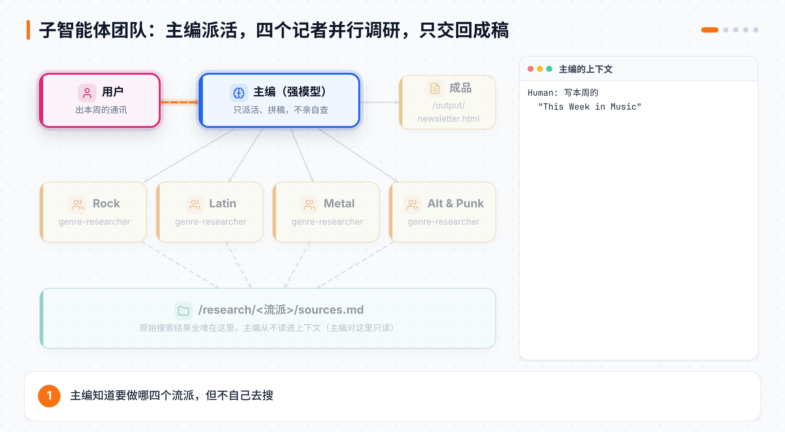
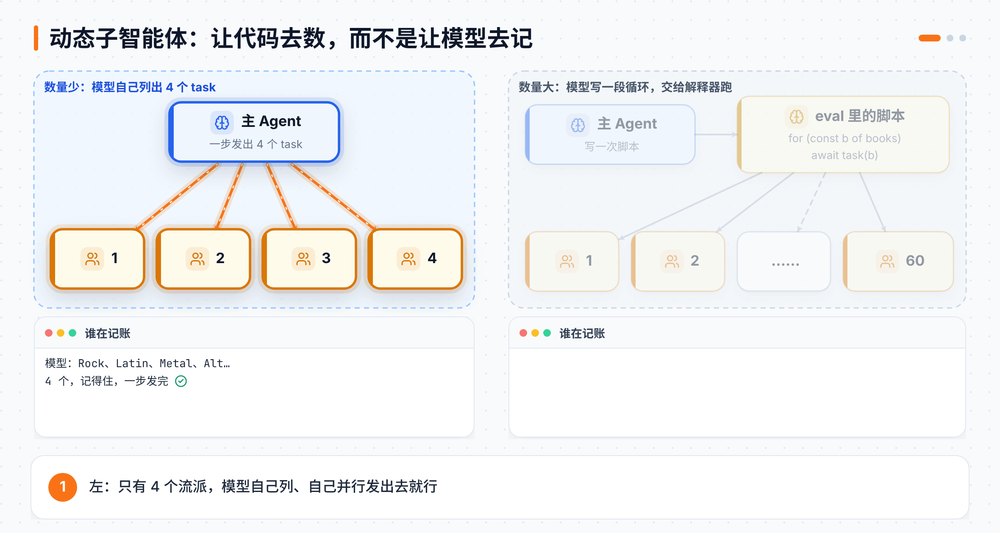
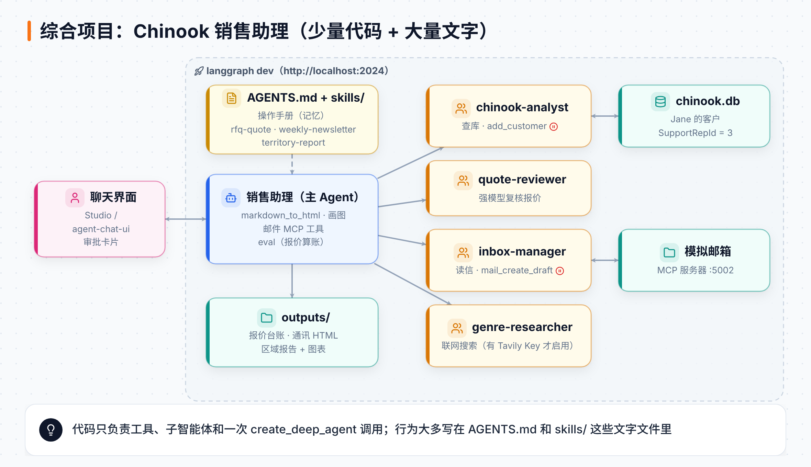
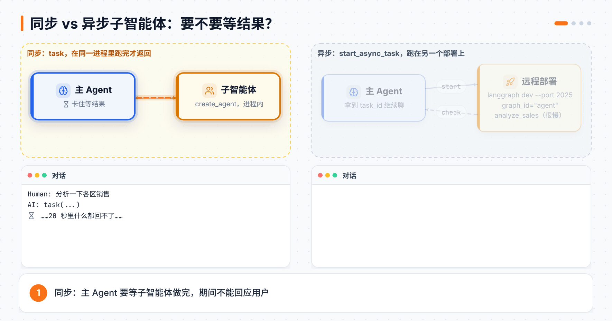

# 第 14 章 Deep Agents 的委派、综合项目与部署

> **本章目标**：学会让主 Agent "带团队"：用任务清单管住自己，用子智能体把脏活累活分出去，任务成百上千时让代码去派活，慢活交给后台异步跑。最后把整门课的所有零件拼成一个真实的销售助理，部署成一个能用浏览器聊天的服务，并了解托管版 Managed Deep Agents。
> **对应课程**：Introduction to Deep Agents · Module 4「Delegation」（Delegation、Building a Subagent Team、Dynamic Subagents）+ Module 5「Putting It All Together」（Local Deployment、The Sales Assistant、Async Subagents、Sales Assistant Advanced）+ Module 6「Managed Deep Agents」

[← 上一章](13-DeepAgents运行环境与上下文.md) ｜ [返回导读](README.md) ｜ [下一章 →](15-LangSmith追踪与评估.md)

---

## 14.1 规划：给主 Agent 一块白板

能力强的模型很会**列计划**，难的是**照着做完**。对话一长、工具调用一多，它就容易忘了哪些做完了、哪些还没做。

Deep Agents 的办法是 `write_todos` 工具。0.7 起它**不再默认开启**，要手动加 `TodoListMiddleware`：

```python
from langchain.agents.middleware import TodoListMiddleware
from deepagents import create_deep_agent

agent = create_deep_agent(
    model=model,
    tools=[...],
    middleware=[TodoListMiddleware()],
)
```

实测加上后，模型的工具列表末尾多了 `write_todos`。每条待办有三种状态：`pending`（还没开始）、`in_progress`（正在做）、`completed`（做完了）。清单存在 Agent 的状态里，配上检查点和同一个 `thread_id`，下一轮还在。

把它想成写在白板上的步骤，做完一项划掉一项。注意：**规划不是委派**，它只是主 Agent 管住自己的手段。

## 14.2 委派：子智能体是什么

一个项目太大时，人类的做法是组团队：主管拆任务、分给专人、最后汇总；每个人带着自己的专长和工具；大家**并行**干活；每个人只管自己那块，不必把整个计划装在脑子里。

**子智能体（subagent）**就是把这套搬到 Agent 上。它是一个完整的 Agent，可以有自己的系统提示词、工具、技能，甚至用不同的模型。主 Agent 通过内置的 **`task` 工具**调用它，在主 Agent 看来，委派就和调用普通工具一样。

### 上下文隔离：子智能体最大的价值

| 方向 | 发生了什么 |
|---|---|
| 进去 | 子智能体只收到**一条**任务消息，**看不到**主 Agent 的对话历史 |
| 中间 | 它自己跑完所有步骤，搜索、读写文件、调工具，全在它自己的上下文里 |
| 出来 | 只交回**一条**最终结果。每次 `task` 都是全新的一次运行，不记得上一次 |

所以一大堆乱七八糟的中间过程被压成了一条干净的结果，主 Agent 的上下文始终只用来协调。如果某个子智能体有几十个专用工具（比如一个数据库专家），这些工具的说明也全都不会出现在主 Agent 的上下文里。

> 🎬 课程里的比喻：《穿普拉达的女王》里，米兰达只要结果，不想听安迪是怎么办到的。子智能体就是安迪：脏活累活自己干，只把米兰达需要知道的交上去。

两者之间唯一的"共享通道"是文件系统等共享状态：子智能体写的文件，主 Agent 能看到。

> 🆕 **fork 模式（实验性，0.7.12 起）**：默认子智能体只看到任务描述。在子智能体配置里加 `"mode": "fork"`，它就能看到父 Agent 到目前为止的对话，并使用父 Agent 的系统提示词。适合"刚才讨论的计划，帮我审一下"这种很难写进任务描述的场景，代价是子智能体的上下文变大，而且不能单独设置自己的 `skills`。

### 什么时候用子智能体

| ✅ 适合用 | ❌ 不必用 |
|---|---|
| 一个多步骤任务会把主 Agent 的上下文弄乱 | 简单的单步任务，开销不值得 |
| 需要专门的指令或一套专用工具 | 你需要保留中间过程，而不只是最终结果 |
| 某个子任务换个模型更合适 | |
| 想让主 Agent 专心做协调 | |

子智能体还分**同步**（主 Agent 等它做完）和**异步**（放到后台，主 Agent 继续干别的），14.7 节细讲。

## 14.3 实战：子智能体团队写一份音乐周报

课程给一家在线音乐发行商做每周通讯。主 Agent 是**主编**，知道四大流派（Rock、Latin、Metal、Alternative & Punk），给每个流派派一个**记者**去调研，最后拼成一份 HTML 通讯。



### 一种子智能体，四份任务

注意只定义了**一种**记者 `genre-researcher`，主编调它四次，流派写在任务里：

```python
GENRE_PROMPT = """You are a music journalist researching one genre ...
1. Use internet_search to find recent, noteworthy developments in that genre.
2. Save the COMPLETE, verbatim output of ALL your searches to
   /research/<genre>/sources.md. Do NOT summarize or trim.
3. Only then, write one tight newsletter segment.
Return ONLY the finished segment: a "## <Genre>" heading + ~120-180 words."""

genre_researcher = {
    "name": "genre-researcher",
    "description": "Research one music genre and write a short newsletter segment "
                   "about what's new in it. Delegate one genre per call.",
    "system_prompt": GENRE_PROMPT,        # 自己的"大脑"，从不继承
    "tools": [internet_search],           # 覆盖：替换掉继承来的自定义工具
    "model": model,                       # 覆盖：用便宜的 Haiku
    "permissions": research_permissions,  # 覆盖：限定写入范围
}
```

`description` 是主编决定"该派给谁"的依据，就像工具的文档字符串。

> ⚠️ **一个细节**：`tools` 会**替换**继承来的自定义工具，但内置的文件工具不受影响。实测记者能用的工具是 `ls`、`read_file`、`write_file`、`edit_file`、`delete`、`glob`、`grep` 加上 `internet_search`，所以它照样能写笔记（子智能体自己没有 `task`）。如果真要收紧文件工具，在子智能体自己的 `middleware` 里放一个 `FilesystemMiddleware(tools=[...])`。

### 用权限划清地盘

```python
from deepagents import FilesystemPermission

# 记者：只能写 /research/ 下面，其他地方一律不许写
research_permissions = [
    FilesystemPermission(operations=["read", "write"], paths=["/research/**"], mode="allow"),
    FilesystemPermission(operations=["write"], paths=["/**"], mode="deny"),
]
# 主编：可以读 /research/，但不许往里写
editor_permissions = [
    FilesystemPermission(operations=["write"], paths=["/research/**"], mode="deny"),
]
```

第一条命中的规则生效，所以记者那条具体的 `allow` 压过了后面宽泛的 `deny`。

### 主编

```python
agent = create_deep_agent(
    model=strong_model,                 # 主编用更强的模型
    tools=[markdown_to_html],           # 只有主编有这个工具
    system_prompt=EDITOR_PROMPT,        # 给每个流派派一个记者、并行；自己别去查；拼稿；转 HTML；写到 /output/
    subagents=[genre_researcher],
    permissions=editor_permissions,
)
```

主编会在**同一步**里发出四个 `task(subagent_type="genre-researcher", description="Research Rock using /research/Rock/ ...")`，四个记者并行，主编等最慢的那个回来。`markdown_to_html` 是纯 Python：把 Markdown 套进固定的 HTML 模板。因为内容来自网络搜索，课程还用白名单做了清洗，防止注入脚本。

**本地实测**（用假模型脚本化每一步）：

| 谁 | 做了什么 | 结果 |
|---|---|---|
| 记者 | 收到的消息 | 只有系统提示词 + 一条 `Research Rock using /research/Rock/`，看不到主编的对话 |
| 记者 | 写 `/research/Rock/sources.md` | `Updated file …` ✅ |
| 记者 | 写 `/output/x.md` | `Error: permission denied for write on /output/x.md` |
| 主编 | 收到 `task` 的结果 | 只有 `## Rock\n段落` 这一段成稿 |
| 主编 | 写 `/research/Rock/edit.md` | `Error: permission denied …` |
| 主编 | 写 `/output/newsletter.html` | `Updated file …` ✅ |

最后状态里两个文件都在：记者写的 `sources.md` 和主编写的 `newsletter.html`。这就是"通过共享文件系统把成品交给你的代码"。

## 14.4 动态子智能体：让代码去派活

四个流派，模型自己列、一步发完，没问题。可如果是 **1000 份销售通话录音**，每份都要总结呢？让模型一轮一轮地自己记账，它往往会：直接说做不了；自己切成 0–100、100–200 然后忘了进度；或者做到第 75 份就宣布完成。

**动态子智能体**的思路是：让模型**写一次脚本**，循环交给代码：

```python
# 模型自己数：能不能数到 1000 全凭它的记性
task(description="summarize transcript 1 of 1,000")
task(description="summarize transcript 2 of 1,000")
# ……

# 代码来数：循环本身就是保证
for transcript in transcripts:
    task(description=f"summarize {transcript}")
```

`task()` 本身没变，变的是"**要不要继续**"这个决定放在哪：模型的记忆里，还是解释器跑的代码里。



### 解释器也能调 task()

第 13 章的 `CodeInterpreterMiddleware` 默认 `subagents=True`：只要配了子智能体，解释器的全局作用域里就有一个 `task()` 函数，调用的正是主 Agent 那个 `task` 工具。每次调用仍是一个全新、隔离的子智能体。它就是"子智能体版的 PTC"。

```python
from deepagents import create_deep_agent
from langchain_quickjs import CodeInterpreterMiddleware

agent = create_deep_agent(
    model=model,
    subagents=[{"name": "book-scanner", "description": "Scan one book for anachronisms.", ...}],
    middleware=[CodeInterpreterMiddleware()],     # subagents=True 是默认值
)
await agent.ainvoke({"messages": [{"role": "user",
    "content": "Run a workflow that reviews every file in src/routes/ and summarizes the top risks."}]})
```

**触发词是 "workflow"**：中间件会在系统提示词里写死一条指令，"如果请求里提到 workflow，就写调度代码用 `task()` 派活并汇总结果，而不是一个个委派"。实测 0.7.29 的系统提示词里确实有这段 workflow 相关的说明。只想简单委派一次时，就别用这个词。

> 运行环境说明：这个解释器运行时目前是 **beta**，需要 Python 3.11+，安装 `pip install -U "deepagents[quickjs]"`。想零配置试玩，可以用 LangChain 开源的终端编程 Agent `dcode`，它默认就开了解释器。

> ⚠️ **审批管不到这里**：`interrupt_on` 只拦模型**直接**发出的工具调用。`eval` 里面调的 `task()` 不走那条路，所以给父 Agent 的 `task` 配审批没用。想在编排运行前让人把关，就**给 `eval` 本身配审批**。子智能体自己配置里的 `interrupt_on` 仍然有效，因为它在子智能体内部运行。

### 模型会写出哪些"形状"

模型写什么样的脚本，是它看任务自己推理出来的，不是配置项，同一个任务两次跑出来可能不一样。常见的六种：

| 模式 | 形状 | 常见场景 | 你配置的子智能体 |
|---|---|---|---|
| 分类处理 | 按类型分给不同专家 | 工单、错误日志、用户反馈分诊 | `bug-fixer`、`feature-analyst`、`support-agent` |
| 扇出汇总 | 同样的活并行做很多份，再合并 | 按文件做代码审查、批量分析文档 | `reviewer` |
| 对抗验证 | 先找，再独立复核，只留确认的 | 安全审计、合规检查（误报代价高） | `reviewer` + `verifier` |
| 生成筛选 | 生成几个候选，打分留最好 | 起标题、提修复方案、头脑风暴 | `generator` + `scorer` |
| 锦标赛 | 两两对决，胜者晋级 | 标准主观、只能比较的场景 | `writer` + `judge` |
| 循环到底 | 一直找，直到一轮没有新发现 | 不知道范围的全面搜查 | `finder` |

想要更稳定，就在系统提示词里写明你要的形状，或者把写好的编排示例打包成一个**技能**，让模型照着写。

### 背后的理论：递归语言模型（RLM）

MIT 的 Zhang、Kraska、Khattab 提出了**递归语言模型**：长上下文不要一口吞，切成块分别处理再合并，哪块还太大就继续切。论文报告这种方法能处理比模型上下文窗口**大两个数量级**的输入。Deep Agents 派出去的是完整的 Agent 而不是同一个模型调用，LangChain 团队管它叫**递归 Agent（RA）**。

LangChain 自己在长上下文推理基准 OOLONG 上的小测试（未调优）：

| 上下文长度 | 不带解释器 | 带解释器 |
|---|---|---|
| 64k token | 0.58 | 0.67 |
| 128k token | 0.44 | 0.79 |

128k 时不带解释器的 Agent 经常直接放弃，说"算不出来"。

### 实验：被篡改的特洛伊战争手稿

有人往《伊利亚特》《奥德赛》《埃涅阿斯纪》合订本（60 卷、约 2MB，远超一个上下文窗口）里塞了 14 句穿越的句子，比如"忒勒马科斯在求婚者到来前把状态改成了'一言难尽'"。主 Agent 拿到解释器、一个 `book-scanner` 子智能体和一个**只读**的 `FilesystemBackend`，系统提示词让它写一个 workflow：读手稿、按 `=== EPIC BOOK N ===` 切成 60 卷、每卷派一个扫描员。

```bash
uv run python m4/m4.3_run_manuscript.py     # 跑 5–10 分钟，派 60 个子智能体
```

真实运行里，模型把 60 卷分成两批、每批 30 个并行派出去，最后输出按卷分组的报告，并对照答案文件自检 `Self-check: 14/14`。整个手稿**从没进过主模型的上下文**，进来的只有每个扫描员的一小段发现。

> 💰 子智能体调用很多，建议用便宜模型。主 Agent 用 Sonnet 的话跑一次大约 2–3 美元。偶尔会多报一两句（老译本里本来就有点怪的措辞），只要自检是 14/14 就算成功。

### 动态子智能体 vs 普通子智能体团队

| 用动态子智能体 | 用普通团队就够 |
|---|---|
| 工作单元很多，或运行时才知道有多少（页、行、文件、录音） | 角色少且固定（每个流派一个记者、一个审稿人） |
| 需要**保证**每一项都处理到 | 按**角色**分工，而不是对一大批同类东西扇出 |
| 编排本身复杂：分支、并行、多阶段 | |

## 14.5 本地部署：从脚本变成服务

到目前为止都是脚本里 `agent.invoke(...)` 一下就结束。综合项目要配一个聊天界面，Agent 得一直在线、通过 HTTP 接请求，也就是变成一个**服务**。

`langgraph dev`（在 `langgraph-cli` 包里）在你电脑上模拟云端部署：把 Agent 包上一层 HTTP API，并附带持久化（线程）、Store（长期记忆）和任务队列。第 9 章讲过 LangGraph 的部署，这里是同一套东西。

最小部署只要两个文件：

```python
# python/m5/hello/agent.py
from deepagents import create_deep_agent
from models import model

graph = create_deep_agent(model=model)   # langgraph.json 指向这个变量
```

```json
{
  "dependencies": ["../.."],
  "graphs": { "agent": "./agent.py:graph" },
  "env": "../../.env"
}
```

```bash
cd python/m5/hello
uv run langgraph dev
```

服务跑在 `http://localhost:2024`，并自动在浏览器打开 **Studio**：左边聊天，右边看图、单步看状态变化。这是网页版 Studio，Windows、macOS、Linux 都能用，不是那个只支持 macOS、要 Docker 的桌面版。

打开 `http://localhost:2024/docs` 能看到服务自带的交互式 API 文档。最常用的几组：

| 分组 | 是什么 | 代表接口 |
|---|---|---|
| Assistants | 图 + 配置，可部署的单位 | `POST /assistants/search` |
| Threads | 一段对话累积的状态 | `POST /threads`、`GET /threads/{id}/state` |
| Thread Runs | 在线程上跑一次 Agent | `POST /threads/{id}/runs/stream`、`…/runs/wait` |
| Store | 跨线程的键值存储 | `PUT /store/items`、`POST /store/items/search` |
| 进阶 | 无状态运行、定时任务、A2A、MCP、健康检查 | `POST /runs/crons`、`/mcp/`、`GET /ok` |

> 💡 图（graph）是 LangGraph 对"组装好的 Agent"的叫法。`create_deep_agent` 返回的就是一个图，惯例上存在名叫 `graph` 的变量里。

课程作业还让你用 LangGraph SDK（`call_agent_api.py`）直接走 Threads 和 Runs 接口跟 Agent 对话，不经过 Studio。正式上线（托管云、独立服务器、自托管）超出本课范围，可以看官方的 Deployment 文档和 Academy 的 LangSmith Deployment 课。

## 14.6 综合项目：Chinook 销售助理

主角是 Chinook 的销售代表 **Jane Peacock**，她的客户是数据库里 `Customer.SupportRepId = 3` 的那些人。助理帮她做三件事：处理询价邮件、写每周音乐通讯、汇报区域业绩。

整个项目最想让你记住的一句话：**做一个 Deep Agent 只要很少的代码，它的行为大部分是"文字"决定的**。



```text
sales_assistant/
├── agent.py            # 唯一的"接线"代码
├── langgraph.json      # 告诉 langgraph dev 跑哪个图
├── start.sh            # 先启动邮件服务器，再启动 langgraph dev
├── AGENTS.md           # 操作手册：纯文字，规定行为
├── skills/             # 每项任务一本手册：纯文字
│   ├── rfq-quote/
│   ├── weekly-newsletter/
│   └── territory-report/
├── subagents.py        # 四个专家
├── tools/              # sql.py · html.py · chart.py · search.py
├── mcp/                # 模拟邮件的 MCP 服务器
└── data/chinook.db
```

### 整门课的零件都用上了

| 功能 | 在这个项目里用在哪 |
|---|---|
| 子智能体 | `chinook-analyst`（管数据库）、`inbox-manager`（管邮件）、`quote-reviewer`（复核报价）、`genre-researcher`（通讯调研） |
| 并行子智能体 | 写通讯时每个流派一个 `genre-researcher` 同时开工 |
| 技能 + `AGENTS.md` | 一本操作手册 + 每项任务一本手册 |
| 文件系统 | 技能、手册、报价台账、通讯 HTML、区域报告都在本地 `FilesystemBackend` 里 |
| 解释器 | 报价的逐行金额和批量折扣**算**出来，不靠模型猜 |
| 人工审批 | 保存邮件草稿、新增客户这两个有后果的动作 |
| MCP | 通过本地模拟 MCP 服务器读写邮件 |
| 任务清单（可选） | 询价流程步骤多，可以用 `write_todos` 记住进度 |

### 接线代码 agent.py

```python
SYSTEM_PROMPT = (
    "You are a sales assistant for Jane Peacock, a Sales Support Agent at Chinook, "
    "an online music distributor. Follow your operating manual (loaded from your memory) "
    "and use the matching playbook from /skills/ for each task."
)
MAIL_SERVER = {"transport": "streamable-http", "url": "http://127.0.0.1:5002/mcp"}
_enable_search = bool(os.environ.get("TAVILY_API_KEY"))
_backend = FilesystemBackend(root_dir=str(HERE), virtual_mode=True)

async def make_graph():
    client = MultiServerMCPClient({"mock-mail": MAIL_SERVER})
    mail_tools = await client.get_tools()
    return create_deep_agent(
        model=strong_model,
        tools=[markdown_to_html, render_pie_chart] + mail_tools,
        system_prompt=SYSTEM_PROMPT,
        subagents=build_subagents(_backend, enable_search=_enable_search, mail_tools=mail_tools),
        skills=["/skills"],
        memory=["/AGENTS.md"],
        backend=_backend,
        middleware=[CodeInterpreterMiddleware()],
        name="chinook-sales-assistant",
    ).with_config({"recursion_limit": 50})
```

`langgraph.json` 这次指向的是 `"./agent.py:make_graph"`，一个**异步工厂函数**。因为邮件工具要等连上 MCP 服务器才知道有哪些，没法提前把图建好，所以让 `langgraph dev` 启动时调用工厂来建。

`subagents.py` 里四个专家各管一摊，有后果的动作都配了审批：

```python
chinook_analyst = {
    "name": "chinook-analyst",
    "tools": [query_chinook, introspect_schema, add_customer],
    "model": model,
    "middleware": [MemoryMiddleware(backend=backend, sources=["/agents/chinook-analyst/AGENTS.md"])],  # 它自己的手册
    "interrupt_on": {"add_customer": _APPROVE_EDIT_REJECT},
    ...
}
quote_reviewer = {"name": "quote-reviewer", "model": strong_model, ...}          # 强模型复核
inbox_manager = {"name": "inbox-manager", "tools": mail_tools, "model": model,
                 "interrupt_on": {"mail_create_draft": _APPROVE_EDIT_REJECT}, ...}
# 有 TAVILY_API_KEY 时才加上 genre-researcher
```

### 跑起来

```bash
cd python/m5/sales_assistant
./start.sh        # 先起模拟邮件服务器，再起 langgraph dev
```

审批步骤用 Studio 不太方便，推荐用官方托管的 [agentchat.vercel.app](https://agentchat.vercel.app)：Deployment URL 填 `http://localhost:2024`，Graph ID 填 `agent`。保存草稿或新增客户时，对话里会直接出现 approve / edit / reject 卡片。

| 试试这句 | 它会做什么 | 产出 |
|---|---|---|
| `Check the inbox for any quote requests and process them.` | 读询价邮件 → 查客户和价格 → 解释器算报价 → 审稿人复核 → 起草回信（等你批准）→ 记台账 | 邮件草稿 + 报价台账 |
| `Write this week's "This Week in Music" newsletter.` | 每个流派一个记者并行调研 → 拼成 HTML（需要 Tavily Key） | `outputs/newsletter-<日期>.html` |
| `How's my book of business looking? Give me a territory report.` | 从数据库拉指标、画图 | `outputs/territory_report-<日期>.md` + 图表 |

想重来一遍：`uv run python mcp/send_to_inbox.py --reset` 重置邮箱；如果批准过新增客户，`data/chinook.db` 已经被改了，用 git 恢复。

## 14.7 异步子智能体：慢活放后台

同步子智能体有个问题：主 Agent 要**干等**。如果子任务要跑好几分钟，用户这段时间什么都问不了。**异步子智能体**让主 Agent 把任务丢到后台，立刻拿回一个 `task_id`，继续陪用户聊天，需要时再去查。



| | 同步子智能体 | 异步子智能体 |
|---|---|---|
| 怎么调用 | 内置 `task` 工具 | `start_async_task` 等工具 |
| 在哪跑 | 同一个进程里 | 另一个部署（远程 Agent Protocol 服务器），通过 LangGraph SDK 访问 |
| 主 Agent | 等它做完 | 立刻继续 |
| 怎么找到它 | 不需要，就是一次工具调用 | `task_id`（存在状态里） |
| 适合 | 下一步就要用结果的活 | 耗时长、可以并发、适合单独部署的活 |

配置时不写提示词和工具，而是**指向一个已经部署好的图**：

```python
from deepagents import AsyncSubAgent, create_deep_agent

subagents = [
    AsyncSubAgent(
        name="analyst",
        description="Runs sales analysis grouped by region or by product, returning "
                    "total revenue and units sold per group only. Slow, so it lives on its own deployment.",
        graph_id="agent",                    # 对方 langgraph.json 里 graphs 的键
        url="http://127.0.0.1:2025",         # 对方服务器地址；不写则走本地 ASGI
    ),
]
graph = create_deep_agent(model=model, subagents=subagents)
```

`AsyncSubAgent` 的字段（0.7.29 实测）：`name`、`description`、`graph_id`，可选 `url`、`headers`（自定义认证）、`mode`。连 LangGraph Platform 时会自动从环境变量里拿 `LANGGRAPH_API_KEY` / `LANGSMITH_API_KEY` 认证。同步的字典和 `AsyncSubAgent` 可以混在同一个 `subagents=` 列表里。

实测配置异步子智能体后，主 Agent 在 `task` 之外多了五个工具：

| 工具 | 作用 |
|---|---|
| `start_async_task` | 在后台启动，**立刻**返回 `task_id` |
| `check_async_task` | 查一个任务的状态，做完了就带回结果 |
| `update_async_task` | 给还在跑的任务发新指令（实际是中断当前运行、在同一线程上重新开跑，`task_id` 不变） |
| `cancel_async_task` | 停掉任务 |
| `list_async_tasks` | 一次列出所有任务的状态 |

每个任务都记在主 Agent 状态的 `async_tasks` 键里（`task_id`、哪种子智能体、`run_id`、状态、时间戳）。它在状态里而不在对话里，所以**对话被摘要压缩后也不会丢**。

工具描述里写好了主 Agent 该有的"规矩"：

- **启动完就停**：报告 `task_id` 后把控制权还给用户，别马上去查。
- **用户问了才查**：不定时轮询，不循环检查。
- **不信对话里的旧状态**：之前说"运行中"，现在可能早做完了，每次都调工具查最新的。

> ⚠️ `description` 不只是用来路由，它还**限定了能让对方做什么**。课程发现：如果把"只返回每组的总收入和数量"这句删掉，主 Agent 会去要"平均客单价"这种对方根本没算的东西，而对方会编一个看起来像样的数字，而不是说做不到。

### 实验：两个部署，一个主管

为什么要分两个部署？`specialized_agent` 需要 `pandas`，`main_agent` 不需要。分开后只有需要的那个部署承担这份依赖。它的 `langgraph.json` 写 `"dependencies": ["."]`，用自己的 `pyproject.toml`，和课程共享环境隔离。它的工具 `analyze_sales` 故意 `time.sleep(20)` 模拟慢任务。

```bash
# 终端 1：专家部署，端口 2025
cd python/m5/async_lab/specialized_agent && uv run langgraph dev --port 2025
# 终端 2：主 Agent，默认端口 2024
cd python/m5/async_lab/main_agent && uv run langgraph dev
```

然后在 Studio 里按顺序试：同时要"按地区"和"按产品"两份分析（两次 `start_async_task`，几秒就返回）→ 随便聊点别的 → 把地区那份改成"只看 West"（`update_async_task`）→ 取消产品那份（`cancel_async_task`）→ 问进度，拿到 `West region: $78,500 revenue, 2,050 units`。中途把 2025 那个服务器关掉，主 Agent 仍能立刻返回、保持响应，只是暂时查不到结果。

> 💡 **别和动态子智能体搞混**：同步/异步说的是一次调用**怎么跑**；动态子智能体说的是**谁决定派多少个**（代码还是模型）。两者可以组合：代码派出去的子智能体也可以是异步的。

## 14.8 进阶（可选）：沙箱 + 异步版销售助理

课程最后一课把销售助理升级了两处，不做也完全可以做出很厉害的 Deep Agent：

**1. 整个文件系统搬进 LangSmith 沙箱**，去掉固定的画图工具，Agent 自己写 matplotlib 代码在沙箱里跑。为什么整个搬进去？因为从沙箱回来的任何东西（包括报错信息）都不可信，可能夹带提示词注入，所以沙箱里**不放任何密钥**，文件通过一条**不经过 Agent** 的 `download()` 通道取出来（自托管的 agent-chat-ui 加了下载面板）。

```python
@contextlib.asynccontextmanager
async def make_graph(config: RunnableConfig, runtime: ServerRuntime):
    if runtime.execution_runtime:                     # 真正在跑某个线程
        thread_id = config.get("configurable", {}).get("thread_id")
        backend = await _sandbox_backend_for_thread(thread_id)
    else:                                             # Studio 只是来读图结构
        backend = StateBackend()
    yield create_deep_agent(..., backend=backend, ...)
```

- 工厂写成**异步上下文管理器**（`yield` 而不是 `return`），`yield` 之后可以放清理逻辑。
- `langgraph dev` 和 Studio 也会为了读图结构调用工厂，这时 `runtime.execution_runtime` 为假，跳过建沙箱。
- **每个线程一个沙箱**（名字 `thread-<thread_id>`）：没有就建、睡着了就叫醒、过期了就重建；**新建时**才把 `/skills` 和 `/AGENTS.md` 种进去。所以改了技能文件，要在**新对话**里才生效。

**2. 通讯改成异步子智能体**：`newsletter-agent` 是同一个部署里注册的第二个图：

```json
"graphs": {
  "agent": "./agent.py:make_graph",
  "newsletter-agent": "./newsletter_agent_graph.py:graph"
}
```

主 Agent 那边几乎不用改代码，只是 `weekly-newsletter` 技能里加了"什么时候启动、什么时候查"的说明：调一次 `start_async_task` 后告诉 Jane 正在后台做、**然后停下，不要轮询**；她问起时 `list_async_tasks()` 找到任务、`check_async_task` 查状态，成功了就把 HTML 写进 `/outputs/`。`start.sh` 用 `--n-jobs-per-worker 10` 启动，给后台任务留出名额。

课程留的三个延伸练习很值得一试：画过去一年每月收入的趋势图；说"Run a workflow that writes a customer directory…"，看它在一次 `eval` 里调 `chinook-analyst` 拿客户列表、再循环调 `write_file` 给每个客户写一个文件（这一课的 `CodeInterpreterMiddleware(ptc=["execute", "write_file"])` 已经打开）；以及通讯跑到一半时改需求、再取消。

## 14.9 托管版：Managed Deep Agents（MDA）

自己部署要管沙箱、部署流水线、聊天界面、日志……**Managed Deep Agents** 把 Deep Agents 套件和一个托管运行时打包在一起：你只提供"业务逻辑"（指令、工具、技能、模型），其余交给它。目前是**公开测试版**，只在 LangSmith Cloud 的**美国区**可用。

```python
# 你已经会的
from deepagents import create_deep_agent
agent = create_deep_agent(name="dvd-rental-analyst", model="anthropic:claude-sonnet-5-5", tools=[email_report])

# 托管版的等价写法
from managed_deepagents import define_deep_agent
agent = define_deep_agent(name="dvd-rental-analyst", model="anthropic:claude-sonnet-5-5", tools=[email_report])
```

`name` 同时也是部署 ID。一个 MDA 项目就是一个**约定好结构的文件夹**，`mda init` 能帮你生成：

| 文件 | 作用 | 改了要重新部署吗 |
|---|---|---|
| `agent.py` | 名字、模型、工具（工具写法和自托管完全一样） | 要 |
| `instructions.md` | 系统提示词，存在 **Context Hub** | **不用**，在线改立刻生效 |
| `skills/` | 技能，同样存在 Context Hub | **不用** |
| `sandbox/__init__.py` + `setup.sh` | `define_sandbox()` 一行声明沙箱；`setup.sh` 装依赖、准备数据，部署时做成快照 | 要 |
| `identity.py` | `define_identity(auth=auth.langsmith_api_key())`，谁能调用 | 要 |
| `channels/slack.py` | `channels.slack()`，在 Slack 里 @ 它就能用 | 要 |
| `tools/`、`middleware/`、`schedules/`、`memory.py`、`evals/` | 可选，同样"放个文件就自动发现" | — |

| 自托管 deepagents | MDA |
|---|---|
| 自己选沙箱厂商、建客户端、接进来 | `define_sandbox()` 一行 |
| 改提示词 → 重新部署 → 重启 → 测试 | 在 Context Hub 改 `instructions.md`，正在跑的部署立刻生效 |
| 自己搭聊天界面和日志 | 聊天界面和完整追踪自带 |
| 接 Slack 要自己建 App、管 Token、托管 webhook、验签名 | `channels.slack()` + 授权时点一下 |

每个对话一个沙箱，第一次运行时从快照创建，后续轮次复用，所以后面的问题能接着前面的成果做。

```bash
uvx --from managed-deepagents==0.8.3 mda init research-assistant   # 生成项目骨架
uv run mda dev .            # 本地编译并用 LangGraph dev 服务器跑
uv run mda chat             # 在终端里和本地 Agent 聊
uv run mda deploy .         # 部署到 LangSmith；再跑一次就是原地更新
uv run mda logs . --lines 200 --level error
uv run mda delete .         # 删除部署及其追踪项目、Context Hub 仓库、沙箱（记忆和线程历史不可恢复）
uv run mda evals init       # 基于 Harbor 生成评测工作区
```

课程实验部署的是 `dvd-rental-analyst`：一个对着 Sakila 示例数据库写 SQL 和 Python、能按需生成季度业务回顾（QBR）的 Slack 机器人。你可以在 Context Hub 里给 `instructions.md` 加一段"用维多利亚时代悲情小孩的口吻回答"，同一个对话里再问一次，语气立刻就变了，而 SQL 和沙箱都没动。Academy 说专门的 Managed Deep Agents 课程即将推出。

## 📌 本章小结

| 你想做的事 | 用什么 | 关键写法 |
|---|---|---|
| 长任务不跑偏 | 任务清单 | `middleware=[TodoListMiddleware()]` → `write_todos` |
| 把子任务分出去 | 同步子智能体 | `subagents=[{"name", "description", "system_prompt", "tools", "model", "permissions"}]` |
| 子智能体看到对话 | fork 模式 | `"mode": "fork"` |
| 成百上千个子任务 | 动态子智能体 | `CodeInterpreterMiddleware()` + 提示词里说 "workflow" |
| 变成 HTTP 服务 | 本地部署 | `langgraph.json` + `uv run langgraph dev` |
| 工具要运行时才知道 | 图工厂 | `"graphs": {"agent": "./agent.py:make_graph"}` |
| 慢活放后台 | 异步子智能体 | `AsyncSubAgent(name, description, graph_id, url)` |
| 少写部署代码 | Managed Deep Agents | `define_deep_agent(...)` + `mda deploy .` |

整个 Deep Agents 系列（第 12–14 章）的一句话总结：**代码负责接线，文字负责行为**。模型、工具、后端、子智能体用几行代码接起来；人设、流程、经验写在系统提示词、`AGENTS.md` 和技能里，随时可以改。

## 🧪 动手练习

1. **白板的作用**：给一个需要 6 步以上的任务（比如"调研三家竞品并写对比表"），分别在有、没有 `TodoListMiddleware` 时各跑一次，对比 LangSmith 里的步骤和最终结果。
2. **自己的团队**：仿照音乐周报，做一个"每周科技简报"：一种 `topic-researcher` 子智能体、三个话题，记者只能写 `/research/**`，主编只能写 `/output/**`。
3. **动态扫描**：自己编一份分成 5 节以上的文本（比如一份客服工单日志），每节埋一两个"账单投诉"，让主 Agent 写 workflow 每节派一个扫描员。再加一个 `finding-verifier` 子智能体，改成"先扫描、再逐条复核"的两阶段流程，看追踪里两种子智能体是不是都被派出去了。
4. **部署你的 Agent**：给第 12 章练习里的"领域助手"加一个 `langgraph.json`，用 `langgraph dev` 跑起来，再用 LangGraph SDK 写一个脚本直接调 Threads / Runs 接口问它问题。
5. **异步全流程**：照着 14.7 的实验依次触发 `start`、`update`、`cancel`、`check`、`list` 五个工具；中途关掉 2025 端口的服务器，看主 Agent 的反应。

[下一章：LangSmith 追踪与评估 →](15-LangSmith追踪与评估.md)
