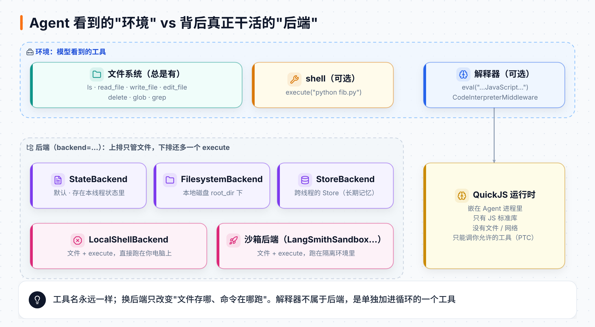
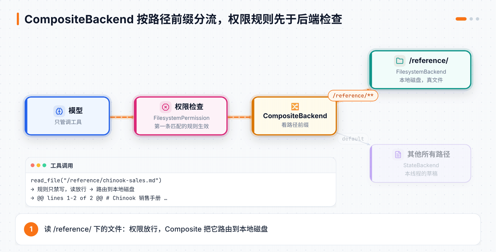
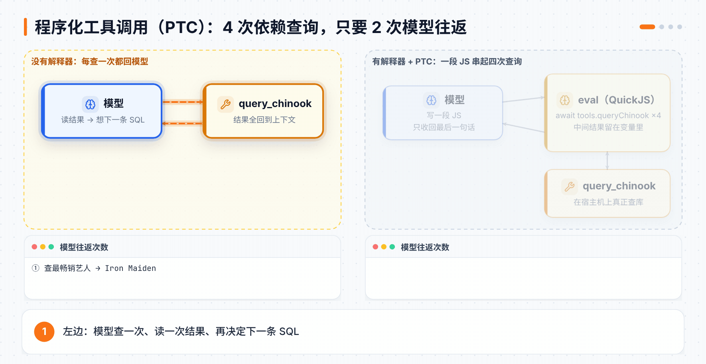
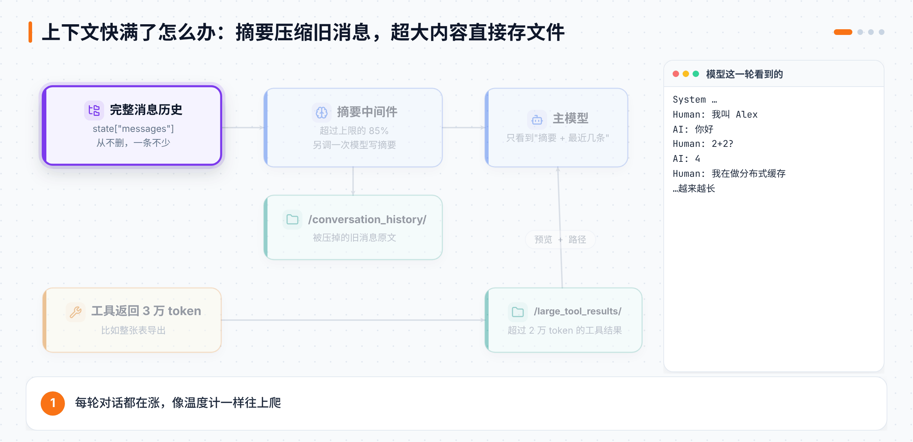
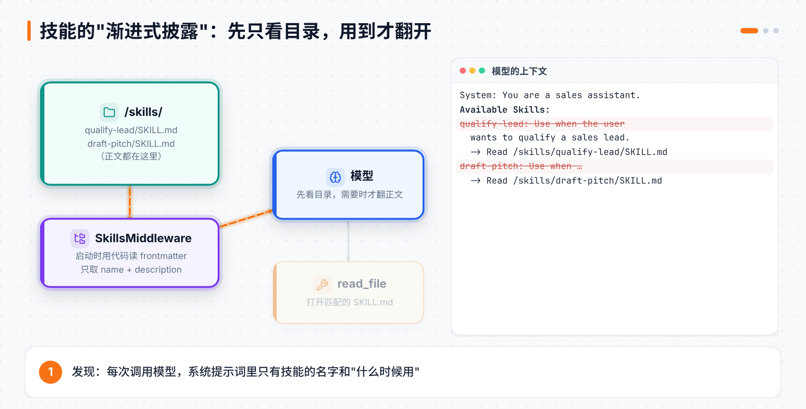

# 第 15 章 Deep Agents 的运行环境与上下文

> **本章目标**：搞清楚 Deep Agent 在"哪里"干活（文件存在哪、命令在哪跑、代码在哪算），以及对话越来越长时它怎么"不忘事也不撑爆"。读完你能按场景选后端、给文件加权限、安全地让 Agent 跑代码，并用技能和长期记忆让 Agent 越用越顺手。
> **对应课程**：Introduction to Deep Agents · Module 2「The Agent Environment」（The Deep Agent Environment、Filesystem Backends、Sandboxes and LocalShell、Interpreters）+ Module 3「Context Engineering」（Summarization and Context Offloading、Skills、Memory）

[← 上一章](14-DeepAgents上手.md) ｜ [返回导读](README.md) ｜ [下一章 →](16-DeepAgents委派与综合项目.md)

---

## 15.1 环境：Agent 看到的三样东西

Deep Agent 不是"悬在空中"运行的，它总待在一个**环境**里。这个环境最多给它三样能力：

| 能力 | 是否必有 | 模型看到的工具 | 用来干什么 |
|---|---|---|---|
| 📁 文件系统 | **总是有** | `ls`、`read_file`、`write_file`、`edit_file`、`delete`、`glob`、`grep` | 当草稿纸：记笔记、存中间结果、放计划和产出物 |
| 🔧 shell | 可选 | `execute` | 跑脚本、装包、编译、跑测试 |
| 🧠 解释器 | 可选 | `eval` | 在循环里直接跑一小段 JavaScript：算数、循环、串联工具调用 |

前两样由**后端（backend）**提供。后端回答三个问题：文件存在哪？有没有 `execute`？有的话命令在哪跑？解释器则不归后端管，它是单独加进 Agent 循环的一个工具。



记住这张图最重要的一点：**模型看到的工具名永远一样**。你把后端从"存在内存里"换成"存在硬盘上"，模型照样调 `read_file`，它根本不知道底下换了什么。

## 15.2 文件系统后端：文件到底存在哪

> ⚠️ **别被名字绕晕**："Agent 的文件系统"指的是那一组文件工具，每个 Deep Agent 都有；`FilesystemBackend` 只是其中**一种**后端，专指"存到本地硬盘"。选"文件系统后端"不等于选 `FilesystemBackend`。

| 后端 | 文件存在哪 | 线程结束后还在吗 | 适合 |
|---|---|---|---|
| `StateBackend`（默认） | 当前线程的状态里 | 跟着检查点走，换个线程就看不到 | 草稿、临时文件 |
| `FilesystemBackend` | 本地硬盘 `root_dir` 下 | 在，真文件 | 让 Agent 读写你的真实项目 |
| `CompositeBackend` | 按路径前缀分给不同后端 | 看每条路由 | 草稿放内存、某个目录放硬盘 |
| `StoreBackend` | LangGraph 的 Store | 在，跨线程共享 | 长期记忆（15.8） |
| 自定义后端 | S3、GitHub、公司内部存储…… | 你说了算 | 实现后端接口即可 |

不传 `backend` 时默认就是 `StateBackend()`。换成本地硬盘只要一行：

```python
from deepagents import create_deep_agent
from deepagents.backends import FilesystemBackend

agent = create_deep_agent(
    model=model,
    backend=FilesystemBackend(root_dir="/path/to/project", virtual_mode=True),
)
```

`virtual_mode=True` 让 `/notes.md` 这样的路径都**落在 `root_dir` 里面**，想用 `../` 跳出去会被拒绝。

更常见的是混着用：普通草稿留在线程状态里，只把 `/reference/` 这个目录指到硬盘上。这就是 `CompositeBackend`：

```python
from pathlib import Path
from deepagents.backends import CompositeBackend, FilesystemBackend, StateBackend

reference_dir = Path(__file__).parent / "reference"

backend = CompositeBackend(
    default=StateBackend(),                       # 没匹配上的路径都走这里
    routes={
        "/reference/": FilesystemBackend(root_dir=str(reference_dir), virtual_mode=True),
    },
)
agent = create_deep_agent(model=model, backend=backend)
```

现在 `/reference/chinook-sales.md` 对应硬盘上的 `reference/chinook-sales.md`，其他路径（比如 `/notes.md`）都只存在本线程的状态里。

## 15.3 权限：在代码层拦住，而不是在提示词里求它

"请不要改 /reference/ 下的文件"写在系统提示词里，模型**大概率**会听，但不保证。权限规则是在**代码里**执行的，模型绕不过去。

```python
from deepagents import FilesystemPermission, create_deep_agent

agent = create_deep_agent(
    model=model,
    backend=backend,                       # 上一节的 CompositeBackend
    permissions=[
        FilesystemPermission(
            operations=["write"],          # 只管写
            paths=["/reference/**"],       # glob 写法，支持 ** 和 {a,b}
            mode="deny",                   # allow / deny / interrupt
        ),
    ],
)
```

| 字段 | 取值 | 说明 |
|---|---|---|
| `operations` | `"read"`、`"write"` | `read` 管 `ls`、`read_file`、`glob`、`grep`；`write` 管 `write_file`、`edit_file`、`delete` |
| `paths` | glob 列表 | 例如 `["/reference/**"]` |
| `mode` | `"allow"`（默认）、`"deny"`、`"interrupt"` | `interrupt` 不直接拒绝，而是暂停等人批准（第 14 章 14.9 的 HITL） |

规则**从上往下匹配，第一条命中的生效**；一条都没命中就放行。



**本地实测**（deepagents 0.7.29）：

| 模型的操作 | 结果 |
|---|---|
| `read_file("/reference/chinook-sales.md")` | 正常读出内容（规则只禁写） |
| `edit_file("/reference/chinook-sales.md", …)` | `Error: permission denied for write on /reference/chinook-sales.md` |
| `write_file("/notes.md", …)` | `Updated file /notes.md`，只存在线程状态里，硬盘上的 `reference/` 目录没有多出任何文件 |
| 把 `mode` 换成 `"interrupt"` 再写 `/reference/x.md` | 运行暂停，中断里带着 `write_file` 的参数，可选 approve / edit / reject / respond |

被拒绝的写操作会以**错误信息**的形式回到模型，模型会自己解释"这个文件是只读的，我没法改"。

### 更狠一点：干脆不给它这个工具

权限规则是"让它调，调了再拦"。如果你连这个工具都不想让模型看见，就用工具白名单：

```python
from deepagents import create_deep_agent, FilesystemMiddleware

agent = create_deep_agent(
    model=model,
    backend=backend,
    middleware=[FilesystemMiddleware(backend=backend, tools=["read_file", "grep", "ls"])],
)
```

实测模型这时能看到的工具只剩 `ls`、`read_file`、`grep`，外加子智能体的 `task`。白名单里 `read_file` 必须保留；可选的名字有 `ls`、`read_file`、`write_file`、`edit_file`、`delete`、`glob`、`grep`、`execute`。

> ⚠️ **常见坑**：自己写的 `FilesystemMiddleware(...)` 一定要传 `backend=backend`。`create_deep_agent` 会用你的中间件**替换**它内置的那个，没传后端的话就悄悄退回只存线程状态，你预先放好的文件看起来就像"不存在"。

## 15.4 让 Agent 跑命令：沙箱 vs 本地 shell

`LocalShellBackend` 和各种沙箱后端在文件工具之外再多给一个 **`execute`**。Agent 用它跑自己写的脚本、命令行工具、编译和测试；命令输出、退出码会作为工具结果回到模型。

怎么选，只看一件事：**隔离**。

- **默认选沙箱**。Agent 写的代码、它装的包，本质上都是"不可信"的，应该关在和你的基础设施隔离的地方跑。
- **只有"让 Agent 直接动你电脑"本身就是目的时**（比如本地编程助手、桌面 Agent），才用 `LocalShellBackend`。它不适合生产环境，也不适合处理陌生人的输入。

### 沙箱的两种用法

| 用法 | Agent 在哪 | 模型 API Key 在哪 | 特点 |
|---|---|---|---|
| Agent 住在沙箱里 | 沙箱里 | 沙箱里 | 环境和生产一致，但改 Agent 要重建镜像 |
| **沙箱当工具**（课程用这个） | 你的机器上 | 你的机器上 | 通过 `execute` 和文件工具远程操作沙箱；Key 不进沙箱，Agent 好更新，沙箱挂了也不影响 Agent 状态 |

那 Agent 替用户调别的服务时需要的 Key 呢？LangSmith Sandbox 有个**认证代理**：密钥放在沙箱旁边的代理里，请求经过代理时才加上去，沙箱里跑的代码永远看不到它，也就偷不走。这是 LangSmith 沙箱特有的功能，不是所有沙箱都有。

### 用 LangSmith Sandbox

```python
from uuid import uuid4
from deepagents import create_deep_agent
from deepagents.backends.langsmith import LangSmithSandbox
from langsmith.sandbox import SandboxClient

client = SandboxClient()
ls_sandbox = client.create_sandbox(name=f"lca-deepagents-lab-{uuid4().hex[:8]}")
backend = LangSmithSandbox(sandbox=ls_sandbox)

agent = create_deep_agent(
    model=model,
    backend=backend,
    system_prompt="You are a coding assistant. When asked to run code, write the script "
                  "to a file first, then execute it. Show the output in your final answer.",
)

try:
    result = agent.invoke({"messages": [{"role": "user",
        "content": "写一个打印前 15 个斐波那契数的 Python 脚本，存成 fib.py 并运行它"}]})
    print(result["messages"][-1].text)
finally:
    client.delete_sandbox(ls_sandbox.name)   # 沙箱按用量计费，务必删掉
```

在 LangSmith 里能看到一串工具调用：`write_file` 写出 `fib.py` → `execute` 跑 `python fib.py` → 输出回到模型 → 模型写最终回答。如果脚本报错，你会看到它调 `edit_file` 修好再 `execute` 一次：**有了 shell，Agent 就能自己改错**。

> 💡 免费的 Developer 套餐也带每月的沙箱额度，可以在 **Settings → Billing and Usage → Usage limits** 设上限。

课程的第二个实验更完整：先把 `chinook.db` **上传**进沙箱，让 Agent 自己 `pip install --break-system-packages matplotlib`、查库、画一张"各流派收入占比"的环形图，最后把图**读回**本地：

```python
with open(DB_PATH, "rb") as f:
    upload_results = backend.upload_files([("/chinook.db", f.read())])   # 运行前上传
# ……agent.invoke(...) 画图……
png_bytes = ls_sandbox.read("/genre_revenue.png")                       # 运行后取回
```

> ⚠️ **超时排查**：把 `models.py` 里模型的 `timeout=` 调大**没用**，那只管模型 API 调用。沙箱有自己的三个时限：创建沙箱最多等 **30 秒**；单条 `execute` 总时长默认 **30 分钟**；连续 **5 分钟**没有任何输出就会被杀掉（装包 + 画图最容易撞上这条）。先看 LangSmith 里的报错是哪一种。

### LocalShellBackend：方便，但要清楚风险

```python
from deepagents.backends import LocalShellBackend

backend = LocalShellBackend(root_dir="./scratch", virtual_mode=True)
```

实测它给模型的工具是全套文件工具加 `execute`。关键是：**`root_dir` 和 `virtual_mode` 只限制文件工具，管不住 `execute`**。`execute("cat ~/.bashrc")` 照样能跑，权限就是你这个用户的权限。

| ✅ 适合 | ❌ 不适合 |
|---|---|
| 本地开发用的命令行工具、编程助手 | 生产环境（Web 服务、API、多租户系统） |
| 你信任其代码的个人开发环境 | 处理不可信的用户输入或代码 |
| 密钥管理到位的 CI/CD | |

风险包括：任意命令以你的身份执行；能读到 `.env`、密钥文件；改动不可撤销；不限 CPU、内存和磁盘。课程的建议是**一定给 `execute` 加人工审批**：

```python
from langgraph.checkpoint.memory import MemorySaver

agent = create_deep_agent(
    model=model,
    backend=LocalShellBackend(root_dir="./scratch", virtual_mode=True),
    interrupt_on={"execute": {"allowed_decisions": ["approve", "reject"]}},
    checkpointer=MemorySaver(),
)
```

> 💡 0.7.29 的 `LocalShellBackend` 默认 `inherit_env=False`：`execute` 跑的命令**拿不到**你当前进程的环境变量（比如 `ANTHROPIC_API_KEY`），只能看到你用 `env={...}` 显式传进去的。不过它照样能读你硬盘上的 `.env` 文件，所以这不能代替审批。

## 15.5 解释器：在循环里跑一段 JavaScript

沙箱很强，但要起一台机器。很多时候 Agent 只是想**算点东西**或**连着调几次工具**，用不着一整个 shell。**解释器**就是更轻的选择：

```python
from deepagents import create_deep_agent
from langchain_quickjs import CodeInterpreterMiddleware

agent = create_deep_agent(model=model, middleware=[CodeInterpreterMiddleware()])
agent.invoke({"messages": [{"role": "user", "content": "用 eval 工具算出前 15 个斐波那契数"}]})
```

加上这个中间件，模型多了一个 **`eval`** 工具，参数是一段 JavaScript。它在嵌入式的 [QuickJS](https://bellard.org/quickjs/) 引擎里运行，最后一个表达式的值和 `console.log` 的输出会作为工具结果返回。实测返回格式是：

```text
<stdout>
n 1
</stdout>
<result>Top: Iron Maiden</result>
```

| QuickJS 里**有** | QuickJS 里**没有** |
|---|---|
| 数组方法、`Map`、`Set`、`JSON`、`Math`、`Promise`、`Date` | 文件系统（`fs`） |
| `async`/`await`、解构、字符串和数字方法 | 网络（`fetch`） |
| `console.log`（会被收集起来返回） | Node.js API、npm 包 |

变量会在多次 `eval` 之间保留。Python 版默认按**线程**保留（要配检查点），TypeScript 版每轮结束就清空。超时（默认 5 秒）、内存、输出长度、工具调用次数都有上限，防止死循环拖垮整个 Agent。

### 解释器 vs 沙箱，怎么选

| | 解释器 | shell 后端 / 沙箱 |
|---|---|---|
| 语言 | JavaScript（QuickJS） | 任何命令、任何装好的运行时 |
| 第三方库 | 只有 JS 标准库 | 环境里装了什么就能用什么 |
| 文件 / 网络 | 没有，只能通过你允许的工具间接访问 | 有（看沙箱的网络配置） |
| 基础设施 | 嵌在 Agent 进程里，零成本 | 本地 shell 或远程沙箱 |
| 最适合 | 计算、循环、串联工具调用 | 脚本、装包、读写文件、构建、测试 |

### 杀手锏：程序化工具调用（PTC）

普通的工具调用，每个结果都要**回到模型**，模型读完再决定下一步。如果四次查询一环扣一环（查最畅销艺人 → 他最畅销的专辑 → 专辑里卖得最多的曲目 → 买过这首歌的客户数），模型就得来回跑五趟。

打开 PTC 后，JavaScript 可以**直接调用你允许的工具**，中间结果留在变量里，只有最后拼好的一句话回到模型：

```python
@tool
def query_chinook(sql: str) -> str:
    """Execute a read-only SQL query against the Chinook database. Returns a JSON-encoded string."""
    ...

agent = create_deep_agent(
    model=model,
    tools=[query_chinook],
    middleware=[CodeInterpreterMiddleware(ptc=["query_chinook"])],   # 白名单：JS 只能调这个
)
```

模型写出来的 JavaScript 大概长这样（工具名会变成驼峰 `tools.queryChinook`，返回的是字符串，要自己 `JSON.parse`）：

```javascript
const artist = JSON.parse(await tools.queryChinook({ sql: `SELECT ... LIMIT 1` }));
const album  = JSON.parse(await tools.queryChinook({ sql: `... WHERE ArtistId = ${artist[0].ArtistId} ...` }));
// ……再查两次……
`最畅销艺人：${artist[0].Name}，专辑：${album[0].Title} ……`;   // 只有这句话回到模型
```



课程的实验让两个 Agent 回答同一个问题，结论一样（Iron Maiden → The X Factor → The Aftermath → 2 位客户），但**有 PTC 的 2 次模型往返，没 PTC 的 5 次**。

> ⚠️ **两个提醒**
> - `ptc=` 是安全边界。只放你愿意让代码批量调用的工具；没列进去的工具在 JS 里根本不存在（`globalThis.tools` 里找不到）。
> - 模型用不用 PTC 是靠系统提示词引导的，复杂任务或弱一点的模型有时会绕过 `eval` 直接调工具。课程在系统提示词里加了一句"依赖查询请用一次 eval 串起来"来提高命中率。去 LangSmith 看：工具调用如果单独出现在 `eval` 外面，就是这一轮没走 PTC。

> 📖 **延伸阅读**：2026 年的论文 *The Bitter Lesson of Tool Calling* 在 14 个模型上比较了"写代码调工具"和传统 JSON 工具调用：前者在 11 个模型上持平或更好；需要同时调很多工具时 13 个模型持平或更好；上下文又长又乱时，它几乎不掉分，而 JSON 方式平均掉 2.3%。

## 15.6 对话太长怎么办：摘要与卸载

长时间运行的 Agent，消息越攒越多。Deep Agents 用两招应对：

- **摘要（Summarization）**：上下文快满时，把旧消息压成一段摘要。
- **卸载（Offloading）**：单条内容太大时，根本不放进上下文，存成文件只留个指针。



### 摘要：越过 85% 就压缩

把上下文窗口想成一支温度计，每条消息都让它往上爬。超过模型上限的 **85%**（默认值）时，摘要中间件就会出手：

1. **另调一次模型**，让它按固定结构写摘要：用户想干什么、关键事实和决定、产出了哪些文件、下一步做什么。
2. 把被压掉的旧消息**原文**存到 `/conversation_history/` 下的一个文件里（0.7.29 实测叫 `session_<id>.md`，课程固定的 0.7.0 叫 `{thread_id}.md`）。
3. 下一次调用模型时，送进去的是"**一条摘要 + 最近几条消息**"。摘要是一条 `HumanMessage`，开头是 `You are in the middle of a conversation that has been summarized.`，里面附带原文文件的路径，模型需要细节时可以自己 `read_file`。

最容易误会的一点：**状态里的 `messages` 一条都没删**。摘要只改变"这一轮送给模型看什么"，同时在状态里留一个私有字段 `_summarization_event` 记录压缩发生过。

想在演示里看到它，就把模型"报告的上下文长度"改小：

```python
from langgraph.checkpoint.memory import MemorySaver
from models import model

model.profile = {**model.profile, "max_input_tokens": 4000}   # 85% ≈ 3400 token 就触发

agent = create_deep_agent(
    model=model,              # 必须传模型对象，传字符串会重新初始化，覆盖就失效了
    checkpointer=MemorySaver(),
    system_prompt="You are a helpful assistant. Keep every response to one sentence.",
)
```

然后用同一个 `thread_id` 连聊几轮：第一轮说"我叫 Alex，在 Acme 工作"，中间聊些别的，最后问"你记得我什么？"。即使早就压缩过了，它仍然能从摘要里答出来。

> ⚠️ **本地实测踩坑**：课程用的是 `700`，但在 0.7.29 下，光是内置工具的说明就占了不少 token，700 太小，直接报 `ContextOverflowError`。调到 `4000` 才正常。想看连续压缩两次，课程作业的参考值是 10 轮对话配 `3000` 左右；再小的话每轮都在压，早期细节反而丢了。

要改触发点，可以给 `SummarizationMiddleware` 传 `trigger=("fraction", 0.5)`，表示到 50% 就压缩。

### 卸载：超大内容直接存文件

摘要处理的是"慢慢攒多了"；卸载处理的是"一下子来了个大的"。文件系统中间件会在内容进入上下文**之前**拦截：

| 什么内容 | 阈值（约） | 存到哪 |
|---|---|---|
| 工具结果（比如整张表导出） | 2 万 token | `/large_tool_results/` |
| 用户消息（比如粘进来一整份文档） | 5 万 token | `/conversation_history/` |

模型看到的是一段提示 + 头尾各 5 行的预览 + 文件路径：

```text
Tool result too large, the result of this tool call was saved in the
filesystem at this path: /large_tool_results/...
You can read the result from the filesystem by using the read_file tool,
but make sure to only read part of the result at a time.
Here is a preview showing the head and tail of the result:
     1  | SELECT id, name, email FROM users WHERE ...
     2  | 1, Alice, alice@example.com
... [1823 lines truncated] ...
```

需要时，模型用 `read_file` 配 `offset` 和 `limit` 分页读。`ls`、`glob`、`grep`、`read_file`、`edit_file`、`write_file` 这几个工具的结果不卸载，它们要么自带截断，要么返回很短。

卸载的文件走的是 Agent 当前的后端：默认 `StateBackend` 就只在本线程可见；用 `CompositeBackend` 把它们路由到硬盘或 Store，就能跨线程共享。

> 📰 **案例**：Harmonic 用"大结果存文件、按需分页读回"的方式重做了它的 Scout Agent，第 1 到第 4 周的留存提升到 4 倍，平均会话时长提升到 10 倍。

## 15.7 技能（Skills）：可复用的"操作手册"

**技能就是一个带 `SKILL.md` 的文件夹**。它遵循开放的 [Agent Skills 规范](https://agentskills.io/specification)，所以能在不同 Agent、不同团队之间复用。

```text
skills/
  qualify-lead/
    SKILL.md
  draft-pitch/
    SKILL.md
```

`SKILL.md` 分两部分，上面是 YAML 头信息，下面是正文：

```markdown
---
name: qualify-lead
description: Use when the user wants to qualify a sales lead or prospect.
---

# Qualify a Lead

用 BANT 框架系统地评估：
**Step 1: Budget** 预算范围是多少？谁拍板采购？
**Step 2: Authority** 你在跟决策人谈吗？
**Step 3: Need** 具体痛点是什么？不解决会怎样？
**Step 4: Timeline** 什么时候决定？什么时候要上线？
……
```

| 头信息字段 | 必填 | 说明 |
|---|---|---|
| `name` | ✅ | 小写字母、数字、连字符；应和文件夹同名（不同名只会打警告） |
| `description` | ✅ | 写清楚**什么时候用**，它永远在上下文里，越短越准越好 |
| `allowed-tools` | | 这个技能会用到的工具名，空格分隔 |
| `compatibility` | | 环境或版本要求 |
| `metadata` | | 任意键值对 |

技能是文件，所以要放在 Agent 的**后端**里，再用 `skills=` 指过去：

```python
from deepagents.backends import FilesystemBackend

backend = FilesystemBackend(root_dir=str(Path(__file__).parent), virtual_mode=True)

agent = create_deep_agent(
    model=model,
    name="Sales_Assistant",
    backend=backend,
    skills=["/skills"],
    system_prompt="You are a sales assistant.",
)
```

### 渐进式披露：先看目录，用到才翻开

技能的精髓是**不把所有手册一股脑塞进上下文**，而是分三步：



1. **发现**：启动时，`SkillsMiddleware` 用代码（不是工具调用）读每个 `SKILL.md` 的头信息，只把名字和描述写进系统提示词。实测系统提示词里是这样一段：
   ```text
   **Available Skills:**
   - **qualify-lead**: Use when the user wants to qualify a sales lead.
     -> Read `/skills/qualify-lead/SKILL.md` for full instructions
   ```
2. **激活**：用户的请求和某个描述对上了，模型自己调 `read_file` 把那份 `SKILL.md` 全文读进来。
3. **执行**：照着正文一步步做，需要时调用它已有的工具。

在 LangSmith 里这三步都看得见：每次的系统消息里都有技能目录（发现）；`read_file` 那一下是激活（要打开 **Hidden runs** 才能看到嵌在中间件里的调用）；之后的工具调用和回答是执行。

> 💡 **技能 vs 工具**：工具是一个**会做事**的函数，调了就有动作、有结果。技能自己**什么都不做**，它只是一份说明书，告诉 Agent 该怎么用它已有的工具。技能文件夹里还可以放参考资料、`scripts/` 脚本（配上沙箱就能跑），Agent 甚至可以边干边改自己的技能。

> 📰 **案例**：Stripe 的内部 Agent "Kai" 有 100 多个团队的 1000 多个技能。技能多到几百个以后，单靠描述匹配会变差，于是他们再加一道筛选：按每个技能的 `allowed-tools` 决定 500 多个内部工具里哪些真正加载。

### 两个新功能（课程实验没用到）

- **固定技能 `pinned_skills`**（0.7.23 起）：用户点名要用某个技能时，不必等模型自己去读：
  ```python
  agent.invoke({"messages": [...], "pinned_skills": ["qualify-lead"]})
  ```
  那份 `SKILL.md` 会在下次调用模型前直接放进对话。
- **技能专属工具**（0.7.22 起）：在头信息里写 `metadata.include_tools: create_customer_request list_customer_requests`，并把这些工具交给 `SkillsMiddleware(tools=[...])`。模型读过（或固定了）这个技能之后才看得到这些工具，平时它们不占提示词。

这两个功能目前只有 Python 版有。

## 15.8 长期记忆：让 Agent 跨对话记住你

记忆分两种，区别在**范围**，而不是存多久：

| | 短期记忆 | 长期记忆 |
|---|---|---|
| 是什么 | 一个线程里的消息历史 | 跨线程都该记住的东西：用户偏好、项目约定、常用事实 |
| 谁管 | 检查点（第 14 章 14.8） | Store 或文件系统 |
| 谁能看到 | 只有这个线程 | 所有符合范围的线程（同一用户、同一团队……） |

检查点就算存在真正的数据库里、程序重启也不丢，它仍然是**短期**记忆，因为只有那个线程看得到。

### 记忆就是文件

在 Deep Agents 里，长期记忆就是普通文件，惯例是 `/memories/AGENTS.md`：

```markdown
# Project Guidelines

## Code Style
- Use type annotations
- Prefer pathlib.Path for file operations

## Workflow
- Run tests with: uv run pytest
```

用 `memory=` 告诉 Agent 哪些文件算记忆：

```python
agent = create_deep_agent(model=model, memory=["/memories/AGENTS.md"])
```

这会自动加上 `MemoryMiddleware`。每次运行时它会读取这些文件，把内容放进系统提示词里一个 `<agent_memory>` 块。实测长这样：

```text
<agent_memory>
/memories/AGENTS.md

# 约定
- 用 pytest

</agent_memory>
```

它还会告诉模型"用户说'记住……'时，就去更新记忆文件"。Agent 用的是它本来就会的 `edit_file`，不需要学什么新的记忆 API。

| | 记忆 | 技能 |
|---|---|---|
| 一直在上下文里的是 | 记忆的**全文** | 技能的**名字和描述** |
| 全文什么时候加载 | 每次运行开头主动加载 | 用到时模型自己去读 |
| 适合放 | 长期事实、偏好、约定 | 可复用的流程和步骤 |

> ⚠️ 记忆在一个线程**第一次运行时**加载，之后就存在这个线程的状态里。所以在 A 线程里刚写进去的新内容，要到**新线程**里才看得到。另外，千万别把 API Key、密码这类机密写进记忆。

### 记忆存在哪、谁能看见

`StateBackend` 只活在一个线程里，存长期记忆没意义。生产里常见的做法是用 `CompositeBackend` 把 `/memories/` 单独路由到 `StoreBackend`：

```python
from deepagents.backends import CompositeBackend, StateBackend, StoreBackend
from langgraph.store.memory import InMemoryStore

store = InMemoryStore()                      # 开发用；生产换成持久化的 Store

def memory_namespace(runtime):
    ctx = runtime.context
    return ("memory", ctx["workspace_id"], ctx["user_id"])

agent = create_deep_agent(
    model=model,
    backend=CompositeBackend(
        default=StateBackend(),
        routes={"/memories/": StoreBackend(namespace=memory_namespace)},
    ),
    store=store,
    memory=["/memories/AGENTS.md"],
)

agent.invoke(
    {"messages": [{"role": "user", "content": "记住：我们改用 ruff 做代码检查了"}]},
    context={"user_id": "u_123", "workspace_id": "acme"},
)
```

三个角色分清楚：`CompositeBackend` 是**路由器**，`StoreBackend` 是**适配器**（把 Store 里某个命名空间伪装成一个目录），`InMemoryStore` 才是真正存数据的**数据库**。它和 `MemorySaver` 地位相当：一个管跨线程记忆，一个管线程历史，都是开发用的内存版。

**本地实测**：先往 Store 的 `("memory", "acme", "u1")` 里放一份 `# 约定\n- 用 pytest`，第一次调用时模型的系统提示词里就出现了这段内容；第二次说"记住：改用 ruff"，模型调 `edit_file` 返回 `Successfully replaced 1 instance(s)…`，再看 Store，文件内容变成了 `- 用 pytest\n- 用 ruff`。

### 命名空间决定"谁跟谁共享"

记忆的范围完全由命名空间元组里放了哪些段决定：

| 范围 | 命名空间 | 适合 |
|---|---|---|
| 所有人共享 | `("memory", assistant_id)` | 大家都该遵守的同一套指令 |
| 按用户 | `("memory", user_id)` | 偏好跟着一个人走 |
| 按团队 | `("memory", workspace_id)` | 团队共享的约定 |
| 团队里的个人 | `("memory", workspace_id, user_id)` | 同一团队里每人有自己的私有偏好 |
| 助手 + 用户 | `("memory", assistant_id, user_id)` | 同一个人在不同助手里记不同的东西 |

每种组合都是**完全独立**的键：`("memory", a)` 和 `("memory", a, u)` 看起来像前缀关系，其实毫不相干。命名空间的形状在工厂函数里定死，每次调用都只解析出一个。

选范围要谨慎：私人记忆放进了共享命名空间，A 用户的偏好就会漏到 B 用户的对话里；团队约定卡得太细，Agent 又没法在团队里复用。

## 📌 本章小结

| 你想做的事 | 用什么 | 关键写法 |
|---|---|---|
| 草稿随线程走 | `StateBackend`（默认） | 什么都不用写 |
| 读写真实文件 | `FilesystemBackend` | `root_dir=..., virtual_mode=True` |
| 不同目录存不同地方 | `CompositeBackend` | `default=..., routes={"/reference/": ...}` |
| 某些文件只读 | 权限规则 | `FilesystemPermission(operations=["write"], paths=[...], mode="deny")` |
| 干脆隐藏某些工具 | 工具白名单 | `FilesystemMiddleware(backend=backend, tools=[...])` |
| 安全地跑代码 | 沙箱 | `LangSmithSandbox` + `try/finally` 删沙箱 |
| 在自己电脑上跑命令 | `LocalShellBackend` | 一定配 `interrupt_on={"execute": ...}` |
| 算数 / 串联工具 | 解释器 + PTC | `CodeInterpreterMiddleware(ptc=["工具名"])` |
| 长对话不爆 | 摘要 + 卸载 | 默认开启，超 85% 压缩、大结果存文件 |
| 可复用的操作手册 | 技能 | `skills=["/skills"]` + `SKILL.md` |
| 跨对话记住用户 | 长期记忆 | `memory=[...]` + `StoreBackend(namespace=...)` |

## 🧪 动手练习

1. **只读菜谱盒**：用 `CompositeBackend` 把 `/recipes/` 指到硬盘，放一份"传家菜谱"，加一条禁止写入的权限规则。让 Agent 读它，再让它"把盐减半"，看它怎么回应。
2. **白名单 vs 权限**：把练习 1 改成用 `FilesystemMiddleware(backend=backend, tools=[...])` 去掉 `write_file` 和 `edit_file`，对比两次的追踪：一次是"调了被拒"，一次是"根本没有这个工具"。
3. **证明沙箱里的文件会保留**：对同一个沙箱发两次 `invoke`，第一次生成一份数据存文件，第二次只读这份文件画图（不许重新生成）。
4. **PTC 的边界**：再写一个 `convert_currency` 工具但不放进 `ptc=`，让 Agent 在 `eval` 里试着调它，确认调不到。
5. **连续压缩两次**：设计 8 轮以上的对话，在第一轮埋一个细节，调 `max_input_tokens` 让摘要至少触发两次，最后问它还记不记得那个细节。
6. **自己的技能**：写一个非销售主题的技能（健身计划、简历点评……），把具体数字放在同目录的 `reference.md` 里，`SKILL.md` 只写"去读 reference.md"，从追踪里确认 Agent 两个文件都读了。
7. **记忆隔离**：用 `("memory", workspace_id, user_id)` 跑两个同团队不同用户的上下文，让 alice 记一件事，确认 bob 看不到；再把命名空间改成 `("memory", workspace_id)`，确认 bob 能看到。

[下一章：Deep Agents 的委派与综合项目 →](16-DeepAgents委派与综合项目.md)
