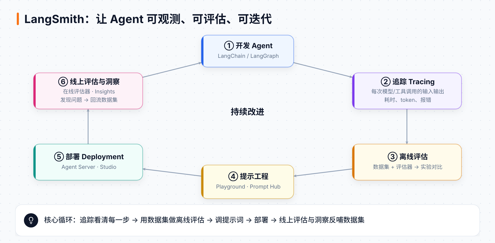
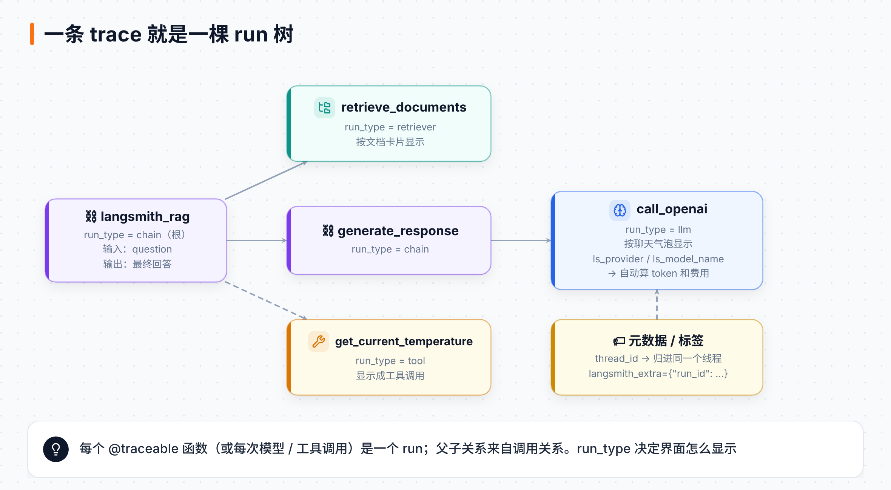
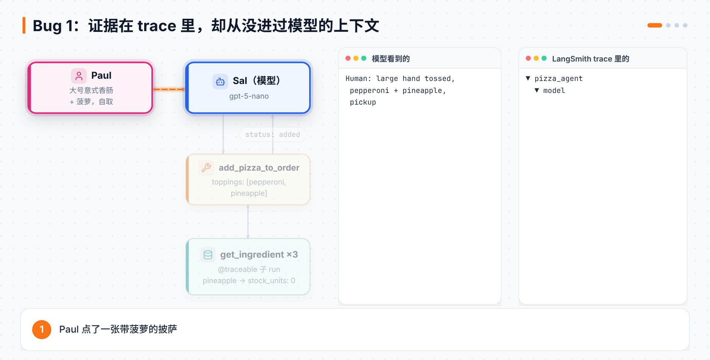
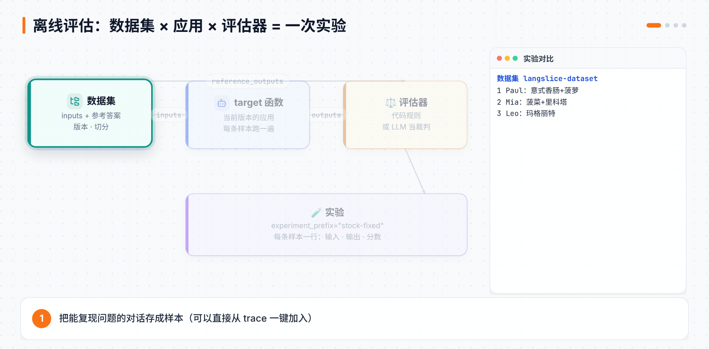

# 第 15 章 LangSmith 追踪与评估：从 trace 里抓出 Bug

> **本章目标**：学会用四种方式把任何代码接上追踪，读懂 run 树和对话线程，用 Studio 调试一个真实的点餐 Agent，并从 trace 里抓出它藏着的第一个 Bug。然后用数据集、评估器和实验，**用数据证明** Bug 修好了。
> **对应课程**：LangSmith Essentials · Module 1「Tracing」（What is Tracing?、Debugging with Studio、Capstone）+ Module 2「Offline Evaluation」（Datasets and Offline Evals、Experiments、Capstone）；Intro to LangSmith · Module 0–2（RAG 应用、追踪基础、Run 类型、其他追踪方式、对话线程、数据集、评估器、实验、两两对比、汇总评估器）

[← 上一章](14-DeepAgents委派与综合项目.md) ｜ [返回导读](README.md) ｜ [下一章 →](16-LangSmith提示工程与生产监控.md)

---

> 📎 **资料说明**：第 11 章是 LangSmith 的"地图"，这一章和下一章是"实战"。代码来自两门课的公开仓库：[intro-to-langsmith](https://github.com/langchain-ai/intro-to-langsmith)（Intro to LangSmith 的 notebook）和 [lca-langsmith-essentials](https://github.com/langchain-ai/lca-langsmith-essentials)（LangSmith Essentials 的披萨店 Agent）。课程视频里的平台操作没有公开文字稿，这部分按 [LangSmith 官方文档](https://docs.langchain.com/langsmith) 补全，会单独标出。标着"本地实测"的结果，是用 langsmith 0.14.11 在不联网、不调真模型的环境里跑出来的。

## 15.1 两门课，一条主线

LangSmith 在 Academy 上有两门课，内容有重叠，但案例不一样：

| | LangSmith Essentials（新） | Intro to LangSmith（老牌） |
|---|---|---|
| 案例 | 🍕 LangSlice 披萨店点餐 Agent，故意埋了两个 Bug | 📚 回答 LangSmith 文档问题的 RAG 应用 |
| 风格 | 跟着一个 Agent 从开发走到上线，边走边抓 Bug | 一个功能一个 notebook，讲得细 |
| 本章用到 | Module 1–2 | Module 0–2 |
| 下一章用到 | Module 3–5 | Module 3–5 |

两门课的主线是同一个循环：**追踪看清 → 评估量化 → 改进 → 上线监控 → 发现新问题**。这一章走前半圈。



## 15.2 案例：LangSlice 披萨店的 Sal

LangSlice 是一家虚构的布鲁克林披萨店。店里的点餐助手叫 **Sal**，用第 1 章学过的 `create_agent` 搭成，默认模型是 `openai:gpt-5-nano`。Sal 有 9 个工具：

| 工具 | 作用 |
|---|---|
| `search_company_info` | 查店铺信息：地址、营业时间、配送范围、付款方式、过敏原…… |
| `get_menu` | 菜单：尺寸、饼底、招牌披萨、配料、小食 |
| `start_order` | 开一张单（自取或外送，外送要地址） |
| `add_pizza_to_order` | 校验并加一张披萨 |
| `modify_pizza` | 改单上已有的披萨 |
| `remove_pizza` | 删掉一张披萨 |
| `add_side` | 加小食或饮料 |
| `view_order` | 看当前订单和金额 |
| `confirm_order` | 算总价、送进厨房 |

订单不放在图的状态里，而是放在 `database.ORDERS` 里，按 `thread_id` 区分。工具通过注入的 `ToolRuntime` 拿到当前对话的 `thread_id`：

```python
def _thread_id(runtime: ToolRuntime) -> str:
    """从注入的工具运行时里取出对话 id"""
    configurable = (runtime.config or {}).get("configurable") or {}
    return str(configurable.get("thread_id") or "default")
```

把仓库跑起来：

```bash
git clone https://github.com/langchain-ai/lca-langsmith-essentials
cd lca-langsmith-essentials
cp .env.example .env              # 填 LANGSMITH_API_KEY 和 OPENAI_API_KEY
cd langgraph-agent
uv sync
uv run python check_setup.py      # 检查 key 和依赖

uv run run_agent.py                         # 终端里聊天
uv run run_agent.py --show-tools            # 顺便打印每次工具调用和结果
uv run run_agent.py -m "how late are you open on friday?"
```

`.env` 里默认 `LANGSMITH_PROJECT=langslice-pizza-agent`，所以每次对话都会出现在 LangSmith 的这个项目里。

> 💡 仓库里还有一个 `claude-sdk-agent/`：同一个披萨店、同样的 9 个工具和 2 个 Bug，换成 Claude Agent SDK 实现。它没有 LangChain，靠一行 `configure_claude_agent_sdk()` 打开追踪。课程跟的是 `langgraph-agent/`，本章也一样。

## 15.3 追踪的四种接法

**一条 trace = 一次完整的请求**；它是一棵树，树上每个节点叫一个 **run**（也叫 span）。把代码接上追踪，有四种办法，从"零改动"到"全手动"：



| 接法 | 适合 | 要做什么 |
|---|---|---|
| 环境变量 | LangChain / LangGraph 应用 | 什么代码都不用改 |
| `@traceable` 装饰器 | 自己写的普通 Python 函数 | 在函数上加一行 |
| `trace` 上下文管理器 | 只想追踪一段代码，或要自己控制输入输出 | 用 `with` 包住 |
| `wrap_openai` | 直接用 OpenAI SDK | 把客户端包一层 |
| `RunTree`（进阶） | 完全手动控制每个节点 | 自己建子节点、自己提交 |

### ① 环境变量：LangChain 应用零改动

```bash
LANGSMITH_TRACING=true
LANGSMITH_API_KEY=lsv2_...
LANGSMITH_PROJECT=langsmith-academy   # 不设就进 default 项目
```

Sal 就是这么接的：`create_agent` 里每次模型调用、每次工具调用自动变成一个 run。调用时还可以顺手带上元数据：

```python
simple_rag_graph.invoke({"question": question}, config={"metadata": {"foo": "bar"}})
```

### ② `@traceable`：给任何函数装上记录仪

Intro 课的 RAG 应用不用 LangChain 搭，直接调 OpenAI SDK。给每个函数加上 `@traceable`，调用关系就自动变成父子 run：

```python
from langsmith import traceable
from openai import OpenAI

openai_client = OpenAI()

@traceable(run_type="retriever")
def retrieve_documents(question: str):
    return retriever.invoke(question)

@traceable(run_type="llm", metadata={"ls_provider": "openai", "ls_model_name": "gpt-4o-mini"})
def call_openai(messages: list[dict]):
    return openai_client.chat.completions.create(model="gpt-4o-mini", messages=messages)

@traceable
def langsmith_rag(question: str):
    documents = retrieve_documents(question)
    formatted = "\n\n".join(doc.page_content for doc in documents)
    messages = [
        {"role": "system", "content": RAG_SYSTEM_PROMPT},
        {"role": "user", "content": f"Context: {formatted}\n\nQuestion: {question}"},
    ]
    return call_openai(messages).choices[0].message.content
```

`@traceable` 在每次调用时帮你建一个 run，记下函数名、输入、输出、耗时和报错。上传在**后台线程**里做，不会拖慢你的程序。

### ③ `trace` 上下文管理器：只记一段

不方便加装饰器，或者想自己决定记什么输入输出时，用 `with trace(...)`：

```python
from langsmith import trace

def generate_response(question: str, documents):
    formatted_docs = "\n\n".join(doc.page_content for doc in documents)
    with trace(
        name="Generate Response",
        run_type="chain",
        inputs={"question": question, "formatted_docs": formatted_docs},   # 只记字符串，不记文档对象
        metadata={"foo": "bar"},
    ) as ls_trace:
        response = call_openai(build_messages(question, formatted_docs))
        ls_trace.end(outputs={"output": response})
    return response
```

### ④ `wrap_openai`：包一层客户端就行

```python
from langsmith.wrappers import wrap_openai
import openai

openai_client = wrap_openai(openai.Client())   # 之后每次 chat.completions.create 都自动记录

openai_client.chat.completions.create(
    model="gpt-4o-mini",
    messages=[{"role": "user", "content": "What color is the sky?"}],
    langsmith_extra={"metadata": {"foo": "bar"}},   # 和 @traceable 一样能带 langsmith_extra
)
```

这几种方式可以混着用：外层函数用 `@traceable`，里面的 OpenAI 调用用 `wrap_openai`，它们会自动挂在同一棵树上。

### 进阶：`RunTree` 全手动

`RunTree` 让你自己建根节点、建子节点、自己提交。它只需要 `LANGSMITH_API_KEY`，**不需要** `LANGSMITH_TRACING=true`：

```python
from langsmith import RunTree

def langsmith_rag(question: str):
    root = RunTree(name="Chat Pipeline", run_type="chain", inputs={"question": question})

    child = root.create_child(name="Retrieve Documents", run_type="retriever", inputs={"question": question})
    documents = retriever.invoke(question)
    child.end(outputs={"documents": documents})
    child.post()

    # …生成回答的子节点同理…

    root.end(outputs={"generation": output})
    root.post()
    return output
```

> ⚠️ 写起来比 `@traceable` 啰嗦得多。除非你在做框架、或者要把别的系统的日志转进 LangSmith，否则用前面几种就够了。

## 15.4 Run 类型：让 LangSmith 认出"这是模型调用"

`@traceable(run_type=...)` 告诉 LangSmith 这个节点是什么，界面会据此做特殊渲染：

| run_type | 含义 | 特殊之处 |
|---|---|---|
| `chain` | 默认值，把多个步骤组合在一起 | 无 |
| `llm` | 调用一次模型 | 按聊天气泡显示，能算 token 和费用 |
| `retriever` | 从数据库或索引取文档 | 按文档卡片显示 |
| `tool` | 执行一次工具调用 | 显示成工具调用 |
| `prompt` | 填充提示词模板 | 无 |
| `parser` | 从文本里抽出结构化数据 | 无 |

要让 `llm` 和 `retriever` 渲染正确，格式有讲究：

- **`llm`**：函数的参数要叫 `messages`，是 OpenAI 格式的消息列表（每条有 `role` 和 `content`）。返回值可以是 OpenAI 的 `{"choices": [{"message": {...}}]}`，也可以是 `{"message": {...}}`、`{"role", "content"}` 或 `("assistant", "内容")`。再加上元数据 `ls_provider` 和 `ls_model_name`，LangSmith 就能算费用。用 LangChain 或 `wrap_openai` 时这两个字段会自动填好。
- **流式 `llm`**：函数是生成器时，传 `reduce_fn` 把一堆片段拼回一条完整回复：

```python
def _reduce_chunks(chunks: list):
    all_text = "".join(chunk["choices"][0]["message"]["content"] for chunk in chunks)
    return {"choices": [{"message": {"content": all_text, "role": "assistant"}}]}

@traceable(run_type="llm", reduce_fn=_reduce_chunks,
           metadata={"ls_provider": "my_provider", "ls_model_name": "my_model"})
def my_streaming_chat_model(messages: list):
    for chunk in ["Hello, " + messages[1]["content"]]:
        yield {"choices": [{"message": {"content": chunk, "role": "assistant"}}]}
```

- **`retriever`**：返回一个字典列表，每个字典有 `page_content`、`type`（固定写 `"Document"`）和 `metadata`。

**本地实测**：用一个假的检索函数和假的模型函数搭了三层 `@traceable`，在根函数上用 `langsmith_extra` 传入预先生成的 `run_id` 和 `thread_id`，然后读每个节点的 run 树：

| 节点 | run_type | 父节点 | 元数据 |
|---|---|---|---|
| `rag` | `chain` | 无（根） | `thread_id`、`ls_method: traceable` |
| `retrieve_docs` | `retriever` | `rag` | |
| `call_model` | `llm` | `rag` | `ls_model_name: fake-1` |

根节点的 id 就是传进去的那个 `run_id`。下一章给 run 加"反馈"时会用到这一点。

## 15.5 元数据、标签与对话线程

**元数据**是挂在 run 上的键值对，比如应用版本、用了哪个向量库、哪个模型。界面里可以按它过滤和分组。可以写死在装饰器上，也可以调用时再传：

```python
@traceable(metadata={"vectordb": "sklearn"})
def retrieve_documents(question: str): ...

langsmith_rag(question, langsmith_extra={"metadata": {"runtime_metadata": "foo"}})
```

**线程（Thread）**把同一段对话的多次请求串起来。每次回复都是一条独立的 trace，只要它们带着同一个线程 id，LangSmith 就会把它们归成一个线程。元数据的键名必须是这三个之一：

- `session_id`
- `thread_id`
- `conversation_id`

```python
import uuid
thread_id = uuid.uuid4()

langsmith_rag("How do I add metadata to a Trace?", langsmith_extra={"metadata": {"thread_id": thread_id}})
langsmith_rag("How can I add tags to a Trace?",   langsmith_extra={"metadata": {"thread_id": thread_id}})
```

LangGraph 应用里，`config={"configurable": {"thread_id": ...}}` 会自动带上，不用你管。下一章的"情绪评估器"就是按线程打分的，所以线程这件事很重要。

## 15.6 用 Studio 调试 Sal

```bash
uv run langgraph dev       # Safari 用户加 --tunnel
```

`langgraph.json` 把 Studio 指向 `agent.py:pizza_agent`。服务跑在 2024 端口，同一个端口的 `http://127.0.0.1:2024/` 还有一个顾客聊天界面，只显示对话文字，工具调用留给 Studio 和 LangSmith 去看。

课程推荐用这句话测试，它一次能触发好几个工具：

> Hey this is Paul, I want a large hand tossed pizza with pepperoni and pineapple for pickup, no special instructions.

Studio 里你能看到图结构、每一步的检查点，能中断、能**分叉（fork）**。

> ⚠️ **分叉的坑**：订单存在 `database.ORDERS` 里，不在图的状态里。从第一条消息分叉重跑，订单**不会**回滚，你会在同一张单上多出一张披萨。这正好说明了第 5 章讲的道理：**只有放进状态的东西才能被时间旅行。**

## 15.7 Module 1 实战：从 trace 里抓出 Bug 1

在 LangSmith 里打开刚才 Paul 那条 trace，展开 `add_pizza_to_order`：



1. `add_pizza_to_order` 收到 `toppings: ["pepperoni", "pineapple"]`，返回 `status: "added"`。看起来一切正常。
2. 再往下展开，每种配料都有一个 `get_ingredient` 子 run。**菠萝那条返回的完整记录里写着 `stock_units: 0`**：店里今天没菠萝了。
3. 工具明明查到了库存是 0，还是把披萨加上了。

原因在 `agent.py` 里配料的校验循环，**只检查了"有没有这种配料"，没检查"还有没有货"**：

```python
for requested in requested_toppings:
    ingredient = db.get_ingredient(requested)
    if ingredient is None:          # 只查了存不存在
        unknown.append(requested)
    else:
        resolved.append(ingredient) # 从没看 ingredient["stock_units"]
```

所以"棉花糖"会被正确拒绝（`reason: "unknown_topping"`），让人以为校验没问题，但缺货这一项根本没查。`database.py` 里缺货的有 `pineapple`、`spinach`、`anchovies`、`ricotta` 四种。

**为什么模型自己发现不了？** `get_ingredient` 带着 `@traceable`，每次查询都会作为子 run 进入 LangSmith，但**结果从不回到模型的上下文**：`add_pizza_to_order` 只把配料名传给 `build_pizza`，`get_menu` 也只给模型看名字、类别和价格。在模型眼里，菠萝毫无问题。

> 💡 这就是追踪的价值：**证据在 trace 里，不在模型的上下文里**。只看最终回复，你永远不知道菠萝没货。

**本地实测**：用一个按剧本出牌的假模型（不调真 API）驱动 Sal 的工具，复现了课程描述：

| 操作 | 工具返回 |
|---|---|
| 加一张"意式香肠 + 菠萝" | `status: "added"`，菠萝进了订单 |
| 再加一张"棉花糖" | `status: "rejected"`，`reason: "unknown_topping"` |

## 15.8 数据集：把"测试题"存起来

修 Bug 之前，先把能复现 Bug 的对话存成**数据集**，修完拿它来证明真的修好了，以后每次改代码也能再跑一遍。

数据集里每条叫一个**样本（example）**，有 `inputs`，通常还有参考答案 `outputs`。建数据集有三种办法：

| 办法 | 怎么做 |
|---|---|
| 从 trace 加 | 在 trace 页面点 **Add to Dataset**，Essentials 课就是这样把 Paul 的对话存进去的 |
| 在界面里手写 | 数据集页面 → **+ Example** |
| 用 SDK 批量传 | `client.create_examples(...)` |

Intro 课用 SDK 一次传了 10 条关于 LangSmith 的问答：

```python
from langsmith import Client

client = Client()
dataset = client.create_dataset(dataset_name="RAG Application Golden Dataset")

example_inputs = [
    ("How do I set up tracing to LangSmith if I'm using LangChain?",
     "To set up tracing to LangSmith while using LangChain, you need to set the environment variable `LANGSMITH_TRACING` to 'true'. ..."),
    ("Does LangSmith support online evaluation?",
     "Yes, LangSmith supports online evaluation as a feature. ..."),
    # ……共 10 条
]
client.create_examples(
    inputs=[{"question": q} for q, _ in example_inputs],
    outputs=[{"output": a} for _, a in example_inputs],
    dataset_id=dataset.id,
)
```

数据集还有两个实用的东西：

- **版本**：每次增删改样本，数据集都会生成一个新版本，可以给版本打标签（比如 `initial dataset`），实验时指定跑哪个版本。
- **切分（split）**：给样本分组，比如把最关键的几条分到 `Crucial Examples`，平时只跑这一组。

## 15.9 评估器：给每个输出打分

评估器就是一个函数：拿到**输入、参考答案、实际输出**，返回一个分数。



```python
def correct_label(inputs: dict, reference_outputs: dict, outputs: dict) -> dict:
    score = outputs.get("output") == reference_outputs.get("label")
    return {"score": int(score), "key": "correct_label"}
```

参数按名字取，用不到的可以不写：`inputs`、`outputs`、`reference_outputs`，还有完整对象 `run` 和 `example`。返回的 `key` 是这个指标在界面上的名字。

评估器分两大类：

| 类型 | 怎么判断 | 例子 |
|---|---|---|
| 代码评估器 | 写死的规则 | 精确匹配、正则、长度、检查 JSON |
| LLM 当裁判（LLM-as-judge） | 把评分标准写进提示词，让另一个模型打分 | 语义相似度、礼貌程度、有没有幻觉 |

LLM 裁判最好用**结构化输出**，让它只能返回规定格式的分数：

```python
from openai import OpenAI
from pydantic import BaseModel, Field

client = OpenAI()

class Similarity_Score(BaseModel):
    similarity_score: int = Field(description="1 到 10 分，1 表示毫不相关，10 表示意思完全相同")

def compare_semantic_similarity(inputs: dict, reference_outputs: dict, outputs: dict):
    completion = client.beta.chat.completions.parse(
        model="gpt-4o",
        messages=[
            {"role": "system", "content": "You are a semantic similarity evaluator. ..."},
            {"role": "user", "content": f"Question: {inputs['question']}\n"
                                        f"Reference Response: {reference_outputs['output']}\n"
                                        f"Run Response: {outputs['output']}"},
        ],
        response_format=Similarity_Score,
    )
    return {"score": completion.choices[0].message.parsed.similarity_score, "key": "similarity"}
```

课程故意给了一个错误答案（"No, LangSmith is NOT integrated with LangChain."），这时分数应该很低。

### Sal 的库存评估器

Essentials 课给 Sal 写的是一个**代码评估器**：从后往前找最后一条带订单的工具消息，检查订单里每张披萨的每种配料是否都有货。

```python
import json
import database as db

def ingredient_stock_evaluator(run, example=None):
    outputs = (run.outputs if hasattr(run, "outputs") else run.get("outputs", {})) or {}

    for message in reversed(outputs.get("messages", [])):
        if isinstance(message, dict):       # 字典消息和消息对象都认
            role = message.get("role") or message.get("type")
            content = message.get("content")
        else:
            role, content = message.type, message.content

        if role != "tool":
            continue
        order = json.loads(content).get("order")
        if not order:
            continue

        out_of_stock = {
            topping
            for pizza in order["pizzas"]
            for topping in pizza["toppings"]
            if db.get_ingredient(topping)["stock_units"] <= 0
        }
        return {
            "score": 0 if out_of_stock else 1,
            "comment": (f"Out-of-stock ingredients added: {', '.join(sorted(out_of_stock))}"
                        if out_of_stock else "All ordered ingredients are in stock."),
        }

    return {"score": 1, "comment": "No order found."}
```

> 💡 这个评估器读的是普通字典，所以同一个评估器能同时给 LangGraph 版和 Claude SDK 版打分。

**本地实测**：对 15.7 里那条订单运行它，得到 `{'score': 0, 'comment': 'Out-of-stock ingredients added: pineapple'}`。

## 15.10 实验：改了之后，到底变好没有

**实验 = 用某个版本的应用把数据集跑一遍，再用评估器逐条打分。** 多个实验可以并排比较。

```python
from langsmith import evaluate

def is_concise_enough(reference_outputs: dict, outputs: dict) -> dict:
    score = len(outputs["output"]) < 1.5 * len(reference_outputs["output"])
    return {"key": "is_concise", "score": int(score)}

def target_function(inputs: dict):          # 把样本的 inputs 转成应用要的参数
    return {"output": langsmith_rag(inputs["question"])}

evaluate(
    target_function,
    data="RAG Application Golden Dataset",
    evaluators=[is_concise_enough],
    experiment_prefix="gpt-4o",
)
```

然后把 `MODEL_NAME` 换成别的模型，`experiment_prefix` 改个名字再跑一次，在界面里把两个实验并排对比：哪些样本变好了、哪些变坏了，一目了然。

**本地实测**：直接用两条样本测 `is_concise_enough`。参考答案"绿色"，输出"草地通常是绿色的，但秋天会变黄。"，长度超过 1.5 倍，得 0 分；参考答案"蓝色"，输出"蓝色"，得 1 分。

`evaluate` 的常用参数：

| 参数 | 作用 | 例子 |
|---|---|---|
| `data=client.list_examples(dataset_name=..., as_of="initial dataset")` | 跑某个版本 | 只跑最初那版 |
| `data=client.list_examples(dataset_name=..., splits=["Crucial Examples"])` | 跑某个切分 | 只跑关键样本 |
| `data=client.list_examples(dataset_name=..., example_ids=[...])` | 跑指定几条 | 调试一两条 |
| `num_repetitions=2` | 每条跑几遍 | 看结果稳不稳定 |
| `max_concurrency=3` | 同时跑几条 | 跑得更快 |
| `metadata={"model_name": MODEL_NAME}` | 给实验加元数据 | 在界面里好找 |

### Module 2 实战：修好 Bug 1 并用实验证明

`agent.py` 的 `add_pizza_to_order` 里有三段注释掉的代码，都标着 `FIX`。全部取消注释：

```python
resolved: list[dict[str, Any]] = []
unknown: list[str] = []
out_of_stock: list[str] = []                 # FIX 1：收集缺货配料

for requested in requested_toppings:
    ingredient = db.get_ingredient(requested)
    if ingredient is None:
        unknown.append(requested)
    elif ingredient["stock_units"] <= 0:     # FIX 2：查库存
        out_of_stock.append(requested)
    else:
        resolved.append(ingredient)

# ……unknown_topping 的拒绝逻辑不变……

if out_of_stock:                             # FIX 3：缺货就拒绝，并给出有货的配料
    return {
        "status": "rejected",
        "reason": "out_of_stock",
        "message": f"We're out of: {', '.join(out_of_stock)}.",
        "out_of_stock_toppings": out_of_stock,
        "available_toppings": [t["name"] for t in db.list_toppings()],
    }
```

`db.list_toppings()` 默认只列有货的配料，所以拒绝时 Sal 能直接告诉顾客"今天还有这些"。

然后跑 `eval.py`。它对数据集里每条样本**新开一个 `thread_id`**，按顺序把顾客的话一句句喂给 Sal，最后交给库存评估器打分：

```python
from langchain.messages import AIMessage, HumanMessage
from langsmith import evaluate
from agent import GREETING, pizza_agent
from stock_evaluator import ingredient_stock_evaluator

def evaluation_target(inputs: dict) -> dict:
    history = [AIMessage(content=GREETING)]
    thread_id = f"eval-{uuid.uuid4()}"
    for message in inputs.get("messages", []):
        # 从 trace 存进来的样本是 type=human，手写的样本常是 role=user，两种都认
        if (message.get("role") or message.get("type")) not in {"user", "human"}:
            continue
        history.append(HumanMessage(content=message["content"]))
        result = pizza_agent.invoke({"messages": history},
                                    config={"configurable": {"thread_id": thread_id}})
        history = result["messages"]
    return {"messages": history}

evaluate(evaluation_target, data=os.environ["DATASET_NAME"],
         evaluators=[ingredient_stock_evaluator], experiment_prefix="stock-fixed")
```

```bash
uv run python eval.py
```

> ⚠️ **为什么每条样本都要新开 `thread_id`？** 订单按 `thread_id` 存。如果所有样本共用一个，第二条样本会在第一条的订单上继续加披萨，分数就乱了。

修复前跑一次、修复后再跑一次，两个实验并排一放，库存这一列从 0 变成 1。这就是"用数据证明 Bug 修好了"。

## 15.11 两两对比：没有标准答案时怎么比

有些任务没有唯一的标准答案，比如"总结一段会议记录"。这时与其给每个输出单独打分，不如**把两个版本的输出放在一起，让裁判挑一个更好的**。

Intro 课的例子：销售员 Bob 要总结一堆客户会议，他写了两版提示词，先各跑一个实验：

```python
def good_summarizer(inputs: dict):
    return openai_client.chat.completions.create(model="gpt-4o", messages=[{
        "role": "user",
        "content": f"Concisely summarize this meeting in 3 sentences. Make sure to include all of the important events. Meeting: {inputs['transcript']}",
    }]).choices[0].message.content

def bad_summarizer(inputs: dict):
    return openai_client.chat.completions.create(model="gpt-4o", messages=[{
        "role": "user", "content": f"Summarize this in one sentence. {inputs['transcript']}",
    }]).choices[0].message.content
```

两两对比的评估器拿到的 `outputs` 是一个**列表**，每个实验一份；返回值也是列表，每个实验一个分数：

```python
class Preference(BaseModel):
    preference: int = Field(description="A 更好输出 1，B 更好输出 2，打平输出 0")

def ranked_preference(inputs: dict, outputs: list[dict]) -> list:
    completion = openai_client.beta.chat.completions.parse(
        model="gpt-4o",
        messages=[
            {"role": "system", "content": JUDGE_SYSTEM_PROMPT},   # 要求公正、别受顺序影响
            {"role": "user", "content": JUDGE_HUMAN_PROMPT.format(
                transcript=inputs["transcript"],
                answer_a=outputs[0].get("output", "N/A"),
                answer_b=outputs[1].get("output", "N/A"))},
        ],
        response_format=Preference,
    )
    preference = completion.choices[0].message.parsed.preference
    return [1, 0] if preference == 1 else [0, 1] if preference == 2 else [0, 0]

evaluate(
    ("Good Summarizer-bafea4ec", "Bad Summarizer-06ff299d"),   # 换成你自己的两个实验名
    evaluators=[ranked_preference],
)
```

> 💡 裁判提示词里特意写了"Avoid any position biases"：LLM 裁判容易偏爱排在前面的答案，要提醒它。

## 15.12 汇总评估器：只能在整体上算的指标

有些指标没法一条一条算，比如分类任务的 **F1 分数**，要先数完全部的真阳性、假阳性、假阴性。这时用**汇总评估器**，它一次拿到所有样本的输出：

```python
def f1_score_summary_evaluator(outputs: list[dict], reference_outputs: list[dict]) -> dict:
    tp = fp = fn = 0
    for o, r in zip(outputs, reference_outputs):
        if o["class"] == "Toxic" and r["class"] == "Toxic":
            tp += 1
        elif o["class"] == "Toxic" and r["class"] == "Not toxic":
            fp += 1
        elif o["class"] == "Not toxic" and r["class"] == "Toxic":
            fn += 1
    if tp == 0:
        return {"key": "f1_score", "score": 0.0}
    precision, recall = tp / (tp + fp), tp / (tp + fn)
    return {"key": "f1_score", "score": 2 * precision * recall / (precision + recall)}

client.evaluate(good_classifier, data=dataset,
                summary_evaluators=[f1_score_summary_evaluator],   # 注意是 summary_evaluators
                experiment_prefix="Good classifier")
```

**本地实测**：5 条样本，预测 `[有毒, 有毒, 无毒, 无毒, 有毒]`，真实 `[有毒, 无毒, 有毒, 无毒, 有毒]`。真阳性 2、假阳性 1、假阴性 1，精确率和召回率都是 2/3，F1 = **0.667**。

## 📌 本章小结

| 你想做的事 | 用什么 | 关键写法 |
|---|---|---|
| LangChain 应用接追踪 | 环境变量 | `LANGSMITH_TRACING=true` |
| 普通函数接追踪 | 装饰器 | `@traceable(run_type="llm")` |
| 只追踪一段代码 | 上下文管理器 | `with trace(name=..., inputs=...) as t: ... t.end(outputs=...)` |
| OpenAI SDK 接追踪 | 包装器 | `wrap_openai(openai.Client())` |
| 把多轮对话串起来 | 线程 | `langsmith_extra={"metadata": {"thread_id": ...}}` |
| 存测试题 | 数据集 | `client.create_examples(inputs=..., outputs=..., dataset_id=...)` |
| 给输出打分 | 评估器 | `def ev(inputs, outputs, reference_outputs) -> {"key", "score"}` |
| 对比两个版本 | 实验 | `evaluate(target, data=..., evaluators=[...], experiment_prefix=...)` |
| 没有标准答案 | 两两对比 | `evaluate(("实验A", "实验B"), evaluators=[pairwise])` |
| 整体指标 | 汇总评估器 | `summary_evaluators=[f1]` |

一句话：**先看 trace 找到问题，再把问题存成数据集，修完用实验证明。**

## 🧪 动手练习

1. **抓 Bug**：把披萨店仓库跑起来，用 Paul 那句话下单，在 LangSmith 里找到 `stock_units: 0` 的那个 `get_ingredient` 子 run。再试试菠菜和凤尾鱼。
2. **换接法**：把 Intro 课的 RAG 应用从 `@traceable` 改成 `wrap_openai` + `trace` 上下文管理器，对比两种 run 树长得有什么不同。
3. **线程**：用同一个 `thread_id` 连问三个问题，在 LangSmith 的 Threads 标签页里找到这段对话。
4. **修 Bug 并证明**：给 Sal 建一个 3 条样本的数据集（至少一条点了缺货配料），修复前后各跑一次 `eval.py`，并排比较两个实验。
5. **自己的裁判**：给 Sal 写一个 LLM 裁判评估器，判断"回复是否简短友好"，用结构化输出返回 0 或 1。

[下一章：LangSmith 提示工程与生产监控 →](16-LangSmith提示工程与生产监控.md)
