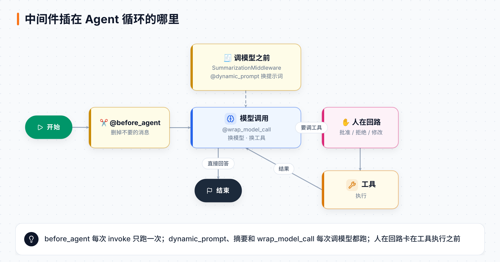
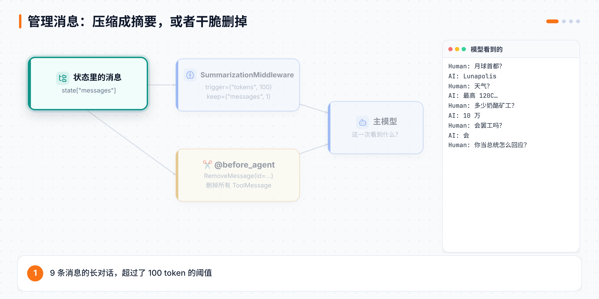
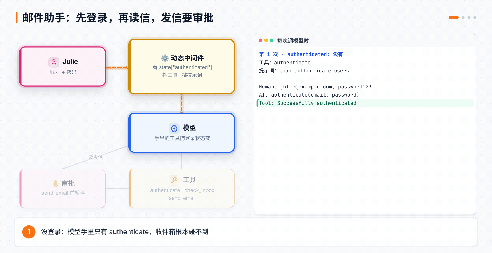

# 第 18 章 新版 LangChain 入门（下）：管理消息、人在回路与动态 Agent

> **本章目标**：学会控制对话越来越长时模型"看到什么"（摘要、删消息），让人在关键操作前审批（批准、拒绝、修改），再用三种**动态**中间件让 Agent 随情况换模型、换提示词、换工具。最后把这些拼成课程的第三个项目：📧 先登录、再读信、发信要审批的邮件助手，并在网页聊天界面里跑起来。
> **对应课程**：Introduction to LangChain (Python) · Module 3「Advanced Context Engineering」（3.2 管理消息、3.3 人在回路、3.4 动态模型 / 动态提示词 / 动态工具、3.5 邮件助手项目与 Agent Chat UI）

[← 上一章](17-LangChain新版入门-模型工具与多智能体.md) ｜ [返回导读](README.md) ｜ [下一章 →](附录-速查表与术语表.md)

---

> 📎 **资料说明**：代码来自 [langchain-ai/lca-lc-foundations](https://github.com/langchain-ai/lca-lc-foundations) 的 `notebooks/module-3`。标着"本地实测"的结果，是用 langchain 1.4.6 加按剧本说话的假模型跑出来的：模型说什么是剧本定的，但**中间件怎么改消息、换工具、换提示词、中断和恢复**，都是框架真实的行为。

## 18.1 这一章的主角：中间件

第 3 章介绍过中间件：在 Agent 循环的关键位置"插钩子"。这一章用到的几种，按它插在哪里分：



| 中间件 | 什么时候运行 | 本章用它做什么 |
|---|---|---|
| `SummarizationMiddleware` | 每次调模型之前 | 消息太长时压缩成摘要（18.2） |
| `@before_agent` | 每次 `invoke` 开始时运行一次 | 删掉不想要的消息（18.3） |
| `HumanInTheLoopMiddleware` | 模型要调工具之后、工具执行之前 | 暂停等人审批（18.4） |
| `@wrap_model_call` | 包住每一次模型调用 | 换模型（18.5）、换工具（18.7） |
| `@dynamic_prompt` | 每次调模型之前 | 换系统提示词（18.6） |

## 18.2 摘要：旧消息压成一段话

对话越长，每次调模型的 token 越多，又贵又慢，还可能超出上下文窗口。`SummarizationMiddleware` 在消息超过阈值时，用一个（可以更便宜的）模型把旧消息写成摘要：

```python
from langchain.agents import create_agent
from langchain.agents.middleware import SummarizationMiddleware
from langgraph.checkpoint.memory import InMemorySaver

agent = create_agent(
    model="gpt-5-nano",
    checkpointer=InMemorySaver(),
    middleware=[
        SummarizationMiddleware(
            model="gpt-4o-mini",          # 写摘要用的模型
            trigger=("tokens", 100),      # 超过 100 个 token 就压缩（课程故意设得很小）
            keep=("messages", 1),         # 压缩后保留最近 1 条原文
        )
    ],
)
```

课程喂给它一段 9 条消息的"月球首都 Lunapolis"对话：天气、10 万奶酪矿工、工会要罢工，最后问"如果你是新总统，怎么回应工会？"



**本地实测**：

| 看哪里 | 结果 |
|---|---|
| 状态里剩几条消息 | 9 条输入 → 只剩 **3 条**：摘要、最后那个问题、模型的回答 |
| 第一条消息 | 一条 `HumanMessage`，以 `Here is a summary of the conversation to date:` 开头，后面是摘要模型写的内容 |
| 主模型这次看到什么 | 只有两条 `HumanMessage`：摘要 + 最后的问题 |

> 💡 和第 13 章 Deep Agents 的摘要不同，这里的摘要会**直接替换状态里的旧消息**，原文不保留。如果旧消息以后还可能用到，要么把 `keep` 设大一点，要么用 Deep Agents 那种"原文存文件"的做法。

`trigger` 和 `keep` 除了按 token 数，也可以按消息条数，比如 `trigger=("messages", 20)`。

## 18.3 删除消息：只留模型需要的

有时候不是消息太多，而是有些消息**根本不该给模型看**，比如一堆机器诊断日志。用 `@before_agent` 在每次调用开始时删掉它们：

```python
from typing import Any
from langchain.agents import AgentState
from langchain.agents.middleware import before_agent
from langchain.messages import RemoveMessage, ToolMessage
from langgraph.runtime import Runtime

@before_agent
def trim_messages(state: AgentState, runtime: Runtime) -> dict[str, Any] | None:
    """Remove all the tool messages from the state"""
    tool_messages = [m for m in state["messages"] if isinstance(m, ToolMessage)]
    return {"messages": [RemoveMessage(id=m.id) for m in tool_messages]}

agent = create_agent(model="gpt-5-nano", checkpointer=InMemorySaver(), middleware=[trim_messages])
```

返回 `RemoveMessage(id=...)` 是 LangGraph 删除消息的标准做法（第 5 章讲过）：消息列表的归约器看到它，就把对应 id 的消息删掉。

课程的例子很有意思：对话里有两条工具消息，一条是 `blorp-x7 initiating diagnostic ping…`，一条是 `temp=42C voltage=2.9v … greeble complete.`。最后用户问"设备温度是多少？"

**本地实测**：模型这次收到的是 `[Human, AI, Human, AI, Human]`，两条 `ToolMessage` 都不见了，状态里也没有了。所以模型**答不出 42°C**，因为温度就在被删掉的那条消息里。

> ⚠️ 这正是课程想让你看到的：**删消息是有代价的**。删之前想清楚模型以后还需不需要这些信息。

## 18.4 人在回路：批准、拒绝、修改

发邮件、转账、删数据这类操作，最好让人先看一眼。`HumanInTheLoopMiddleware` 按工具名决定要不要暂停：

```python
from langchain.agents import AgentState, create_agent
from langchain.agents.middleware import HumanInTheLoopMiddleware
from langchain.tools import tool, ToolRuntime

class EmailState(AgentState):
    email: str

@tool
def read_email(runtime: ToolRuntime) -> str:
    """Read an email from the given address."""
    return runtime.state["email"]

@tool
def send_email(body: str) -> str:
    """Send an email to the given address with the given subject and body."""
    return "Email sent"

agent = create_agent(
    model="gpt-5-nano",
    tools=[read_email, send_email],
    state_schema=EmailState,
    checkpointer=InMemorySaver(),               # 必须有：暂停时要把进度存下来
    middleware=[
        HumanInTheLoopMiddleware(
            interrupt_on={"read_email": False, "send_email": True},   # 只有发信要审批
            description_prefix="Tool execution requires approval",
        ),
    ],
)

config = {"configurable": {"thread_id": "1"}}
response = agent.invoke({
    "messages": [HumanMessage(content="Please read my email and send a response immediately. Send the reply now in the same thread.")],
    "email": "Hi Seán, I'm going to be late for our meeting tomorrow. Can we reschedule? Best, John.",
}, config=config)

print(response["__interrupt__"][0].value["action_requests"][0]["args"]["body"])   # 看看它想发什么
```

暂停后，用**同一个 `thread_id`** 发一个 `Command(resume=...)` 来做决定：



```python
from langgraph.types import Command

# ✅ 批准：照原样执行
agent.invoke(Command(resume={"decisions": [{"type": "approve"}]}), config=config)

# ❌ 拒绝：不执行，并告诉模型为什么
agent.invoke(Command(resume={"decisions": [{
    "type": "reject",
    "message": "No please sign off - Your merciful leader, Seán.",
}]}), config=config)

# ✏️ 修改：换成你改过的参数再执行
agent.invoke(Command(resume={"decisions": [{
    "type": "edit",
    "edited_action": {"name": "send_email", "args": {"body": "This is the last straw, you're fired!"}},
}]}), config=config)
```

**本地实测**：

| 决定 | 模型下一轮看到的工具消息 | 之后 |
|---|---|---|
| 批准 | 工具的真实返回值 | 继续 |
| 拒绝 | ``User rejected the tool call for `send_email` with reason: 请署名`` | 模型按意见改了正文、重新调用 `send_email`，**又停下来等审批** |
| 修改 | 先是一段说明："a human reviewer replaced this tool call before it ran… Do not re-issue your original call. Executed instead: send_email with arguments {…}"，然后是工具用新参数执行的结果 | 继续 |

中断信息里的 `review_configs` 写着允许哪些决定，实测是 `['approve', 'edit', 'reject', 'respond']`，比课程演示的三种多一个 `respond`。实测 `{"type": "respond", "message": "我自己已经回过了"}` 的效果是：工具不执行，这句话直接变成工具消息交给模型。

## 18.5 动态模型：按情况换模型

`@wrap_model_call` 把每次模型调用包起来，可以在调用之前改请求。课程的例子：**短对话用便宜模型，长对话换上下文窗口更大的模型**。

```python
from typing import Callable
from langchain.agents.middleware import wrap_model_call, ModelRequest, ModelResponse
from langchain.chat_models import init_chat_model

large_model = init_chat_model("claude-sonnet-4-6")
standard_model = init_chat_model("gpt-5-nano")

@wrap_model_call
def state_based_model(request: ModelRequest,
                      handler: Callable[[ModelRequest], ModelResponse]) -> ModelResponse:
    """Select model based on State conversation length."""
    message_count = len(request.messages)        # request.messages 是 request.state["messages"] 的简写
    model = large_model if message_count > 10 else standard_model
    return handler(request.override(model=model))

agent = create_agent(model="gpt-5-nano", middleware=[state_based_model],
                     system_prompt="You are roleplaying a real life helpful office intern.")
```

`request.override(...)` 返回一个改过的新请求，原请求不变；最后一定要 `return handler(request)`，把请求交下去。看实际用了哪个模型：`response["messages"][-1].response_metadata["model_name"]`。

**本地实测**：用两个假模型分别回答 `small` 和 `big`。只有 1 条消息时回答是 `small`；喂 11 条消息时回答是 `big`。

## 18.6 动态提示词：按用户换系统提示词

`@dynamic_prompt` 是一种专门用来生成系统提示词的中间件：函数返回什么字符串，这一次调用的系统提示词就是什么。

```python
from dataclasses import dataclass
from langchain.agents.middleware import dynamic_prompt, ModelRequest

@dataclass
class LanguageContext:
    user_language: str = "English"

@dynamic_prompt
def user_language_prompt(request: ModelRequest) -> str:
    """Generate system prompt based on user role."""
    user_language = request.runtime.context.user_language
    base_prompt = "You are a helpful assistant."
    if user_language != "English":
        return f"{base_prompt} only respond in {user_language}."
    return base_prompt

agent = create_agent(model="gpt-5-nano", context_schema=LanguageContext, middleware=[user_language_prompt])

agent.invoke({"messages": [HumanMessage(content="Hello, how are you?")]},
             context=LanguageContext(user_language="Irish"))      # 用爱尔兰语回答
```

上一章说过：上下文不会自动进入提示词。**动态提示词就是把上下文（或状态）变成提示词的最直接办法。** 它能读 `request.runtime.context`，也能读 `request.state`。

## 18.7 动态工具：按权限给工具

还是 `@wrap_model_call`，这次改的是 `tools`：

```python
@dataclass
class UserRole:
    user_role: str = "external"

@wrap_model_call
def dynamic_tool_call(request: ModelRequest,
                      handler: Callable[[ModelRequest], ModelResponse]) -> ModelResponse:
    """Dynamically call tools based on the runtime context"""
    if request.runtime.context.user_role != "internal":
        request = request.override(tools=[web_search])     # 外部用户只能联网搜索
    return handler(request)                                # 内部用户保留全部工具

agent = create_agent(model="gpt-5-nano", tools=[web_search, sql_query],
                     middleware=[dynamic_tool_call], context_schema=UserRole)

agent.invoke({"messages": [HumanMessage(content="How many artists are in the database?")]},
             context={"user_role": "external"})            # 上下文也可以直接传字典
```

外部用户问数据库，模型手里根本没有 `sql_query`，只能说查不了。

> 💡 **"不给工具"比"在提示词里说别用"可靠得多。** 模型看不到的工具，它就不可能调用。这和第 13 章 Deep Agents 的"权限写在代码里"是同一个道理。

三种动态中间件对照：

| | 改什么 | 装饰器 | 常见依据 |
|---|---|---|---|
| 动态模型 | `request.override(model=...)` | `@wrap_model_call` | 对话长度、任务难度、成本 |
| 动态提示词 | 返回的字符串 | `@dynamic_prompt` | 用户语言、角色、偏好 |
| 动态工具 | `request.override(tools=[...])` | `@wrap_model_call` | 权限、登录状态、当前阶段 |

## 18.8 项目三：📧 邮件助手

Module 3 的项目把这一章全部串起来：

1. **先登录**：没登录时，模型只有 `authenticate` 一个工具，系统提示词也只说"你能帮用户登录"。
2. **登录后才能看信**：工具换成 `check_inbox` 和 `send_email`，提示词换成"你能查收件箱和发邮件，登录后第一步先查收件箱"。
3. **发信要审批**：`send_email` 交给人在回路中间件把关。

```python
from dataclasses import dataclass
from langchain.agents import AgentState, create_agent
from langchain.tools import tool, ToolRuntime
from langchain.messages import ToolMessage
from langgraph.types import Command

@dataclass
class EmailContext:                     # 正确的账号密码，调用时从外面递进来
    email_address: str = "julie@example.com"
    password: str = "password123"

class AuthenticatedState(AgentState):   # 登录状态，对话中会变
    authenticated: bool

@tool
def check_inbox() -> str:
    """Check the inbox for recent emails"""
    return """
    Hi Julie,
    I'm going to be in town next week and was wondering if we could grab a coffee?
    - best, Jane (jane@example.com)
    """

@tool
def send_email(to: str, subject: str, body: str) -> str:
    """Send an response email"""
    return f"Email sent to {to} with subject {subject} and body {body}"

@tool
def authenticate(email: str, password: str, runtime: ToolRuntime) -> Command:
    """Authenticate the user with the given email and password"""
    ok = email == runtime.context.email_address and password == runtime.context.password
    return Command(update={
        "authenticated": ok,
        "messages": [ToolMessage("Successfully authenticated" if ok else "Authentication failed",
                                 tool_call_id=runtime.tool_call_id)],
    })
```

（课程原文的 `authenticate` 用 `if/else` 写了两个 `Command`，意思一样。）

动态工具和动态提示词都看**状态里的 `authenticated`**：

```python
@wrap_model_call
def dynamic_tool_call(request: ModelRequest, handler: Callable[[ModelRequest], ModelResponse]) -> ModelResponse:
    """Allow read inbox and send email tools only if user provides correct email and password"""
    tools = [check_inbox, send_email] if request.state.get("authenticated") else [authenticate]
    return handler(request.override(tools=tools))

authenticated_prompt = """You are a helpful assistant that can check the inbox and send emails.
Your first step after authentication is to check the inbox."""
unauthenticated_prompt = "You are a helpful assistant that can authenticate users."

@dynamic_prompt
def dynamic_prompt_func(request: ModelRequest) -> str:
    """Generate system prompt based on authentication status"""
    return authenticated_prompt if request.state.get("authenticated") else unauthenticated_prompt

agent = create_agent(
    "gpt-5-nano",
    tools=[authenticate, check_inbox, send_email],      # 先全部登记，再由中间件挑
    checkpointer=InMemorySaver(),
    state_schema=AuthenticatedState,
    context_schema=EmailContext,
    middleware=[
        dynamic_tool_call,
        dynamic_prompt_func,
        HumanInTheLoopMiddleware(interrupt_on={"authenticate": False, "check_inbox": False, "send_email": True}),
    ],
)
```

> ⚠️ `tools=[...]` 里要把三个工具**都列上**。中间件只能从已登记的工具里挑；没登记的工具，就算模型调了，Agent 也不知道怎么执行。

跑一遍：

```python
config = {"configurable": {"thread_id": "1"}}

agent.invoke({"messages": [HumanMessage(content="julie@example.com, password123")]},
             context=EmailContext(), config=config)
# → 登录成功，自动查收件箱，读出 Jane 约咖啡的信，给出几版回信草稿

response = agent.invoke({"messages": [HumanMessage(content="any draft is fine. don't check back.")]},
                        context=EmailContext(), config=config)
print(response["__interrupt__"][0].value["action_requests"][0]["args"]["body"])   # 停在发信前

agent.invoke(Command(resume={"decisions": [{"type": "approve"}]}), config=config)
# → Email sent to jane@example.com with subject "Re: Coffee next week" ...
```

**本地实测**：用假模型按"登录 → 查收件箱 → 回复 → 发信 → 结束"的剧本跑完一遍，记下每次调用模型时**它手里有哪些工具、系统提示词是哪个**：

| 第几次调模型 | 状态里 `authenticated` | 模型拿到的工具 | 系统提示词 |
|---|---|---|---|
| 1 | 没有 | `authenticate` | 未登录版 |
| 2 | `True` | `check_inbox`、`send_email` | 已登录版 |
| 3–5 | `True` | `check_inbox`、`send_email` | 已登录版 |

`send_email` 调用时停下，中断信息里的正文就是剧本里写的那句；批准后工具返回 `Email sent to jane@example.com …`。换成错误密码再跑一次：`authenticated` 是 `False`，第二次调模型时手里**仍然只有 `authenticate`**，收件箱根本碰不到。

> 💡 课程 notebook 开头有一行 `warnings.filterwarnings("ignore", message=".*Pydantic serializer warnings.*")`。实测不加的话，每次把 `dataclass` 当上下文传进去都会打出一串 `PydanticSerializationUnexpectedValue` 警告。它不影响结果，只是吵。

## 18.9 在网页聊天界面里跑邮件助手

课程最后把邮件助手放进 **Agent Chat UI**：一个现成的网页聊天界面，能显示工具调用，遇到中断会弹出审批卡片。

`notebooks/module-3/langgraph.json`：

```json
{
  "dependencies": ["."],
  "graphs": { "agent": "./3.5_email_agent.py:agent" },
  "env": "../../.env"
}
```

注意 `3.5_email_agent.py` 里的 `create_agent` **没有传 `checkpointer`**，用 `langgraph dev` 或部署时，服务器会自动提供持久化（第 9 章讲过）。它里面的 `dynamic_tool_call` 写成了 `async def`，配合服务器的异步执行。

```bash
cd notebooks/module-3
uv run langgraph dev                   # 本地服务跑在 http://localhost:2024

cd agent-chat-ui                       # 课程仓库里带了一份
pnpm install
pnpm dev                               # 打开网页，连接 http://localhost:2024，图 ID 填 agent
```

也可以不装，直接用在线版 [agentchat.vercel.app](https://agentchat.vercel.app)，填上本地服务地址和图 ID。

> ⚠️ 网页界面里怎么传 `context`（账号密码）？`EmailContext` 的字段都有默认值，不传就用默认的 `julie@example.com / password123`。真实项目里，账号信息应该由你的后端在调用时注入，而不是写死在代码里。

## 📌 本章小结

| 你想做的事 | 用什么 | 关键写法 |
|---|---|---|
| 对话太长就压缩 | 摘要中间件 | `SummarizationMiddleware(model=..., trigger=("tokens", N), keep=("messages", K))` |
| 删掉某类消息 | `@before_agent` | `return {"messages": [RemoveMessage(id=m.id) ...]}` |
| 关键操作要审批 | 人在回路 | `HumanInTheLoopMiddleware(interrupt_on={"send_email": True})` |
| 恢复执行 | `Command` | `Command(resume={"decisions": [{"type": "approve" / "reject" / "edit"}]})` |
| 按情况换模型 | `@wrap_model_call` | `handler(request.override(model=...))` |
| 按用户换提示词 | `@dynamic_prompt` | 返回字符串；读 `request.runtime.context` 或 `request.state` |
| 按权限给工具 | `@wrap_model_call` | `handler(request.override(tools=[...]))` |
| 网页里聊天和审批 | Agent Chat UI | `langgraph dev` + 图 ID |

新版 LangChain 入门课的三个项目对照：

| 项目 | 新学到的 | 章节 |
|---|---|---|
| 🍳 私人厨师 | 工具 + 提示词 + 记忆 | 17.5 |
| 💒 婚礼策划 | MCP、状态驱动的多智能体、容错 | 17.9 |
| 📧 邮件助手 | 动态工具和提示词、人在回路、聊天界面 | 18.8 |

## 🧪 动手练习

1. **摘要的阈值**：把 18.2 的 `trigger` 改成 `("messages", 6)`、`keep` 改成 `("messages", 3)`，数一数压缩后状态里剩几条消息。
2. **聪明地删消息**：把 18.3 的 `trim_messages` 改成"只删内容里带 `blorp` 的工具消息"，再问一次温度，看模型能不能答出 42°C。
3. **三种决定**：在邮件助手里分别试一次批准、拒绝（理由写"语气再正式一点"）、修改（把收件人改成你自己），在 LangSmith 里对比三条 trace。
4. **按时间换模型**：写一个动态模型中间件，工作日用便宜模型，周末用强模型（提示：在中间件里用 `datetime.now().weekday()`）。
5. **登录三次锁定**：给邮件助手的状态加一个 `failed_attempts` 计数，密码错三次后，动态工具里连 `authenticate` 也不给了，动态提示词改成"账号已锁定"。

---

🎉 **新版 LangChain 入门课到这里就学完了。** 到此为止，Academy 上 LangChain、LangGraph、Deep Agents、LangSmith 四条线的入门课本教程都覆盖了。

[下一章：附录 · 速查表与术语表 →](附录-速查表与术语表.md)
