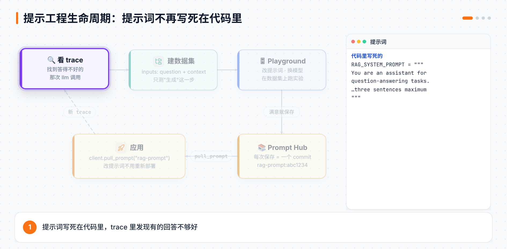
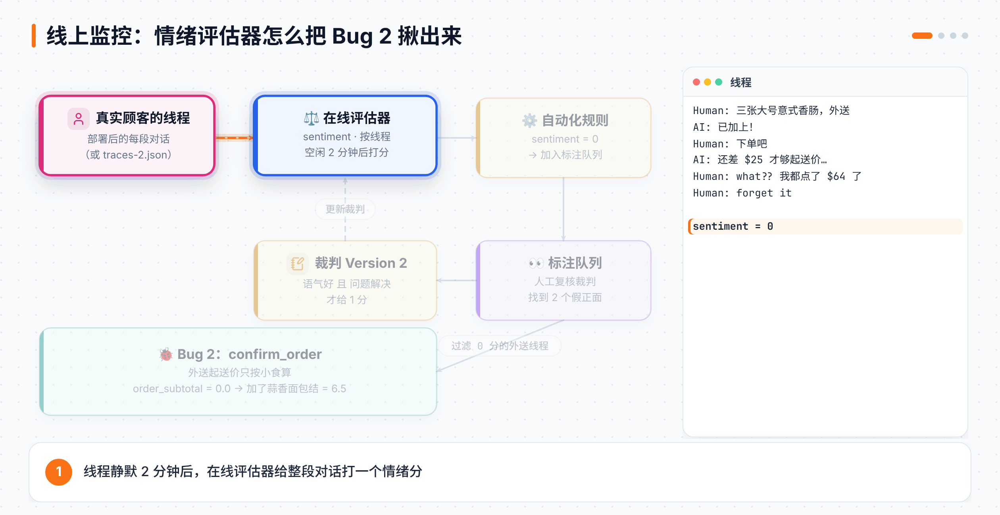
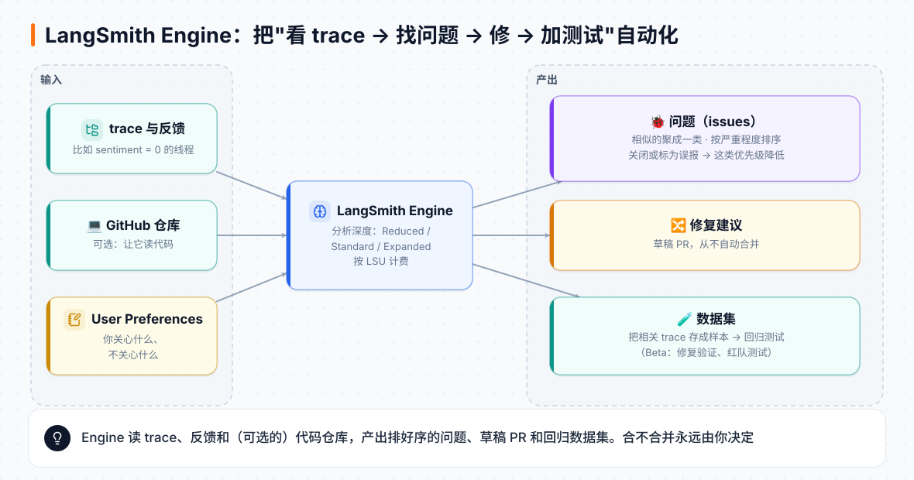

# 第 18 章 LangSmith 提示工程与生产监控：上线之后才是开始

> **本章目标**：学会把提示词交给 Prompt Hub 管理、在 Playground 里做提示词实验；把 Agent 部署上线，收集用户反馈，用在线评估器、自动化规则、标注队列、Insights 和仪表盘盯住线上流量，最后抓出只有真实流量才暴露的 Bug 2。最后看看 LangSmith Engine 怎么把这个循环自动化。
> **对应课程**：LangSmith Essentials · Module 3「Deployments」+ Module 4「Online Evaluation & Monitoring」（Online Evaluators and Automations、Annotation Queues、Insights、Dashboards、Capstone）+ Module 5「Closing the Loop」（Closing the Loop、Automating the ADLC with LangSmith Engine）；Intro to LangSmith · Module 3–5（Playground 实验、Prompt Hub、提示工程生命周期、发布反馈、过滤、在线评估）

[← 上一章](17-LangSmith追踪与评估.md) ｜ [返回导读](README.md) ｜ [下一章 →](附录-速查表与术语表.md)

---

> 📎 **资料说明**：代码来自 [intro-to-langsmith](https://github.com/langchain-ai/intro-to-langsmith) 和 [lca-langsmith-essentials](https://github.com/langchain-ai/lca-langsmith-essentials) 两个公开仓库，情绪评估器的两版提示词原文来自后者的 README。Annotation Queues、Insights、Dashboards、Engine、LangSmith Chat 这几节课是纯平台操作、没有公开文字稿，内容按 [LangSmith 官方文档](https://docs.langchain.com/langsmith) 整理（2026 年 10 月）。平台界面和价格变得快，以你看到的为准。

## 18.1 Playground：不写代码试提示词

**Playground** 是 LangSmith 网页上的提示词试验台：改提示词、换模型、调温度，马上看到输出。有三种常见用法：

| 用法 | 怎么进 |
|---|---|
| 从零试一个提示词 | 左侧菜单 **Playground** |
| 重放一次模型调用 | 打开任意 trace 里的 `llm` run，点 **Playground**，输入原样带过去 |
| 在数据集上跑实验 | Playground 里选一个数据集，一次把所有样本都跑一遍，还能挂上评估器 |

第三种叫 **Playground 实验**，和上一章的 `evaluate()` 一样会生成实验记录，只是不用写代码。Intro 课先用 SDK 建了一个三条样本的小数据集：

```python
from langsmith import Client

client = Client()
dataset = client.create_dataset(dataset_name="Sample Questions", description="Sample questions about color")
client.create_examples(
    inputs=[{"question": q} for q in ["What color is the sky?", "What color is grass?", "What color is dirt?"]],
    outputs=[{"output": a} for a in ["The sky is blue", "Grass is green", "Dirt is brown"]],
    dataset_id=dataset.id,
)
```

然后在 Playground 里选这个数据集，写一个提示词（比如"用海盗的口吻回答"），点 **Start**，三条输出并排出现。改一版提示词再跑一次，两个实验就能对比了。

## 18.2 Prompt Hub：把提示词当代码管

提示词写死在代码里，每改一个字都要重新部署。**Prompt Hub** 把提示词存在 LangSmith 上，每次保存是一个 **commit**，代码里按名字拉取就行。

### 拉取

在 Prompt Hub 页面复制代码片段，大致长这样：

```python
from langsmith import Client
client = Client()

prompt = client.pull_prompt("my-prompt")                 # 最新版
prompt = client.pull_prompt("my-prompt:abc1234")         # 指定某个 commit
prompt = client.pull_prompt("my-prompt", include_model=True)   # 连模型配置一起拉（LangChain 专用）
```

不带 `include_model` 时拉下来的只是模板（`StructuredPrompt`），不能直接运行。先用 `.invoke()` 填进变量，再转成 OpenAI 格式发出去：

```python
from openai import OpenAI
from langsmith.client import convert_prompt_to_openai_format

hydrated = prompt.invoke({"question": "Are you a captain yet?", "language": "Spanish"})
messages = convert_prompt_to_openai_format(hydrated)["messages"]
OpenAI().chat.completions.create(model="gpt-4o-mini", messages=messages)
```

带 `include_model=True` 时，拉下来的是"模板 + 模型"组成的 LangChain 可运行对象，直接 `prompt.invoke({...})` 就能拿到回答。

### 推送

```python
from langchain_core.prompts import ChatPromptTemplate
from langchain_openai import ChatOpenAI

french_prompt = ChatPromptTemplate.from_template("""You are an assistant for question-answering tasks.
Use the following pieces of retrieved context to answer the latest question in the conversation.

Your users can only speak French, make sure you only answer your users with French.

Conversation: {conversation}
Context: {context}
Question: {question}
Answer:""")

client.push_prompt("french-rag-prompt", object=french_prompt)                       # 只推模板
client.push_prompt("french-runnable-sequence", object=french_prompt | ChatOpenAI(model="gpt-4o-mini"))  # 模板 + 模型
```

推"模板 + 模型"时，模型的提供商必须是 Playground 支持的。

## 18.3 提示工程的生命周期

把前两节串起来，就是 Intro 课 Module 3 讲的完整流程：



1. **看 trace**：跑一次应用，在 trace 里找到效果不好的那次模型调用。
2. **建数据集**：只针对"生成回答"这一步建数据集。课程的样本输入有两个字段：`question` 和检索到的 `context`，这样评估时不用每次都重新检索。
3. **Playground 迭代**：把提示词放进 Playground，在数据集上跑实验，一版一版改，直到分数满意。
4. **保存到 Prompt Hub**：满意的版本存成一个 commit。
5. **应用改成拉取**：把代码里写死的 `RAG_SYSTEM_PROMPT` 换成从 Prompt Hub 拉：

```python
prompt = client.pull_prompt("rag-prompt")       # 你在 Prompt Hub 保存的名字

@traceable(run_type="chain")
def generate_response(question: str, documents):
    formatted_docs = "\n\n".join(doc.page_content for doc in documents)
    formatted_prompt = prompt.invoke({"context": formatted_docs, "question": question})
    messages = convert_prompt_to_openai_format(formatted_prompt)["messages"]
    return call_openai(messages)
```

以后改提示词只要在 Prompt Hub 里存个新版本，不用改代码、不用重新部署。

## 18.4 Module 3：把 Sal 部署上线

Essentials 课用一条命令把披萨店 Agent 部署到 LangSmith：

```bash
cd langgraph-agent
uv run langgraph deploy --name langslice-deployment
```

部署读的是同一个 `langgraph.json`，部署完就有了一个线上 API（第 11 章讲过部署的原理）。之后顾客的每段对话都会以线程的形式出现在追踪项目里，这就是下面几节要监控的"真实流量"。

> ⚠️ **别漏了这一步**：后面的在线评估器是 **LangSmith 在自己的服务器上**调模型，读不到你本机的 `.env`。所以要把 `OPENAI_API_KEY` 存成工作区密钥：**Settings → Provider secrets**。课程的情绪裁判是按 OpenAI 模型校准的，就算你只跑 Claude SDK 版，这里也要放 OpenAI 的 key。

课程仓库还提供了录好的对话，没有真实用户时可以直接上传，模拟一批线上流量：

```bash
cd traces
uv sync
uv run python upload_traces.py --input traces-1.json     # Module 1 用
uv run python upload_traces.py --input traces-2.json     # Module 4 用
```

## 18.5 用户反馈：让顾客给 run 打分

线上最直接的信号是用户反馈（点赞、点踩、打分）。只要知道 `run_id`，就能给它挂反馈：

```python
from langsmith import Client
client = Client()

client.create_feedback(run_id, key="sample-continuous", score=7.0,
                       comment="连续分数：比如 1–10 分")
client.create_feedback(run_id, key="sample-categorical", value="no",
                       comment="分类值：比如 yes / no")
```

问题是：用户点"👍"的时候，你的前端怎么知道 `run_id`？办法是**提前生成**，调用时传进去：

```python
import uuid
from langsmith import traceable

pre_defined_run_id = uuid.uuid4()

@traceable
def foo():
    return "This is a sample Run!"

foo(langsmith_extra={"run_id": pre_defined_run_id})     # 这次 run 的 id 就是它
client.create_feedback(pre_defined_run_id, "user_feedback", score=1)
```

上一章的本地实测已经确认：传进去的 `run_id` 就是根节点的 id。

还有一个问题：网页前端不能拿着 API Key 去调 `create_feedback`。这时用**预签名反馈链接**，它不需要密钥，甚至可以在 run 产生之前就生成：

```python
pre_signed_url_id = uuid.uuid4()
token = client.create_presigned_feedback_token(pre_signed_url_id, "user_presigned_feedback")

foo(langsmith_extra={"run_id": pre_signed_url_id})      # 之后再产生这个 run

import requests
requests.get(f"{token.url}?score=1")                    # 前端直接请求这个链接就算打分
```

## 18.6 过滤：在几万条 trace 里找到想看的

LangSmith 界面上可以按名字、标签、元数据、耗时、反馈分数、有没有报错等条件过滤 trace。拼好过滤条件后，可以把它复制成**查询语句**，在 SDK 里用：

```python
from datetime import datetime, timedelta
from langsmith import Client

client = Client()
runs = client.list_runs(
    project_name="langsmith-academy",
    filter='and(eq(run_type, "llm"), gt(latency, 5))',      # 过滤 run 本身：耗时超过 5 秒的模型调用
    start_time=datetime.now() - timedelta(days=1),
)

roots = client.list_runs(project_name="langsmith-academy", filter="eq(is_root, true)")   # 只要根节点
```

除了 `filter`，还有两个参数：

| 参数 | 作用于 | 例子 |
|---|---|---|
| `filter` | 要返回的 run 本身 | 只要报错的 run |
| `trace_filter` | 这个 run 所在 trace 的**根节点** | 只看根节点收到负面反馈的 trace 里的 run |
| `tree_filter` | 这个 run 所在 trace 里的**任意节点** | 只看某个工具被调用过的 trace |

## 18.7 在线评估器：给每段对话自动打分

上一章的评估器在数据集上跑，叫**离线评估**。**在线评估器**在真实流量上跑：新的 trace 或线程进来，按采样率自动打分，分数作为反馈挂上去。

Essentials 课给 Sal 做了一个**顾客情绪**评估器：LLM 当裁判，按**线程**打分（一段对话一个分数，而不是每条回复一个分数）。设置如下：

| 字段 | 值 |
|---|---|
| 来源 | Threads（线程） |
| 采样率 | 100% |
| 线程空闲时间 | 2 分钟（2 分钟没新消息，就认为这段对话结束了，开始打分） |
| 变量 | 三层花括号包住的 `human_ai_pairs`（见下面提示词末尾），绑定线程的 `human_ai_pairs` 字段 |
| 反馈键 | `sentiment` |
| 描述 | `Customer sentiment score as 1 (clearly positive) or 0 (negative)` |
| 类型 | Boolean（1 正面，0 负面） |

第一版提示词（Version 1）**只看语气**。节选：

```text
You are an expert customer-experience evaluator assessing customer sentiment across
multi-turn conversations with a pizza-ordering agent.

<Rubric>
Score 0 for negative sentiment when the customer's own language is negative:
- The customer expresses disbelief, annoyance, impatience, or anger ("what??", "are you kidding me").
- The customer raises their voice - capitals, repeated punctuation, or repeated objections.
- The customer signs off dismissively ("forget it", "I'm done", "I'll leave it").
- ……
Score 1 for positive sentiment when the customer's language stays pleasant, calm, or matter-of-fact:
- The customer disagrees with or corrects the agent in plain, unemotional terms ("that's not right", "no")
  - disagreement is not the same as displeasure.
- ……
</Rubric>

<Instructions>
- Judge the feeling the customer expresses, not whether the order was completed
  - task success is tracked separately.
- Do not give a positive score merely because the agent remains polite.
- ……
</Instructions>

<Reminder>
- Absence of negative language is positive sentiment.
</Reminder>

  <conversation>
  {{{human_ai_pairs}}}
  </conversation>
```

> 💡 注意 Version 1 的两句话："不管订单成没成，只看情绪"和"没有负面词就算正面"。下面你会看到它们出了什么问题。

## 18.8 自动化规则：分数出来之后自动做事

光打分还不够，还要**根据分数做事**。**自动化规则（Automation rule）**由四部分组成：

| 部分 | 说明 |
|---|---|
| 对象 | runs 还是 threads |
| 过滤条件 | 比如 `sentiment` 反馈为 0 |
| 采样率 | 符合条件的里面抽多少比例 |
| 动作 | 加入标注队列、加入数据集、调 webhook、跑在线评估器、跑代码评估器、延长保留期、发告警 |

在线评估器本身就是一种规则（动作是"跑评估器"）。Sal 的课程里再加一条：**情绪为 0 的线程 → 加入标注队列**，让人去复核。

> ⚠️ 按线程的规则有个**空闲时间**（默认 10 分钟，最少 2 分钟），线程静默这么久才会触发。每次最多处理 7 天内的 500 个线程。

## 18.9 标注队列：让人复核裁判

LLM 裁判也会判错，所以要有人定期抽查。**标注队列（Annotation Queue）**就是一个待复核的收件箱：

| 设置 | 作用 |
|---|---|
| 类型 | 单条复核（runs 或 threads），或两两对比（A/B 打分，快捷键 A、B、E） |
| 评分标准（rubric）和说明 | 告诉复核的人按什么打分 |
| 预留（reservation） | 一个人打开某条时先占住，别人不会重复看 |
| 每条需要几人复核、指定复核人 | 多人复核取共识 |

每次往队列里加东西最多 100 条。复核的人看完对话，可以改分、写备注，还可以一键把这条存进数据集。

### Sal 的复核结果：两个"假正面"

Essentials 课在队列里人工复核情绪裁判的打分，发现了**两个假正面**：顾客语气一直很平静，但最后**没买成**，裁判却给了 1 分。Version 2 的提示词里就点名了这两类情况：一个顾客只说了"that's not right."和"no. just the pizzas."，订单没下就走了；另一个顾客全程很客气，听从推销加了东西，又被拒了一次，最后说"thanks anyway"离开。

原因正是 Version 1 那两句：只看语气，不看结果。于是 **Version 2 加了"结果"这一块**：

```text
Also score 0 on outcome, whatever the tone:
- The customer's problem remains unresolved at the end of the conversation.
- The agent asks the customer to accept an unreasonable workaround, or to buy something they did not want,
  in order to get what they asked for.
- The customer gives up on their original request, or settles for something lesser than what they came for.

Score 1 for positive sentiment only when the customer's language stays pleasant, calm, or matter-of-fact
AND they got what they came for.

Flat affect is not a positive score. ……

<Reminder>
- Absence of negative language is not evidence of a good experience.
</Reminder>
```

| Version 1 | Version 2 |
|---|---|
| 只看语气，任务成败另算 | 加了"结果"一块：没解决就 0 分，不管语气多好 |
| 语气好就 1 分 | 语气好**而且**问题解决了才 1 分 |
| "没有负面词就算正面" | "没有负面词**不代表**体验好" |
| 平静地反对算正面 | 平静但订单没成，算负面 |

> 💡 这就是"评估评估器"：**裁判也需要被评估**。人工复核是给裁判找 Bug 的办法，找到的错判样本还可以存成数据集，以后改裁判提示词时拿来回归测试。

## 18.10 Module 4 实战：情绪分抓出了 Bug 2

把 `traces-2.json` 上传、情绪评估器跑完以后，过滤 `sentiment = 0` 的线程，会发现一批**外送订单**的对话都很糟糕：顾客点了好几张披萨，Sal 却一直说"还差 25 美元才够外送起送价"。



打开其中一条 trace：

1. `add_pizza_to_order` 返回的订单摘要里 `subtotal: 64.75`，明明早就超过 25 美元了。
2. 紧接着 `confirm_order` 返回 `status: "rejected"`、`reason: "below_delivery_minimum"`、`order_subtotal: 0.0`、`short_by: 25.0`。
3. 顾客加了一份蒜香面包结（garlic knots）之后，`confirm_order` 报 `order_subtotal: 6.5`，**正好是这份小食的价格**。这就是破案的线索。
4. 最后订单停在 `status: "open"`，`subtotal: 71.25`，什么都没送进厨房。

问题在 `confirm_order` 里，外送起送价**只按小食算了小计，没算披萨**：

```python
if order["order_type"] == "delivery":
    subtotal = sum(side["price"] * side["quantity"] for side in order["sides"])   # 披萨没算进去
    if subtotal < db.DELIVERY_MINIMUM:
        ...
```

**本地实测**：用假模型驱动工具复现，一张只有披萨的外送单确认时返回 `below_delivery_minimum`、`order_subtotal 0.0`、`short_by 25.0`；加了蒜香面包结后变成 `order_subtotal 6.5`、`short_by 18.5`。和课程描述一致。

**为什么 Module 1 时没发现？** Bug 1 在任何一条点了菠萝的 trace 里都能看到；Bug 2 只在"外送 + 主要点披萨"时出现，离线数据集里没有这种对话。**只有真实流量才会把它带出来**，这正是在线监控存在的意义。

**为什么 Sal 自己没察觉？** 其他订单工具都会返回 `db.order_summary(order)`，唯独这个拒绝响应没带订单快照，只给了原因、起送价和两个数字。系统提示词还要求 Sal "不要向顾客猜测原因"，所以它只能照着转述"还差 25 美元"。顾客越加越多、越来越生气，最后要么改自取，要么放弃。

**修复**：`confirm_order` 里有一行标着 `FIX` 的注释，取消注释、删掉上面那行。`db.order_summary()` 本来就会把披萨、小食和饮料全部加起来：

```python
if order["order_type"] == "delivery":
    subtotal = float(db.order_summary(order)["subtotal"])
    if subtotal < db.DELIVERY_MINIMUM:
        ...
```

## 18.11 Insights：自动归纳"用户都在聊什么、哪里出问题"

线程多到看不过来时，用 **Insights**：它读一批 trace，自动聚类，告诉你用户主要在做什么、常见的失败模式是什么。

| 项目 | 说明（按官方文档） |
|---|---|
| 套餐 | Plus 和 Enterprise |
| 规模 | 一次最多分析 1,000 条 trace，报告最长约 30 分钟生成 |
| 费用 | 用 OpenAI 模型大约每 1,000 个线程 1–2 美元 |
| 可配置 | 想要的分类（categories）、要抽取的属性（attributes）、只分析哪些 trace（`filter_by`）、总结提示词 |
| 定时 | 每天、每周或 cron 表达式 |
| 代码里用 | `client.generate_insights(...)`，或命令行 `langsmith insights create` |

对 Sal 来说，一份 Insights 报告可能会把"外送被拒"聚成一个单独的类，并告诉你它占了多少比例。

## 18.12 仪表盘：盯住关键数字

每个追踪项目都自带**预置仪表盘**，分成 Traces、LLM Calls、Cost & Tokens、Tools、Run Types、Feedback Scores 几块。想要自己的视图就新建一个：**Monitoring → + New Dashboard**。

| 可选指标 | 可选图表 |
|---|---|
| 数量、耗时、首字耗时（TTFT）、token 和费用、反馈分数、比率 | 折线、堆叠柱状、KPI 数字卡、排名柱状、环形图、表格 |

可以按元数据、标签等**分组**（最多 20 组）。给 Sal 建一个仪表盘：一张折线图看 `sentiment` 平均分，按 `order_type` 分组，修复 Bug 2 前后外送那条线的变化一眼就能看到。

## 18.13 Module 5：闭环，以及 LangSmith Engine

到这里，整个循环已经转了一圈：

| 阶段 | 用到的 LangSmith 功能 | Sal 的例子 |
|---|---|---|
| 开发与调试 | 追踪、Studio | 找到 Bug 1 |
| 离线评估 | 数据集、评估器、实验 | 证明 Bug 1 修好了 |
| 部署 | Deployment | 上线 |
| 线上监控 | 在线评估器、自动化、标注队列、Insights、仪表盘 | 发现 Bug 2，改进裁判 |
| 回流 | 坏样本存进数据集 | 下一轮离线评估覆盖外送场景 |

**闭环的关键一步是最后那一行**：线上发现的坏对话要存进数据集。这样 Bug 2 修好以后，以后每次改代码都会自动检查外送场景，它不会悄悄回来。

### LangSmith Engine：让这个循环自己转

Essentials 最后一课讲的是 **LangSmith Engine**，它把"看 trace → 找问题 → 修 → 加测试"这件事自动化。按官方文档：



| 项目 | 说明 |
|---|---|
| 读什么 | 项目里的 trace 和反馈；可选连上 GitHub 仓库读代码；你写的偏好设置（User Preferences） |
| 产出什么 | **问题（issues）**：按相似度聚类、按严重程度排序；**修复建议**：以草稿 PR 的形式提交，**从不自动合并**；**数据集**：把相关 trace 存成样本，方便回归测试 |
| 分析深度 | Reduced、Standard、Expanded 三档 |
| 计费 | 按 LSU 计，每个 1 美元，组织默认每月上限 750 LSU |
| Beta 功能 | 修复验证（Fix validation）和红队测试（Red Teaming），仅 Cloud 版 |

你对它的判断也是信号：把某个问题关掉或标成 **Incorrectly Flagged（误报）**，Engine 会降低这一类问题的优先级；修好的问题如果又出现，会自动重新打开。

对 Sal 来说，理想情况是：Engine 从情绪为 0 的线程里聚出"外送起送价计算错误"这个问题，读 `agent.py` 找到 `confirm_order`，提一个草稿 PR 把那行改掉，再附上一个包含这些对话的数据集。**合不合并，仍然是你说了算。**

### LangSmith Chat：用大白话问 LangSmith

LangSmith 界面右下角有一个聊天助手 **LangSmith Chat**（以前叫 Polly）。追踪、Playground、实验、标注队列这些页面都能用，比如在一条 trace 上问"这个 Agent 为什么调了两次 confirm_order"，或在实验页问"这两个实验差在哪几条样本"。

## 📌 本章小结

| 你想做的事 | 用什么 | 关键写法 / 位置 |
|---|---|---|
| 快速试提示词 | Playground | trace 里的 `llm` run → Playground |
| 提示词不写死在代码里 | Prompt Hub | `client.pull_prompt("name:commit")`、`client.push_prompt(...)` |
| 转成 OpenAI 格式 | 工具函数 | `convert_prompt_to_openai_format(hydrated)["messages"]` |
| 部署 | Deployment | `uv run langgraph deploy --name ...` + 工作区密钥 |
| 收集用户评价 | 反馈 | `create_feedback(run_id, key, score=/value=)`、预生成 `run_id`、预签名链接 |
| 查 trace | 过滤 | `list_runs(filter=..., trace_filter=..., tree_filter=...)` |
| 线上自动打分 | 在线评估器 | 来源选 Threads、空闲时间、反馈键 |
| 按分数自动做事 | 自动化规则 | 过滤 + 采样 + 动作 |
| 人工复核 | 标注队列 | rubric、预留、多人复核 |
| 看全局 | Insights、仪表盘 | 自动聚类；自定义图表 |
| 自动找问题、提修复 | LangSmith Engine | issues + 草稿 PR + 数据集 |

两个 Bug 的对照：

| | Bug 1：缺货没拦 | Bug 2：外送起送价算错 |
|---|---|---|
| 在哪 | `add_pizza_to_order` | `confirm_order` |
| 怎么发现 | 开发时看一条 trace | 线上情绪评估器 + 过滤 |
| 证据 | `get_ingredient` 子 run 里 `stock_units: 0` | `order_subtotal` 正好等于小食价格 |
| 怎么证明修好 | 库存评估器 + 实验对比 | 情绪分回升，坏对话存进数据集做回归 |

## 🧪 动手练习

1. **Prompt Hub**：把 Intro 课 RAG 应用的系统提示词推到 Prompt Hub，改成"只用中文回答"再存一个 commit，在代码里分别拉两个 commit 对比输出。
2. **反馈按钮**：写一个最小的命令行聊天，每轮回答后问"满意吗？(y/n)"，用预生成的 `run_id` 把回答作为反馈挂上去，在 LangSmith 里按反馈过滤。
3. **在线情绪评估器**：上传 `traces-2.json`，照 18.7 的设置建 Version 1 评估器，找出两个假正面；再换成 Version 2，看它们是不是变成了 0 分。
4. **修 Bug 2 并回归**：把情绪为 0 的外送对话存进数据集，修复 `confirm_order` 前后各跑一个实验，再写一个代码评估器检查"外送单最后有没有成功下单"。
5. **仪表盘**：新建一个仪表盘，放一张按 `order_type` 分组的 `sentiment` 折线图和一张工具调用次数的排名柱状图。

---

🎉 **LangSmith 两门课到这里就学完了。** 回头看第 13 章那张循环图，现在每一格你都亲手做过一遍。

[下一章：附录 · 速查表与术语表 →](附录-速查表与术语表.md)
