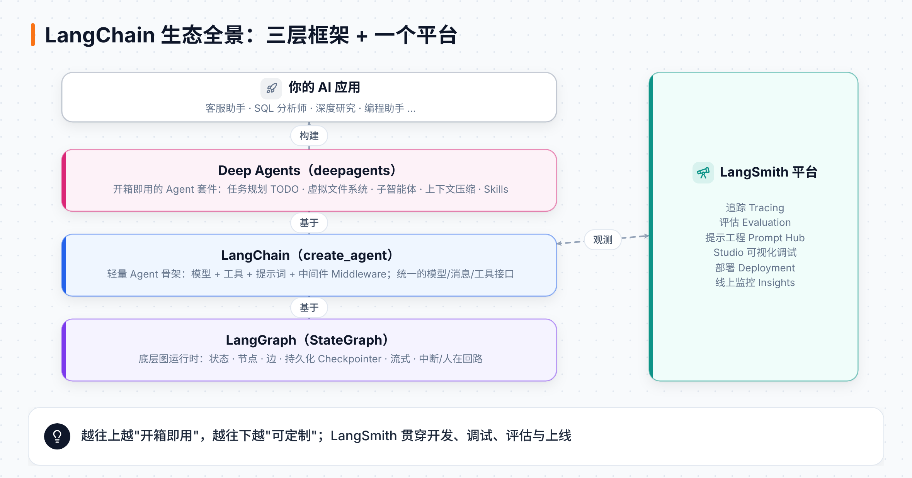
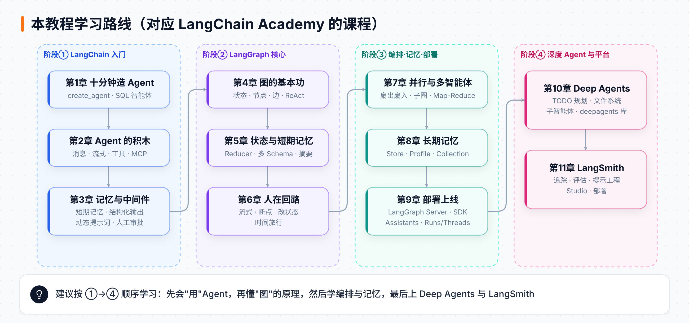

# LangChain Academy 中文图文教程 · 总导读

> 本教程依据 [LangChain Academy](https://academy.langchain.com/) 的官方免费课程整理而成，用中文、配图和动图，带你从"会用一个 Agent"一路走到"能设计、调试、部署复杂的多智能体系统"。

---

## 一、这份教程适合谁？

| 你的情况 | 建议读法 |
|---|---|
| 会一点 Python，从没写过 AI Agent | 从第 1 章顺序读，每章末尾的"动手练习"一定要做 |
| 用过 LangChain 老版本（`create_react_agent`、LCEL） | 直接看第 1、3 章，了解 1.0 的 `create_agent` 与中间件；再看第 10 章 |
| 想把 Agent 做成产品 | 重点读第 6（人在回路）、8（长期记忆）、9（部署）、11（LangSmith）章 |
| 想做 Claude Code / Manus 那样的"长任务 Agent" | 第 4 章打底，然后直接读第 10 章 Deep Agents |

**前置知识**：Python 基础（函数、类、类型注解 `TypedDict`）、知道什么是 API Key。不需要机器学习背景。

---

## 二、先用一分钟弄懂四个名字

LangChain 团队的产品是**一层叠一层**的，理解这一点，后面所有内容都会顺很多：

| 名字 | 一句话 | 你什么时候用它 |
|---|---|---|
| **LangGraph** | 底层"图运行时"：用 **状态 + 节点 + 边** 描述任意流程，自带持久化、流式、中断 | 流程不是标准 Agent 循环，需要精细控制时 |
| **LangChain** | 在 LangGraph 之上的轻量 Agent 骨架 `create_agent`，加上统一的模型/消息/工具接口 | 绝大多数"模型 + 工具"的 Agent，几行代码搞定 |
| **Deep Agents** | 在 `create_agent` 之上的"全家桶"：任务规划、文件系统、子智能体、上下文压缩 | 需要几十步工具调用的长任务（研究、编程） |
| **LangSmith** | 平台：追踪、评估、提示工程、Studio 调试、部署 | 从第一天开发起就用来"看清"Agent 在干什么 |

> 💡 记忆口诀：**LangGraph 是发动机，LangChain 是整车底盘，Deep Agents 是改装好的越野车，LangSmith 是仪表盘和 4S 店。**

---

## 三、LangChain Academy 有哪些课？

Academy 上的课程会持续更新，下面是撰写本教程时（2026 年 10 月）能确认的主要课程，以及它们在本教程中的位置：

| Academy 课程 | 内容 | 本教程章节 |
|---|---|---|
| **LangChain Essentials（Python）** / Introduction to LangChain | `create_agent`、消息、流式、工具、MCP、记忆、结构化输出、中间件 | 第 1–3 章 |
| **Introduction to LangGraph** | 图的基本功 → 状态与记忆 → 人在回路 → 并行与子图 → 长期记忆 → 部署（Module 0–6） | 第 4–9 章 |
| **Deep Agents**（Introduction to Deep Agents / Deep Agents from Scratch） | TODO 规划、虚拟文件系统、子智能体、`deepagents` 库 | 第 10 章 |
| **LangSmith Essentials** / Intro to LangSmith | 追踪、在线/离线评估、提示工程、部署 | 第 11 章 |
| Deep Research with LangGraph、Ambient Agents、LangSmith Deployment 等项目课 | 综合项目 | 第 7、9、10 章中的综合案例 |
| LangChain Certified Agent Engineer 认证 | 40 道选择题、120 分钟、28 题及格（官方页面信息） | 学完本教程可作为备考材料 |

---

## 四、学习路线

| 章节 | 你将学会 | 关键 API |
|---|---|---|
| [第 0 章 环境准备](00-环境准备.md) | 装好 Python、uv、API Key、LangSmith、Studio | `uv sync`、`.env`、`langgraph dev` |
| [第 1 章 十分钟造一个 Agent](01-十分钟造一个Agent.md) | 用 `create_agent` 做一个会查数据库的 SQL 智能体 | `create_agent`、`@tool`、`context_schema` |
| [第 2 章 Agent 的积木](02-Agent的积木.md) | 消息、流式输出、工具描述、MCP | `HumanMessage`、`stream_mode`、`MultiServerMCPClient` |
| [第 3 章 记忆、结构化输出与中间件](03-记忆结构化输出与中间件.md) | 让 Agent 记住对话、输出 JSON、动态提示词、人工审批 | `InMemorySaver`、`response_format`、`@dynamic_prompt`、`HumanInTheLoopMiddleware` |
| [第 4 章 LangGraph 图的基本功](04-LangGraph图的基本功.md) | 自己从零搭出 ReAct Agent | `StateGraph`、`add_edge`、`ToolNode`、`tools_condition` |
| [第 5 章 状态与短期记忆](05-状态与短期记忆.md) | Reducer、多 Schema、裁剪消息、滚动摘要、SQLite 持久化 | `Annotated`、`add_messages`、`RemoveMessage`、`SqliteSaver` |
| [第 6 章 人在回路](06-人在回路.md) | 流式、断点、修改状态、动态中断、时间旅行 | `interrupt`、`Command(resume=)`、`update_state`、`get_state_history` |
| [第 7 章 并行、子图与多智能体](07-并行子图与多智能体.md) | 扇出扇入、子图、Map-Reduce、研究助手项目 | `Send`、子图作为节点 |
| [第 8 章 长期记忆](08-长期记忆.md) | 跨会话记住用户：字符串、Profile、Collection | `InMemoryStore`、`store.put/search` |
| [第 9 章 部署上线](09-部署上线.md) | 把图变成服务：Assistants、Threads、Runs | `langgraph.json`、`get_client`、`RemoteGraph` |
| [第 10 章 Deep Agents](10-DeepAgents.md) | 规划、文件系统、子智能体，从零实现 + 用官方库 | `write_todos`、`InjectedState`、`Command`、`create_deep_agent` |
| [第 11 章 LangSmith](11-LangSmith.md) | 追踪、评估、提示工程、上线监控 | `LANGSMITH_TRACING`、数据集、评估器 |
| [附录 速查表与术语表](附录-速查表与术语表.md) | 一页纸复习 | — |

---

## 五、图例说明

本教程的配图统一使用下面的颜色，看图时可以对照：

| 颜色 | 含义 |
|---|---|
| 🟦 蓝色 | 大模型（LLM）相关的节点 |
| 🟧 橙色 | 工具 / 外部动作 |
| 🟪 紫色 | 普通的图节点 |
| 🟩 青绿色 | 存储（检查点、Store、文件） |
| 🟥 粉红色 | 人类 / 子智能体 / 需要介入的地方 |
| 🔶 橙红色描边高亮 | 动图中"当前这一步"正在发生的位置 |

带 **"步骤 x / y"** 字样的是 GIF 动图，会自动循环播放。

---

## 六、资料来源与说明

- **academy.langchain.com 本身无法从本教程的生成环境直接访问**（网络策略拦截），因此正文内容来自 Academy 课程**配套的官方 GitHub 仓库**（课程的全部 notebook 与代码都在里面）：
  - [langchain-ai/lca-langchainV1-essentials](https://github.com/langchain-ai/lca-langchainV1-essentials) → 第 1–3 章
  - [langchain-ai/langchain-academy](https://github.com/langchain-ai/langchain-academy) → 第 4–9 章
  - [langchain-ai/deep-agents-from-scratch](https://github.com/langchain-ai/deep-agents-from-scratch) 与 [langchain-ai/deepagents](https://github.com/langchain-ai/deepagents) → 第 10 章
  - 课程目录、LangSmith 课程大纲、认证信息来自 Academy 公开页面的搜索结果 → 第 11 章及本页"课程列表"
- 第 4–7 章中凡标注 **"本地实测"** 的输出，都是用 `langgraph 1.2.16 / langchain 1.4.6 / deepagents 0.7.28` 在本地真实运行得到的；需要调用大模型的输出则来自课程原文，因模型随机性你的结果可能略有不同。
- `assets/course/` 中的图片来自上述官方课程仓库（MIT 许可），`assets/figures/` 中的图和动图为本教程原创绘制。
- 课程代码默认使用 OpenAI 模型，你可以把 `"openai:gpt-5-mini"` 换成任何支持工具调用的模型，例如 `"anthropic:claude-sonnet-4-5"`，只需配置对应的 API Key。
